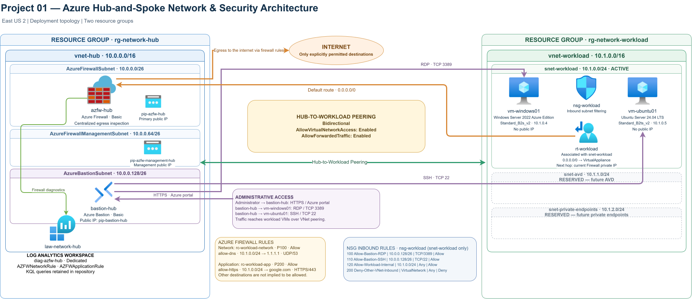

# Project 01 — Azure Hub-and-Spoke Network & Security Architecture



## Overview

This project uses a hub-and-spoke network, with Azure Firewall handling outbound traffic, Azure Bastion providing VM access, and firewall logs sent to Log Analytics.

Resources are organized into two resource groups:

- `rg-network-hub` — hub VNet, Azure Firewall, Azure Bastion, public IP resources, and Log Analytics.
- `rg-network-workload` — workload VNet, NSG, route table, and test VMs.

The script creates both resource groups in East US 2 and checks their provisioning state:

```powershell
$ResourceGroupNames = ('rg-network-hub', 'rg-network-workload')
$Location = 'eastus2'

foreach ($ResourceGroupName in $ResourceGroupNames) {
    New-AzResourceGroup -Name $ResourceGroupName -Location $Location
}

Get-AzResourceGroup | Where-Object -Property ResourceGroupName -in $ResourceGroupNames | Select-Object ResourceGroupName, Location, ProvisioningState | Format-Table
```

**Script:** [Create resource groups](Scripts/01-Create-ResourceGroups.ps1)

## Network layout

| Component | Name | Address range |
|---|---|---|
| Hub VNet | `vnet-hub` | `10.0.0.0/16` |
| Firewall subnet | `AzureFirewallSubnet` | `10.0.0.0/26` |
| Firewall management subnet | `AzureFirewallManagementSubnet` | `10.0.0.64/26` |
| Bastion subnet | `AzureBastionSubnet` | `10.0.0.128/26` |
| Workload VNet | `vnet-workload` | `10.1.0.0/16` |
| Workload subnet | `snet-workload` | `10.1.0.0/24` |
| AVD subnet | `snet-avd` | `10.1.1.0/24` |
| Private Endpoints subnet | `snet-private-endpoints` | `10.1.2.0/24` |

`snet-avd` is reserved for Project 02. `snet-private-endpoints` is reserved for Project 03. Neither subnet hosts resources in this project.

`vnet-hub` contains the Azure Firewall and Bastion subnets. `vnet-workload` contains `snet-workload`, plus `snet-avd` and `snet-private-endpoints`, which are reserved for later projects.

Hub VNet creation:

```powershell
$FirewallSubnet = New-AzVirtualNetworkSubnetConfig -Name 'AzureFirewallSubnet' -AddressPrefix '10.0.0.0/26'
$FirewallManagementSubnet = New-AzVirtualNetworkSubnetConfig -Name 'AzureFirewallManagementSubnet' -AddressPrefix '10.0.0.64/26'
$BastionSubnet = New-AzVirtualNetworkSubnetConfig -Name 'AzureBastionSubnet' -AddressPrefix '10.0.0.128/26'

$VirtualNetwork = New-AzVirtualNetwork -Name $VirtualNetworkName -ResourceGroupName $ResourceGroupName -Location $Location -AddressPrefix $AddressSpace -Subnet $FirewallSubnet, $FirewallManagementSubnet, $BastionSubnet
```

Workload VNet creation:

```powershell
$WorkloadSubnet = New-AzVirtualNetworkSubnetConfig -Name 'snet-workload' -AddressPrefix '10.1.0.0/24'
$AVDSubnet = New-AzVirtualNetworkSubnetConfig -Name 'snet-avd' -AddressPrefix '10.1.1.0/24'
$PrivateEndpointsSubnet = New-AzVirtualNetworkSubnetConfig -Name 'snet-private-endpoints' -AddressPrefix '10.1.2.0/24'

$VirtualNetwork = New-AzVirtualNetwork -Name $VirtualNetworkName -ResourceGroupName $ResourceGroupName -Location $Location -AddressPrefix $AddressSpace -Subnet $WorkloadSubnet, $AVDSubnet, $PrivateEndpointsSubnet
```

### VNet peering

The `hub-workload-peering` and `workload-hub-peering` peering resources connect `vnet-hub` and `vnet-workload`. Forwarded traffic is enabled in both directions so traffic routed through `azfw-hub` can traverse the peering.

```powershell
$HubVNet = Get-AzVirtualNetwork -Name 'vnet-hub' -ResourceGroupName 'rg-network-hub'
$WorkloadVNet = Get-AzVirtualNetwork -Name 'vnet-workload' -ResourceGroupName 'rg-network-workload'

Add-AzVirtualNetworkPeering -VirtualNetwork $HubVNet -RemoteVirtualNetworkId $WorkloadVNet.Id -Name 'hub-workload-peering' -AllowForwardedTraffic
Add-AzVirtualNetworkPeering -VirtualNetwork $WorkloadVNet -RemoteVirtualNetworkId $HubVNet.Id -Name 'workload-hub-peering' -AllowForwardedTraffic

Get-AzVirtualNetworkPeering -VirtualNetwork $HubVNet.Name -ResourceGroupName $HubVNet.ResourceGroupName | Format-Table Name, PeeringState, AllowVirtualNetworkAccess, AllowForwardedTraffic
Get-AzVirtualNetworkPeering -VirtualNetwork $WorkloadVNet.Name -ResourceGroupName $WorkloadVNet.ResourceGroupName | Format-Table Name, PeeringState, AllowVirtualNetworkAccess, AllowForwardedTraffic
```

**Scripts:** [Create hub VNet](Scripts/02-Create-HubVNet.ps1) · [Create workload VNet](Scripts/03-Create-WorkloadVNet.ps1) · [Configure peering](Scripts/04-Configure-VNetPeering.ps1)

**Screenshots:** [Resource groups](Screenshots/01-Resource-Groups-Overview.png) · [Hub VNet](Screenshots/02-Hub-VNet-Overview.png) · [Hub subnets](Screenshots/03-Hub-VNet-Subnets.png) · [Workload VNet](Screenshots/04-Workload-VNet-Overview.png) · [Workload subnets](Screenshots/05-Workload-VNet-Subnets.png) · [Hub-to-workload peering settings](Screenshots/06.1-Hub-to-Workload-Peering-Settings.png) · [Hub peering remote VNet](Screenshots/06.2-Hub-to-Workload-Peering-Remote-VNet.png) · [Workload-to-hub peering settings](Screenshots/07.1-Workload-to-Hub-Peering-Settings.png) · [Workload peering remote VNet](Screenshots/07.2-Workload-to-Hub-Peering-Remote-VNet.png)

## Workload virtual machines

Two VMs are deployed in `snet-workload`. Both use private IP addresses and have no public IP:

| VM | NIC | OS disk | Operating system | Size | Private IP |
|---|---|---|---|---|---|
| `vm-windows01` | `nic-windows01` | `osdisk-windows01` | Windows Server 2022 Datacenter Azure Edition | `Standard_B2s_v2` | `10.1.0.4` |
| `vm-ubuntu01` | `nic-ubuntu01` | `osdisk-ubuntu01` | Ubuntu Server 24.04 LTS | `Standard_B2ts_v2` | `10.1.0.5` |

Both OS disks (`osdisk-windows01` and `osdisk-ubuntu01`) use Standard SSD. The NICs (`nic-windows01` and `nic-ubuntu01`) attach to `snet-workload` with private IPs assigned during creation. I used the same deployment pattern for both operating systems and collect administrator credentials at runtime rather than storing them in the scripts. The shared NIC configuration is:

```powershell
$VirtualNetwork = Get-AzVirtualNetwork -Name $VirtualNetworkName -ResourceGroupName $ResourceGroupName
$Subnet = Get-AzVirtualNetworkSubnetConfig -VirtualNetwork $VirtualNetwork -Name $SubnetName
$NetworkInterface = New-AzNetworkInterface -Name $NICName -ResourceGroupName $ResourceGroupName -Location $Location -SubnetId $Subnet.Id -PrivateIpAddress $PrivateIPAddress
```

The NIC is added to a VM configuration with its size, operating system, source image, and OS disk. The Windows and Ubuntu scripts follow the same sequence, with different OS settings and image details:

```powershell
$VMConfig = New-AzVMConfig -VMName $VMName -VMSize $VMSize
Set-AzVMOperatingSystem -VM $VMConfig -ComputerName $VMName -Credential $Credential -Windows
Set-AzVMSourceImage -VM $VMConfig -PublisherName $PublisherName -Offer $Offer -Skus $SKU -Version $Version
Set-AzVMOSDisk -VM $VMConfig -Name $OSDiskName -CreateOption FromImage -StorageAccountType $OSDiskType

$VirtualMachine = Add-AzVMNetworkInterface -VM $VMConfig -Id $NetworkInterface.Id
New-AzVM -ResourceGroupName $ResourceGroupName -Location $Location -VM $VirtualMachine
```

The Ubuntu script uses `-Linux` in `Set-AzVMOperatingSystem`; both scripts collect credentials with `Get-Credential`.

**Scripts:** [Windows VM](Scripts/06-Create-WindowsVM.ps1) · [Ubuntu VM](Scripts/07-Create-UbuntuVM.ps1)

**Screenshots:** [Windows VM overview](Screenshots/10-Windows-VM-Overview.png) · [Windows VM networking](Screenshots/11-Windows-VM-Networking.png) · [Ubuntu VM overview](Screenshots/12-Ubuntu-VM-Overview.png) · [Ubuntu VM networking](Screenshots/13-Ubuntu-VM-Networking.png)

## Workload subnet security

`nsg-workload` is associated with `snet-workload` on `vnet-workload`.

| Priority | Rule | Source | Protocol / port | Action |
|---:|---|---|---|---|
| 100 | `Allow-Bastion-RDP` | `10.0.0.128/26` | TCP 3389 | Allow |
| 110 | `Allow-Bastion-SSH` | `10.0.0.128/26` | TCP 22 | Allow |
| 120 | `Allow-Workload-Internal` | `10.1.0.0/24` | Any | Allow |
| 200 | `Deny-Other-VNet-Inbound` | `VirtualNetwork` | Any | Deny |

The specific Bastion and workload rules take precedence over the inbound deny rule. `nsg-workload` is associated with `snet-workload`, not with the individual VM NICs.

The script defines the four inbound rules before creating `nsg-workload`:

```powershell
$AllowBastionRDP = New-AzNetworkSecurityRuleConfig -Name 'Allow-Bastion-RDP' -Priority 100 -Direction Inbound -Access Allow -Protocol Tcp -SourceAddressPrefix $BastionAddressPrefix -SourcePortRange * -DestinationAddressPrefix * -DestinationPortRange 3389
$AllowBastionSSH = New-AzNetworkSecurityRuleConfig -Name 'Allow-Bastion-SSH' -Priority 110 -Direction Inbound -Access Allow -Protocol Tcp -SourceAddressPrefix $BastionAddressPrefix -SourcePortRange * -DestinationAddressPrefix * -DestinationPortRange 22
$AllowWorkloadInternal = New-AzNetworkSecurityRuleConfig -Name 'Allow-Workload-Internal' -Priority 120 -Direction Inbound -Access Allow -Protocol * -SourceAddressPrefix $WorkloadAddressPrefix -SourcePortRange * -DestinationAddressPrefix * -DestinationPortRange *
$DenyOtherVNetInbound = New-AzNetworkSecurityRuleConfig -Name 'Deny-Other-VNet-Inbound' -Priority 200 -Direction Inbound -Access Deny -Protocol * -SourceAddressPrefix VirtualNetwork -SourcePortRange * -DestinationAddressPrefix * -DestinationPortRange *
```

The NSG is then created and associated with `snet-workload`:

```powershell
$NetworkSecurityGroup = New-AzNetworkSecurityGroup -Name $NSGName -ResourceGroupName $ResourceGroupName -Location $Location -SecurityRules $AllowBastionRDP, $AllowBastionSSH, $AllowWorkloadInternal, $DenyOtherVNetInbound

Set-AzVirtualNetworkSubnetConfig -Name $SubnetName -VirtualNetwork $WorkloadVNet -AddressPrefix $WorkloadAddressPrefix -NetworkSecurityGroup $NetworkSecurityGroup
Set-AzVirtualNetwork -VirtualNetwork $WorkloadVNet
```

**Script:** [Create workload NSG](Scripts/05-Create-WorkloadNSG.ps1)

**Screenshots:** [NSG inbound rules](Screenshots/08-Workload-NSG-Rules.png) · [NSG subnet association](Screenshots/09-Workload-NSG-Subnet-Association.png)

## Azure Firewall and routing

Azure Firewall Basic (`azfw-hub`) is deployed in `vnet-hub`, using `pip-azfw-hub` for its primary configuration and `pip-azfw-management-hub` for management. Route table `rt-workload` is associated with `snet-workload`. Its `route-to-internet` route sends `0.0.0.0/0` traffic to the firewall's private IP as a virtual appliance:

Both public IP resources are created before `azfw-hub`:

```powershell
$FirewallPublicIP = New-AzPublicIpAddress -Name $FirewallPublicIPName -ResourceGroupName $ResourceGroupName -Location $Location -AllocationMethod Static
$ManagementPublicIP = New-AzPublicIpAddress -Name $ManagementPublicIPName -ResourceGroupName $ResourceGroupName -Location $Location -AllocationMethod Static

$Firewall = New-AzFirewall -Name $FirewallName -ResourceGroupName $ResourceGroupName -Location $Location -VirtualNetwork $HubVNet -PublicIpAddress $FirewallPublicIP -ManagementPublicIpAddress $ManagementPublicIP -SkuTier $FirewallSKU
```

After deployment, the firewall configuration is checked for its assigned private IP:

```powershell
$Firewall = Get-AzFirewall -Name $FirewallName -ResourceGroupName $ResourceGroupName
$Firewall.IpConfigurations | Format-Table Name, PrivateIpAddress
```

`rt-workload` is created in `rg-network-workload`. The `route-to-internet` default route uses the current private IP of `azfw-hub` as its next hop:

```powershell
$Firewall = Get-AzFirewall -Name $FirewallName -ResourceGroupName $FirewallResourceGroupName
$FirewallPrivateIP = $Firewall.IpConfigurations[0].PrivateIpAddress

$RouteTable = New-AzRouteTable -Name $RouteTableName -ResourceGroupName $ResourceGroupName -Location $Location
Add-AzRouteConfig -Name $RouteName -AddressPrefix $AddressPrefix -NextHopType $NextHopType -NextHopIpAddress $FirewallPrivateIP -RouteTable $RouteTable
Set-AzRouteTable -RouteTable $RouteTable
```

**Scripts:** [Deploy Azure Firewall](Scripts/08-Deploy-AzureFirewall.ps1) · [Create workload route table](Scripts/09-Create-WorkloadRouteTable.ps1)

**Screenshots:** [Firewall overview](Screenshots/14-Azure-Firewall-Overview.png) · [Firewall IP configuration](Screenshots/15-Azure-Firewall-IP-Configuration.png) · [Workload route](Screenshots/16-Workload-Route-Table.png) · [Route table association](Screenshots/17-Route-Table-Subnet-Association.png)

## Firewall rules

The `azfw-hub` policy is intentionally narrow. `rc-workload-network` allows DNS to `1.1.1.1`, and `rc-workload-app` allows HTTPS to `google.com`. These are the only outbound destinations permitted for the connectivity tests:

| Collection | Rule | Destination | Protocol / port | Action |
|---|---|---|---|---|
| `rc-workload-network` | `allow-dns` | `1.1.1.1` | UDP 53 | Allow |
| `rc-workload-app` | `allow-https` | `google.com` | HTTPS 443 | Allow |

`allow-dns` is a network rule targeting an IP address and port. `allow-https` is an application rule targeting an FQDN. The DNS rule and its collection are created and applied to `azfw-hub` as follows:

```powershell
$Rule = New-AzFirewallNetworkRule -Name 'allow-dns' -SourceAddress '10.1.0.0/24' -DestinationAddress '1.1.1.1' -Protocol 'UDP' -DestinationPort '53'
$RuleCollection = New-AzFirewallNetworkRuleCollection -Name 'rc-workload-network' -Priority 100 -ActionType 'Allow' -Rule $Rule

$Firewall = Get-AzFirewall -Name 'azfw-hub' -ResourceGroupName 'rg-network-hub'
$Firewall.NetworkRuleCollections.Add($RuleCollection)
Set-AzFirewall -AzureFirewall $Firewall
```

`allow-https` uses the same process, with `google.com` as its target FQDN:

```powershell
$Rule = New-AzFirewallApplicationRule -Name 'allow-https' -SourceAddress '10.1.0.0/24' -TargetFqdn 'google.com' -Protocol 'Https:443'
$RuleCollection = New-AzFirewallApplicationRuleCollection -Name 'rc-workload-app' -Priority 200 -ActionType 'Allow' -Rule $Rule

$Firewall = Get-AzFirewall -Name 'azfw-hub' -ResourceGroupName 'rg-network-hub'
$Firewall.ApplicationRuleCollections.Add($RuleCollection)
Set-AzFirewall -AzureFirewall $Firewall
```

**Scripts:** [Configure network rules](Scripts/10-Configure-AzureFirewallNetworkRules.ps1) · [Configure application rules](Scripts/11-Configure-AzureFirewallApplicationRules.ps1)

**Screenshots:** [Network rule collection](Screenshots/18.1-Firewall-Network-Rule-Collection.png) · [DNS rule details](Screenshots/18.2-Firewall-DNS-Network-Rule.png) · [Application rule collection](Screenshots/19.1-Firewall-Application-Rule-Collection.png) · [HTTPS rule details](Screenshots/19.2-Firewall-HTTPS-Application-Rule.png)

## Azure Bastion

Azure Bastion Basic (`bastion-hub`) is deployed in `AzureBastionSubnet` on `vnet-hub`, using Standard static public IP `pip-bastion-hub`. It provides RDP access to `vm-windows01` and SSH access to `vm-ubuntu01`; neither VM has a public IP:

```powershell
$PublicIP = New-AzPublicIpAddress -Name 'pip-bastion-hub' -ResourceGroupName 'rg-network-hub' -Location 'eastus2' -Sku 'Standard' -AllocationMethod 'Static'
$Bastion = New-AzBastion -Name 'bastion-hub' -ResourceGroupName 'rg-network-hub' -Sku 'Basic' -PublicIpAddress $PublicIP -VirtualNetwork $VirtualNetwork

Get-AzBastion -Name 'bastion-hub' -ResourceGroupName 'rg-network-hub' | Format-List Name, ProvisioningState, Sku
```

**Script:** [Create Azure Bastion](Scripts/14-Create-AzureBastion.ps1)

**Screenshots:** [Bastion overview](Screenshots/22-Azure-Bastion-Overview.png) · [Bastion session records](Screenshots/23-Azure-Bastion-Sessions.png)

## Firewall diagnostics

`law-network-hub` is created in `rg-network-hub`. Diagnostic setting `diag-azfw-hub` sends the network-rule and application-rule logs from `azfw-hub` to this workspace.

```powershell
$Workspace = New-AzOperationalInsightsWorkspace -Name 'law-network-hub' -ResourceGroupName 'rg-network-hub' -Location 'eastus2'
```

`diag-azfw-hub` uses the `Dedicated` destination type:

```powershell
$Log = @(
    New-AzDiagnosticSettingLogSettingsObject -Enabled $true -Category 'AZFWNetworkRule'
    New-AzDiagnosticSettingLogSettingsObject -Enabled $true -Category 'AZFWApplicationRule'
)

New-AzDiagnosticSetting -Name 'diag-azfw-hub' -ResourceId $Firewall.Id -WorkspaceId $Workspace.ResourceId -Log $Log -LogAnalyticsDestinationType 'Dedicated'
```

The KQL queries are kept in the `Queries/` folder:

- [Network rule query](Queries/01-FirewallNetworkRules.kql)
- [Application rule query](Queries/02-FirewallApplicationRules.kql)

The query results show DNS requests matching `allow-dns` and HTTPS requests to `google.com` matching `allow-https`. Exports are stored in `Queries/Results/`.

**Scripts:** [Create Log Analytics workspace](Scripts/12-Create-LogAnalyticsWorkspace.ps1) · [Configure firewall diagnostics](Scripts/13-Configure-AzureFirewallDiagnostics.ps1)

**Screenshots:** [Log Analytics workspace](Screenshots/20-Log-Analytics-Workspace.png) · [Firewall diagnostic setting](Screenshots/21-Firewall-Diagnostic-Settings.png) · [Network rule logs](Screenshots/28-Firewall-Network-Rule-Logs.png) · [Application rule logs](Screenshots/29-Firewall-Application-Rule-Logs.png)

## Connectivity validation

Connectivity was tested from both VMs through Bastion. The Windows commands check TCP reachability, DNS resolution, and HTTPS:

```powershell
Test-NetConnection 10.1.0.5 -Port 22
nslookup google.com 1.1.1.1
Test-NetConnection google.com -Port 443
```

The Ubuntu checks use `nc` for TCP reachability, `nslookup` for DNS, and `curl` for HTTPS:

```bash
nc -zv 10.1.0.4 3389
nslookup google.com 1.1.1.1
curl -I https://google.com
```

| Test | Command | Result |
|---|---|---|
| `vm-windows01` to `vm-ubuntu01` SSH port | `Test-NetConnection 10.1.0.5 -Port 22` | TCP connection succeeded |
| `vm-ubuntu01` to `vm-windows01` RDP port | `nc -zv 10.1.0.4 3389` | TCP connection succeeded |
| DNS resolution | `nslookup google.com 1.1.1.1` | DNS records returned from both VMs |
| Windows TCP/443 | `Test-NetConnection google.com -Port 443` | TCP connection succeeded |
| Ubuntu HTTPS | `curl -I https://google.com` | `HTTP/2 301` |
| Windows HTTPS diagnostic | `curl.exe -Iv --ssl-no-revoke https://google.com` | Request completed |

The SSH and RDP tests confirm that the ports are reachable; they do not establish authenticated sessions. Bastion session records are shown separately.

**Screenshots:** [Windows-to-Ubuntu SSH](Screenshots/24-Windows-to-Ubuntu-SSH-Test.png) · [Ubuntu-to-Windows RDP port test](Screenshots/25-Ubuntu-to-Windows-RDP-Test.png) · [Windows DNS](Screenshots/26.1-Windows-DNS-Resolution-Test.png) · [Ubuntu DNS](Screenshots/26.2-Ubuntu-DNS-Resolution-Test.png) · [Windows HTTPS](Screenshots/27.1-Windows-HTTPS-Connectivity-Test.png) · [Ubuntu HTTPS](Screenshots/27.2-Ubuntu-HTTPS-Connectivity-Test.png)

## Project files

- `Architecture/` — architecture diagram.
- `Scripts/` — deployment and operational scripts.
- `Queries/` — KQL queries and exported results.
- `Screenshots/` — configuration and validation evidence.


## Scope

This project covers hub-and-spoke networking, workload subnet security, Azure Firewall routing and rules, Bastion access, and firewall diagnostics.

Private Endpoints and Private DNS are part of Project 03. The AVD subnet is reserved for Project 02. VPN Gateway, ExpressRoute, Application Gateway, and Load Balancer are not included.