# Project 02  -  Azure Compute, Load Balancing & Web Infrastructure

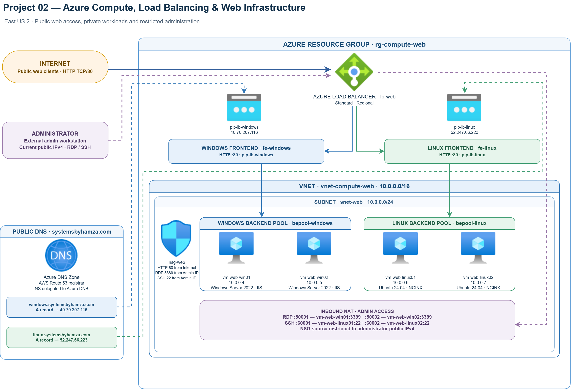

## Overview

This project deploys four web servers in Azure: two Windows Server VMs running IIS and two Ubuntu VMs running NGINX. A Standard Load Balancer exposes separate public endpoints for the Windows and Linux workloads, distributes HTTP requests across each pair of VMs, and provides explicit outbound connectivity.

The VMs have private IP addresses only. Inbound administrative access is provided through Load Balancer NAT rules, while public DNS records resolve the web hostnames to the corresponding Load Balancer frontends.

All resources are deployed in East US 2 in `rg-compute-web`.

## Network layout

| Component | Name | Address range |
|---|---|---|
| Virtual network | `vnet-compute-web` | `10.0.0.0/16` |
| Web subnet | `snet-web` | `10.0.0.0/24` |
| Network security group | `nsg-web` | Associated with `snet-web` |

The subnet contains all four VMs. Each NIC is assigned a private IP address, and none has a public IP configuration.

The subnet is initially created with default outbound access enabled:

```powershell
$Subnet = New-AzVirtualNetworkSubnetConfig -Name $SubnetName -AddressPrefix $SubnetAddressPrefix -DefaultOutboundAccess $true
```

Default outbound access is enabled during the initial deployment so the VMs can reach package repositories and update services while they are being configured. After the Load Balancer outbound rules are created, the subnet is updated to disable default outbound access and use the explicit outbound path.

The network script creates the resource group, subnet configuration, and virtual network:

```powershell
New-AzVirtualNetwork -Name $VirtualNetworkName -ResourceGroupName $ResourceGroupName -Location $Location -AddressPrefix $VirtualNetworkAddressPrefix -Subnet $Subnet
```

**Script:** [Create network](Scripts/01-Create-Network.ps1)

**Screenshots:** [Resource group](Screenshots/01-Resource-Group-Overview.png) · [VNet topology](Screenshots/02-VNet-Overview.png) · [Subnet configuration](Screenshots/03-VNet-Subnet-Configuration.png)

## Network security

`nsg-web` is associated with `snet-web`. Its inbound rules allow HTTP from the Internet and restrict RDP and SSH to my public IPv4.

| Priority | Rule | Source | Protocol / port | Action |
|---:|---|---|---|---|
| 100 | `Allow-HTTP` | Internet | TCP 80 | Allow |
| 110 | `Allow-RDP-Admin` | Admin's Public IPv4 | TCP 3389 | Allow |
| 120 | `Allow-SSH-Admin` | Admin's Public IPv4 | TCP 22 | Allow |

The NSG rules use the backend ports. The Load Balancer NAT rules translate the frontend ports to TCP 3389 or TCP 22 before traffic reaches the VM.

The script retrieves my public IPv4 at runtime and uses it as the source for the administrative NSG rules:

```powershell
$AdminPublicIP = (Invoke-RestMethod https://api.ipify.org).Trim()
$AdminAddressPrefix = "$AdminPublicIP/32"

Add-AzNetworkSecurityRuleConfig -NetworkSecurityGroup $NSG -Name 'Allow-RDP-Admin' -Protocol Tcp -Direction Inbound -Priority 110 -SourceAddressPrefix $AdminAddressPrefix -SourcePortRange * -DestinationAddressPrefix * -DestinationPortRange 3389 -Access Allow
Add-AzNetworkSecurityRuleConfig -NetworkSecurityGroup $NSG -Name 'Allow-SSH-Admin' -Protocol Tcp -Direction Inbound -Priority 120 -SourceAddressPrefix $AdminAddressPrefix -SourcePortRange * -DestinationAddressPrefix * -DestinationPortRange 22 -Access Allow

Set-AzNetworkSecurityGroup -NetworkSecurityGroup $NSG
```

**Scripts:** [Create NSG](Scripts/02-Create-NSG.ps1) · [Configure inbound NAT](Scripts/10-Configure-InboundNAT.ps1) · [Update administrator IP](Scripts/11-Update-AdminIP.ps1)

**Screenshot:** [NSG inbound rules](Screenshots/04-NSG-Inbound-Rules.png)

## Virtual machines

Four VMs provide two independent web backends:

| VM | NIC | OS disk | Operating system | Size | Private IP |
|---|---|---|---|---|---|
| `vm-web-win01` | `nic-web-win01` | `osdisk-web-win01` | Windows Server 2022 Datacenter Azure Edition | `Standard_B2s_v2` | `10.0.0.4` |
| `vm-web-win02` | `nic-web-win02` | `osdisk-web-win02` | Windows Server 2022 Datacenter Azure Edition | `Standard_B2s_v2` | `10.0.0.5` |
| `vm-web-linux01` | `nic-web-linux01` | `osdisk-web-linux01` | Ubuntu Server 24.04 LTS | `Standard_B2ts_v2` | `10.0.0.6` |
| `vm-web-linux02` | `nic-web-linux02` | `osdisk-web-linux02` | Ubuntu Server 24.04 LTS | `Standard_B2ts_v2` | `10.0.0.7` |

Two VMs per operating system provide a pair of backend instances for load distribution and failover testing. I included both Windows and Linux to apply the same Azure networking and load-balancing design to two platforms, using IIS on Windows and NGINX on Ubuntu.

The VMs use Standard SSD managed OS disks and Microsoft-managed Boot Diagnostics. Credentials are collected at runtime with `Get-Credential`.

The deployment scripts build each VM configuration before passing it to `New-AzVM`:

```powershell
for ($i = 0; $i -lt $VirtualMachineNames.Count; $i++) {
    $NetworkInterface = New-AzNetworkInterface -Name $NetworkInterfaceNames[$i] -ResourceGroupName $ResourceGroupName -Location $Location -SubnetId $Subnet.Id -PrivateIpAddress $PrivateIPAddresses[$i]

    $VMConfig = New-AzVMConfig -VMName $VirtualMachineNames[$i] -VMSize $VirtualMachineSize
    Set-AzVMBootDiagnostic -VM $VMConfig -Enable
    Set-AzVMOperatingSystem -VM $VMConfig -ComputerName $VirtualMachineNames[$i] -Credential $Credential -Windows
    Set-AzVMSourceImage -VM $VMConfig -PublisherName $PublisherName -Offer $Offer -Skus $SKU -Version $Version
    Set-AzVMOSDisk -VM $VMConfig -Name $OSDiskNames[$i] -CreateOption FromImage -StorageAccountType $OSDiskType

    $VirtualMachine = Add-AzVMNetworkInterface -VM $VMConfig -Id $NetworkInterface.Id
    New-AzVM -VM $VirtualMachine -ResourceGroupName $ResourceGroupName -Location $Location
}
```

The Ubuntu deployment uses `-Linux` in `Set-AzVMOperatingSystem`. Both deployment scripts enable Microsoft-managed Boot Diagnostics.

**Scripts:** [Create Windows VM](Scripts/03-Create-WindowsVM.ps1) · [Create Ubuntu VM](Scripts/04-Create-UbuntuVM.ps1)

**Screenshots:** [VM overview](Screenshots/05-Virtual-Machines-Overview.png) · [Windows NIC](Screenshots/06.1-Windows-VM-Networking.png) · [Linux NIC](Screenshots/06.2-Linux-VM-Networking.png)

## Web server configuration

The Azure Custom Script Extension installs and configures IIS and NGINX inside each VM after deployment. This keeps the setup repeatable across all four VMs without manually connecting to each one to configure its web server.

Each default page displays the VM's hostname. This makes it clear which backend handled each request during load distribution and failover testing.

The IIS configuration installs the Web Server role and writes the response page:

```powershell
Install-WindowsFeature Web-Server -IncludeAllSubFeature
Set-Content 'C:\inetpub\wwwroot\Default.htm' "IIS running on $env:COMPUTERNAME"
```

The NGINX configuration installs the package, writes the response page, and enables the service:

```bash
apt-get update
apt-get install -y nginx
echo "NGINX running on $(hostname)" > /var/www/html/index.html
systemctl enable --now nginx
```

The deployment scripts read the configuration files and pass them to the appropriate Custom Script Extension. The Windows extension runs the PowerShell configuration, while the Linux extension runs the shell configuration.

**Scripts:** [Deploy IIS](Scripts/05-Deploy-IIS.ps1) · [Deploy NGINX](Scripts/06-Deploy-NGINX.ps1)

**Configuration files:** [IIS](Configs/Configure-IIS.ps1) · [NGINX](Configs/Configure-NGINX.sh)

The deployment scripts apply the configuration to both VMs in each group. For Windows, the extension runs the PowerShell script through `commandToExecute`:

```powershell
$Settings = @{
    commandToExecute = "powershell.exe -NoProfile -ExecutionPolicy Bypass -EncodedCommand $EncodedScript"
}

for ($i = 0; $i -lt $VirtualMachineNames.Count; $i++) {
    Set-AzVMExtension -ResourceGroupName $ResourceGroupName -VMName $VirtualMachineNames[$i] -Location $Location -Name $ExtensionName -Publisher 'Microsoft.Compute' -ExtensionType 'CustomScriptExtension' -TypeHandlerVersion '1.10' -Settings $Settings
}
```

The Linux deployment uses the Custom Script extension's `script` setting:

```powershell
$Settings = @{
    script = $EncodedScript
}

for ($i = 0; $i -lt $VirtualMachineNames.Count; $i++) {
    Set-AzVMExtension -ResourceGroupName $ResourceGroupName -VMName $VirtualMachineNames[$i] -Location $Location -Name $ExtensionName -Publisher 'Microsoft.Azure.Extensions' -ExtensionType 'CustomScript' -TypeHandlerVersion '2.1' -Settings $Settings
}
```

## Azure Load Balancer

`lb-web` is a Standard regional Load Balancer with two public frontends. The Windows and Linux workloads use separate frontends and backend pools so each has an independent public endpoint and outbound public IP.

| Component | Windows | Linux |
|---|---|---|
| Public IP resource | `pip-lb-windows` | `pip-lb-linux` |
| Frontend | `fe-windows` | `fe-linux` |
| Public IP | `40.70.207.116` | `52.247.66.223` |
| Backend pool | `bepool-windows` | `bepool-linux` |
| Health probe | `probe-windows-http` | `probe-linux-http` |
| Load-balancing rule | `rule-windows-http` | `rule-linux-http` |

### Frontends and backend pools

The creation script provisions the two Standard static public IP addresses, creates a frontend configuration for each, and creates the corresponding backend pools:

```powershell
$WindowsPublicIP = New-AzPublicIpAddress -Name $WindowsPublicIPName -ResourceGroupName $ResourceGroupName -Location $Location -Sku Standard -AllocationMethod Static
$LinuxPublicIP = New-AzPublicIpAddress -Name $LinuxPublicIPName -ResourceGroupName $ResourceGroupName -Location $Location -Sku Standard -AllocationMethod Static

$WindowsFrontend = New-AzLoadBalancerFrontendIpConfig -Name $WindowsFrontendName -PublicIpAddress $WindowsPublicIP
$LinuxFrontend = New-AzLoadBalancerFrontendIpConfig -Name $LinuxFrontendName -PublicIpAddress $LinuxPublicIP

$WindowsBackendPool = New-AzLoadBalancerBackendAddressPoolConfig -Name $WindowsBackendPoolName
$LinuxBackendPool = New-AzLoadBalancerBackendAddressPoolConfig -Name $LinuxBackendPoolName
```

`New-AzLoadBalancer` creates the Standard regional Load Balancer with both frontend configurations and both backend pools. The configuration script then associates the Windows NICs with `bepool-windows` and the Linux NICs with `bepool-linux`:

```powershell
$WindowsNetworkInterfaces = Get-AzNetworkInterface -ResourceGroupName $ResourceGroupName | Where-Object Name -like '*nic-web-win0*'
$LinuxNetworkInterfaces = Get-AzNetworkInterface -ResourceGroupName $ResourceGroupName | Where-Object Name -like '*nic-web-linux0*'

foreach ($NetworkInterface in $WindowsNetworkInterfaces) {
    $NetworkInterface.IpConfigurations[0].LoadBalancerBackendAddressPools.Add($WindowsBackendPool)
    Set-AzNetworkInterface -NetworkInterface $NetworkInterface
}

foreach ($NetworkInterface in $LinuxNetworkInterfaces) {
    $NetworkInterface.IpConfigurations[0].LoadBalancerBackendAddressPools.Add($LinuxBackendPool)
    Set-AzNetworkInterface -NetworkInterface $NetworkInterface
}

Add-AzLoadBalancerProbeConfig -LoadBalancer $LoadBalancer -Name $WindowsProbeName -Protocol Http -Port 80 -RequestPath $ProbeRequestPath -IntervalInSeconds 5 -ProbeCount 2
Add-AzLoadBalancerProbeConfig -LoadBalancer $LoadBalancer -Name $LinuxProbeName -Protocol Http -Port 80 -RequestPath $ProbeRequestPath -IntervalInSeconds 5 -ProbeCount 2

$WindowsProbe = $LoadBalancer.Probes | Where-Object Name -eq $WindowsProbeName
$LinuxProbe = $LoadBalancer.Probes | Where-Object Name -eq $LinuxProbeName

Add-AzLoadBalancerRuleConfig -LoadBalancer $LoadBalancer -Name $WindowsRuleName -Protocol Tcp -FrontendPort 80 -BackendPort 80 -FrontendIpConfiguration $WindowsFrontend -BackendAddressPool $WindowsBackendPool -Probe $WindowsProbe -DisableOutboundSNAT
Add-AzLoadBalancerRuleConfig -LoadBalancer $LoadBalancer -Name $LinuxRuleName -Protocol Tcp -FrontendPort 80 -BackendPort 80 -FrontendIpConfiguration $LinuxFrontend -BackendAddressPool $LinuxBackendPool -Probe $LinuxProbe -DisableOutboundSNAT

Set-AzLoadBalancer -LoadBalancer $LoadBalancer
```

**Scripts:** [Create load balancer](Scripts/07-Create-LoadBalancer.ps1) · [Configure load balancer](Scripts/08-Configure-LoadBalancer.ps1)

**Screenshots:** [Load Balancer overview](Screenshots/07-Load-Balancer-Overview.png) · [Frontends](Screenshots/08-Load-Balancer-Frontend-Configuration.png) · [Backend pools](Screenshots/09-Load-Balancer-Backend-Pools.png)

### Health probes and load-balancing rules

Each backend pool has its own HTTP health probe. Both probes check TCP port 80 using the HTTP request path `/`, at five-second intervals with a probe count of two. The Load Balancer uses probe health to determine which backend instances can receive new traffic.

```powershell
Add-AzLoadBalancerProbeConfig -LoadBalancer $LoadBalancer -Name $WindowsProbeName -Protocol Http -Port 80 -RequestPath $ProbeRequestPath -IntervalInSeconds 5 -ProbeCount 2
Add-AzLoadBalancerProbeConfig -LoadBalancer $LoadBalancer -Name $LinuxProbeName -Protocol Http -Port 80 -RequestPath $ProbeRequestPath -IntervalInSeconds 5 -ProbeCount 2

Add-AzLoadBalancerRuleConfig -LoadBalancer $LoadBalancer -Name $WindowsRuleName -Protocol Tcp -FrontendPort 80 -BackendPort 80 -FrontendIpConfiguration $WindowsFrontend -BackendAddressPool $WindowsBackendPool -Probe $WindowsProbe -DisableOutboundSNAT
Add-AzLoadBalancerRuleConfig -LoadBalancer $LoadBalancer -Name $LinuxRuleName -Protocol Tcp -FrontendPort 80 -BackendPort 80 -FrontendIpConfiguration $LinuxFrontend -BackendAddressPool $LinuxBackendPool -Probe $LinuxProbe -DisableOutboundSNAT

Set-AzLoadBalancer -LoadBalancer $LoadBalancer
```

Each rule maps frontend TCP/80 to backend TCP/80 and uses the health probe for its own pool. Outbound SNAT is disabled on these inbound rules because outbound connectivity is configured separately.

Both rules reported 100% healthy instances during validation. Each pool contained two healthy backend addresses.

**Screenshots:** [Health probes](Screenshots/10-Load-Balancer-Health-Probes.png) · [Load-balancing rules](Screenshots/11.1-Load-Balancing-Rules.png) · [Windows rule](Screenshots/11.2-Windows-Load-Balancing-Rule.png) · [Linux rule](Screenshots/11.3-Linux-Load-Balancing-Rule.png)

### Outbound rules

The VMs need outbound connectivity for tasks such as installing packages and receiving operating-system updates. Separate outbound rules map the Windows and Linux backend pools to their respective frontend IPs.

Two explicit outbound rules associate each backend pool with its matching frontend and allocate 1,024 outbound ports:

```powershell
$LoadBalancer = Get-AzLoadBalancer -Name $LoadBalancerName -ResourceGroupName $ResourceGroupName

$WindowsFrontend = $LoadBalancer.FrontendIpConfigurations | Where-Object Name -eq $WindowsFrontendName
$LinuxFrontend = $LoadBalancer.FrontendIpConfigurations | Where-Object Name -eq $LinuxFrontendName

$WindowsBackendPool = $LoadBalancer.BackendAddressPools | Where-Object Name -eq $WindowsBackendPoolName
$LinuxBackendPool = $LoadBalancer.BackendAddressPools | Where-Object Name -eq $LinuxBackendPoolName

Add-AzLoadBalancerOutboundRuleConfig -LoadBalancer $LoadBalancer -Name $WindowsOutboundRuleName -FrontendIpConfiguration $WindowsFrontend -BackendAddressPool $WindowsBackendPool -Protocol All -AllocatedOutboundPort 1024
Add-AzLoadBalancerOutboundRuleConfig -LoadBalancer $LoadBalancer -Name $LinuxOutboundRuleName -FrontendIpConfiguration $LinuxFrontend -BackendAddressPool $LinuxBackendPool -Protocol All -AllocatedOutboundPort 1024

Set-AzLoadBalancer -LoadBalancer $LoadBalancer

$VirtualNetwork = Get-AzVirtualNetwork -Name $VirtualNetworkName -ResourceGroupName $ResourceGroupName
$Subnet = $VirtualNetwork.Subnets | Where-Object Name -eq $SubnetName
Set-AzVirtualNetworkSubnetConfig -Name $Subnet.Name -VirtualNetwork $VirtualNetwork -AddressPrefix $Subnet.AddressPrefix -NetworkSecurityGroup $Subnet.NetworkSecurityGroup -DefaultOutboundAccess $false
Set-AzVirtualNetwork -VirtualNetwork $VirtualNetwork
```

The subnet update disables default outbound access after the outbound rules have been saved.

**Script:** [Configure outbound rules](Scripts/09-Configure-OutboundRules.ps1)

**Screenshot:** [Outbound rules](Screenshots/12-Load-Balancer-Outbound-Rules.png)

### Outbound connectivity testing

Outbound connectivity was tested from all four VMs after default outbound access was disabled on the subnet.

From each Windows VM:

```powershell
Invoke-RestMethod https://api.ipify.org
```

From each Linux VM:

```bash
curl https://api.ipify.org
```

The hostname identifies the VM running the command. The returned public address confirms which Load Balancer frontend provided egress.

| VM group | Outbound public IP |
|---|---|
| Windows | `40.70.207.116` |
| Linux | `52.247.66.223` |

The RDP and SSH session screenshots in the inbound NAT section also show the hostname and outbound address from each VM.


## Administrative access through inbound NAT

The VMs do not have public IP addresses on their NICs. Four inbound NAT rules provide individual administrative access through the Load Balancer frontends. Each VM has a distinct frontend port, translated to the standard RDP or SSH port on that VM.

| NAT rule | Frontend | Frontend port | Backend VM | Backend port |
|---|---|---:|---|---:|
| `nat-win01-rdp` | `fe-windows` | 50001 | `vm-web-win01` | 3389 |
| `nat-win02-rdp` | `fe-windows` | 50002 | `vm-web-win02` | 3389 |
| `nat-linux01-ssh` | `fe-linux` | 60001 | `vm-web-linux01` | 22 |
| `nat-linux02-ssh` | `fe-linux` | 60002 | `vm-web-linux02` | 22 |

The NAT rules provide individual access to each VM without assigning a public IP to every NIC. Unique frontend ports identify the target VM, while the NSG restricts RDP and SSH to my public IPv4.

The script defines each frontend-to-backend mapping, adds the NAT rules to the Load Balancer, then associates each rule with its VM's NIC:

```powershell
$NATRuleConfigurations = @(
    @{
        Name         = 'nat-win01-rdp'
        FrontendName = 'fe-windows'
        FrontendPort = 50001
        BackendPort  = 3389
    }
    @{
        Name         = 'nat-win02-rdp'
        FrontendName = 'fe-windows'
        FrontendPort = 50002
        BackendPort  = 3389
    }
    @{
        Name         = 'nat-linux01-ssh'
        FrontendName = 'fe-linux'
        FrontendPort = 60001
        BackendPort  = 22
    }
    @{
        Name         = 'nat-linux02-ssh'
        FrontendName = 'fe-linux'
        FrontendPort = 60002
        BackendPort  = 22
    }
)

foreach ($NATRule in $NATRuleConfigurations) {
    $Frontend = $LoadBalancer.FrontendIpConfigurations | Where-Object Name -eq $NATRule.FrontendName
    Add-AzLoadBalancerInboundNatRuleConfig -LoadBalancer $LoadBalancer -Name $NATRule.Name -Protocol Tcp -FrontendIpConfiguration $Frontend -FrontendPort $NATRule.FrontendPort -BackendPort $NATRule.BackendPort
}

Set-AzLoadBalancer -LoadBalancer $LoadBalancer

$LoadBalancer = Get-AzLoadBalancer -Name $LoadBalancerName -ResourceGroupName $ResourceGroupName

$NATRuleAssociations = @(
    @{
        NetworkInterfaceName = 'nic-web-win01'
        NATRuleName          = 'nat-win01-rdp'
    }
    @{
        NetworkInterfaceName = 'nic-web-win02'
        NATRuleName          = 'nat-win02-rdp'
    }
    @{
        NetworkInterfaceName = 'nic-web-linux01'
        NATRuleName          = 'nat-linux01-ssh'
    }
    @{
        NetworkInterfaceName = 'nic-web-linux02'
        NATRuleName          = 'nat-linux02-ssh'
    }
)

foreach ($Association in $NATRuleAssociations) {
    $NetworkInterface = Get-AzNetworkInterface -Name $Association.NetworkInterfaceName -ResourceGroupName $ResourceGroupName
    $NATRule = $LoadBalancer.InboundNatRules | Where-Object Name -eq $Association.NATRuleName
    $NetworkInterface.IpConfigurations[0].LoadBalancerInboundNatRules.Add($NATRule)
    Set-AzNetworkInterface -NetworkInterface $NetworkInterface
}
```

The same script also creates the RDP and SSH NSG rules using my public IPv4 as the source address.

**Scripts:** [Configure inbound NAT](Scripts/10-Configure-InboundNAT.ps1) · [Update administrator IP](Scripts/11-Update-AdminIP.ps1)

**Screenshot:** [Inbound NAT rules](Screenshots/13-Load-Balancer-Inbound-NAT-Rules.png)

The NAT mappings were validated by connecting to each VM through its Load Balancer frontend. The sessions below show the target hostname and confirm that administrative access works without public IP addresses on the VM NICs.

**Windows  -  RDP**

#### RDP to `vm-web-win01` via `40.70.207.116:50001`

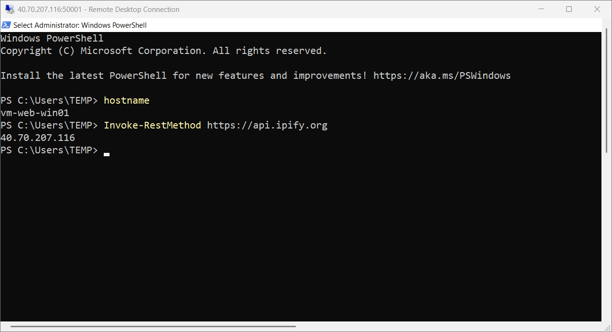

#### RDP to `vm-web-win02` via `40.70.207.116:50002`

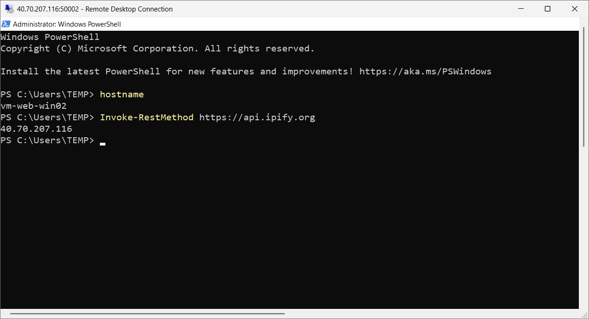

**Linux  -  SSH**

#### SSH to `vm-web-linux01` via `52.247.66.223:60001`

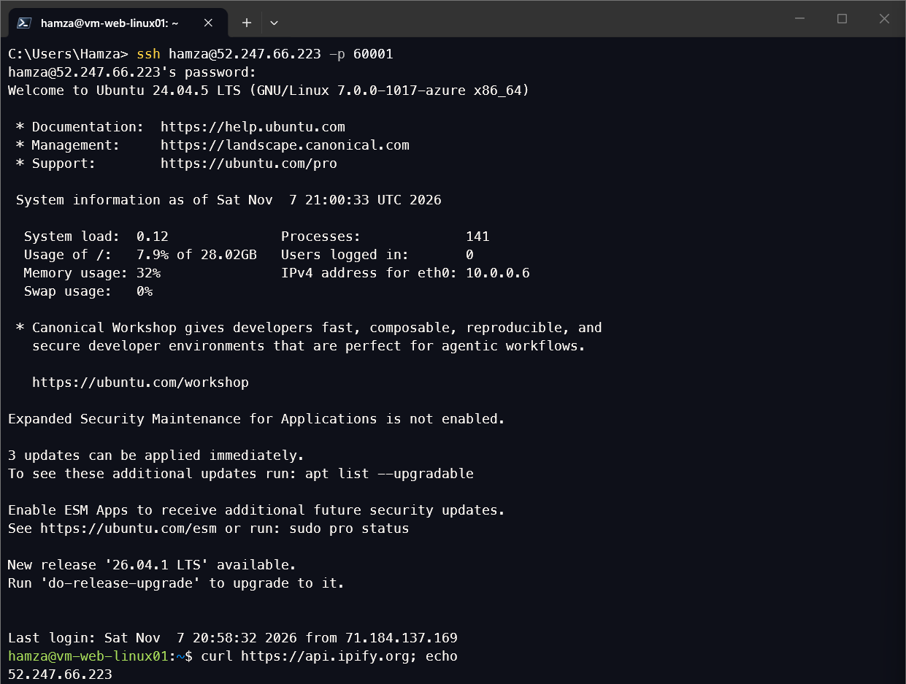

#### SSH to `vm-web-linux02` via `52.247.66.223:60002`

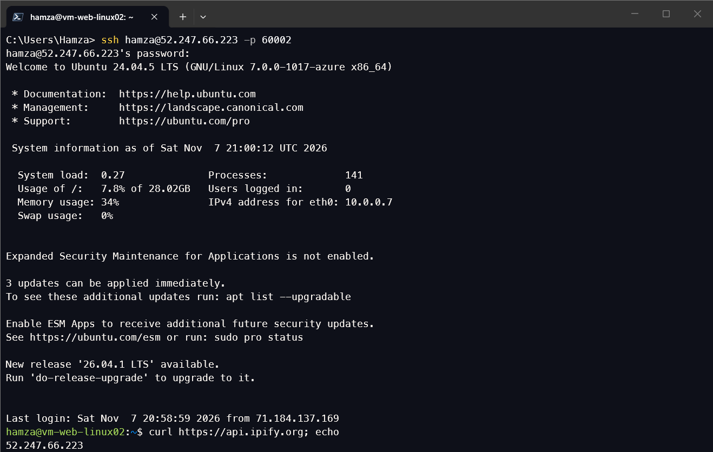

## Public DNS

The public DNS zone `systemsbyhamza.com` is hosted in Azure DNS. The domain is registered through AWS Route 53, with its nameservers delegated to Azure DNS. Route 53 handles domain registration while Azure DNS hosts and answers the public DNS records.

A records provide easy-to-remember hostnames for the sites instead of requiring users to enter public IP addresses. Both records point to the Load Balancer frontends, keeping the VM addresses private.

| Record | Type | Destination |
|---|---|---|
| `windows.systemsbyhamza.com` | A | `40.70.207.116` |
| `linux.systemsbyhamza.com` | A | `52.247.66.223` |

The record script retrieves the public IP resources and uses their current addresses when creating the A records:

```powershell
$WindowsPublicIP = Get-AzPublicIpAddress -Name $WindowsPublicIPName -ResourceGroupName $ResourceGroupName
$LinuxPublicIP = Get-AzPublicIpAddress -Name $LinuxPublicIPName -ResourceGroupName $ResourceGroupName

$WindowsRecord = New-AzDnsRecordConfig -Ipv4Address $WindowsPublicIP.IpAddress
New-AzDnsRecordSet -Name $WindowsRecordName -ZoneName $DNSZoneName -ResourceGroupName $ResourceGroupName -RecordType A -Ttl 300 -DnsRecords $WindowsRecord

$LinuxRecord = New-AzDnsRecordConfig -Ipv4Address $LinuxPublicIP.IpAddress
New-AzDnsRecordSet -Name $LinuxRecordName -ZoneName $DNSZoneName -ResourceGroupName $ResourceGroupName -RecordType A -Ttl 300 -DnsRecords $LinuxRecord
```

**Scripts:** [Create DNS zone](Scripts/12-Create-DNSZone.ps1) · [Create DNS records](Scripts/13-Create-DNSRecords.ps1)

**Screenshots:** [Azure DNS zone and records](Screenshots/14-Azure-DNS-Zone-and-Records.png) · [Route 53 registration and delegation](Screenshots/15-AWS-Route53-Domain-Registration.png)

DNS resolution was checked for both A records and the zone's NS and SOA records:

```powershell
Resolve-DnsName windows.systemsbyhamza.com -Type A
Resolve-DnsName linux.systemsbyhamza.com -Type A
Resolve-DnsName systemsbyhamza.com -Type NS
Resolve-DnsName systemsbyhamza.com -Type SOA
```

The A records returned the corresponding Load Balancer public IP addresses, and the NS records returned the Azure DNS nameservers.

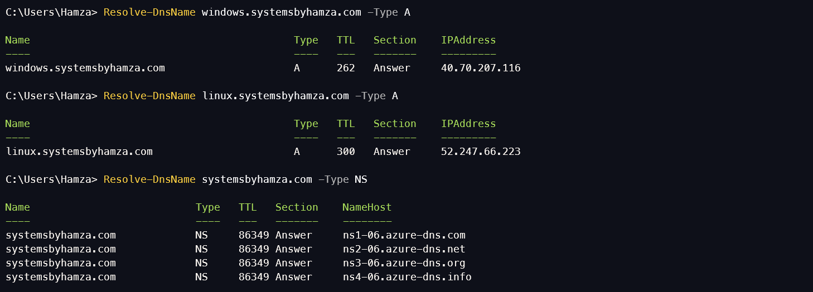

**Command output:** [DNS resolution and delegation](Commands/23-DNS-Resolution-and-Delegation.txt)

## Public endpoint validation

The public DNS names resolve to the Load Balancer frontends. Requests to each endpoint return the hostname of the VM that handled the connection.

- [windows.systemsbyhamza.com](http://windows.systemsbyhamza.com)
- [linux.systemsbyhamza.com](http://linux.systemsbyhamza.com)

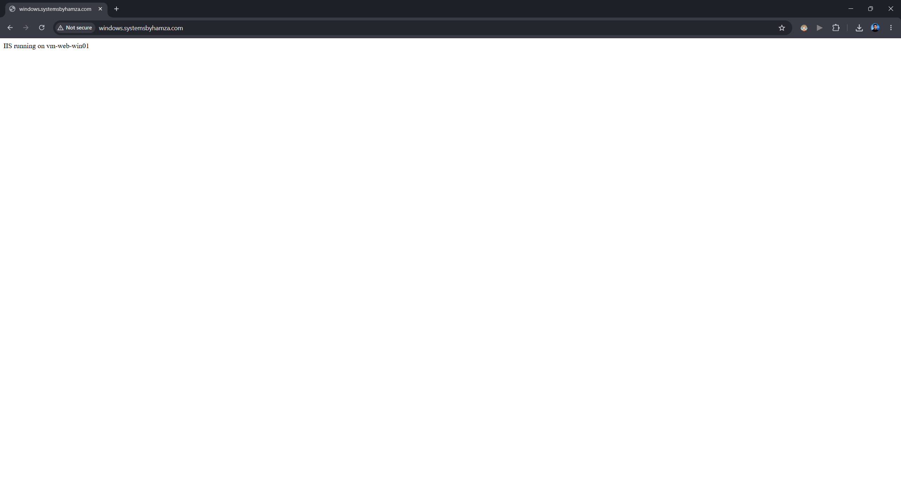

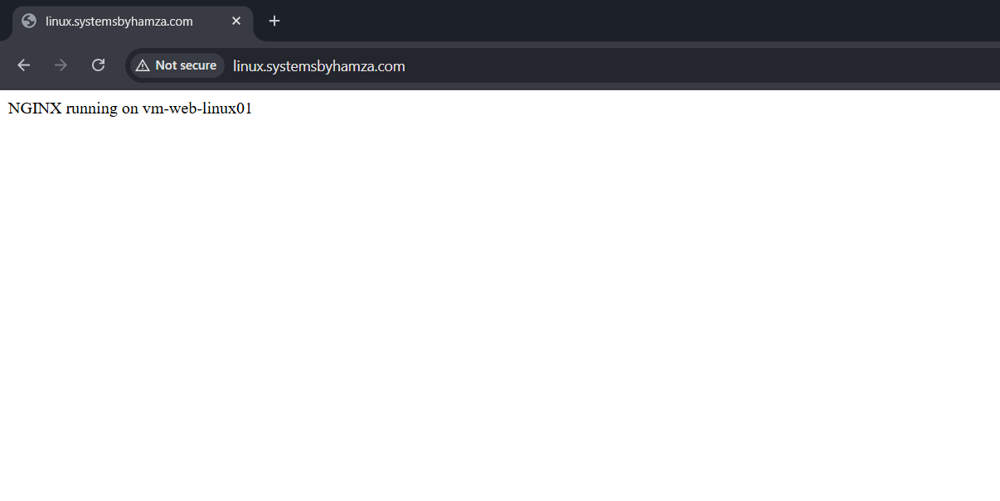

## Load balancing and failover validation

The web pages return the hostname of the backend VM. Repeated requests to each public endpoint therefore show which VM handled each connection.

The following PowerShell loops send 20 requests to each endpoint:

```powershell
1..20 | ForEach-Object {
    curl http://windows.systemsbyhamza.com
}

1..20 | ForEach-Object {
    curl http://linux.systemsbyhamza.com
}
```

The Windows responses included both `vm-web-win01` and `vm-web-win02`. The Linux responses included both `vm-web-linux01` and `vm-web-linux02`. This confirms that requests reached both members of each backend pool.

<table>
  <tr>
    <th>Windows request distribution</th>
    <th>Linux request distribution</th>
  </tr>
  <tr>
    <td>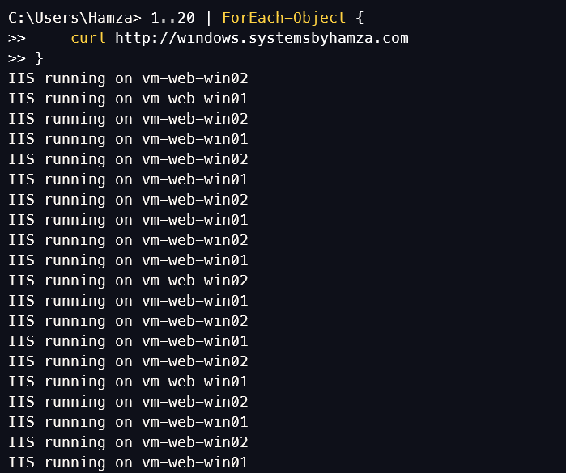</td>
    <td>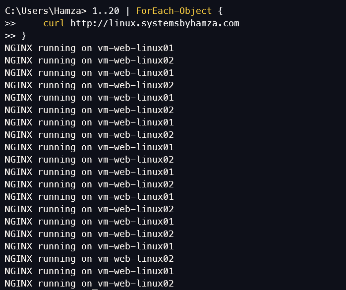</td>
  </tr>
</table>

The request output is also retained as text: [Windows test](Commands/17.1-Windows-Load-Balancing-Test.txt) · [Linux test](Commands/17.2-Linux-Load-Balancing-Test.txt).

### Backend health and failover

Backend deallocation was used to test how the health probes affect traffic distribution. When one VM was deallocated, its probe marked it unhealthy and the Load Balancer sent requests to the remaining healthy backend. After the VM was allocated again and its web service became healthy, requests reached both backends again.

**Windows backend**

<table>
  <tr>
    <th>Failure</th>
    <th>Recovery</th>
  </tr>
  <tr>
    <td>
      <p><strong>1. Deallocate vm-web-win01</strong></p>
      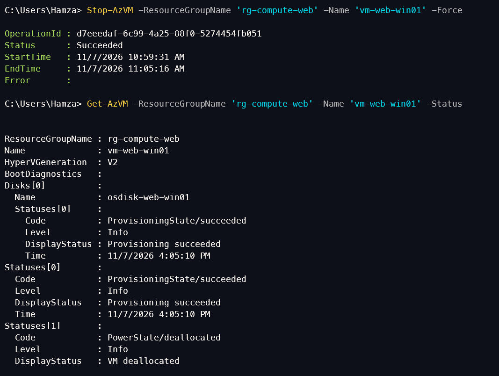
      <p><strong>2. Backend marked unhealthy</strong></p>
      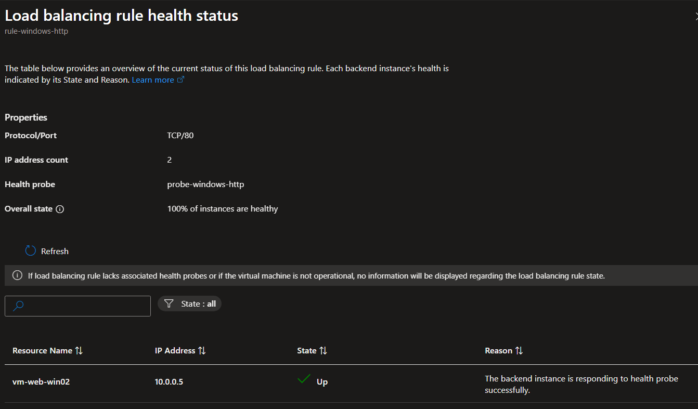
      <p><strong>3. Requests reach vm-web-win02 only</strong></p>
      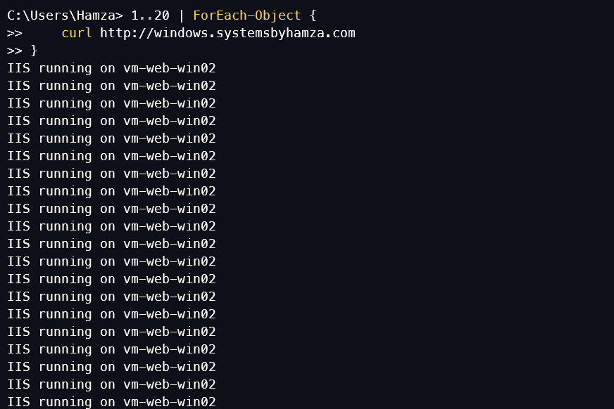
    </td>
    <td>
      <p><strong>4. Reallocate vm-web-win01</strong></p>
      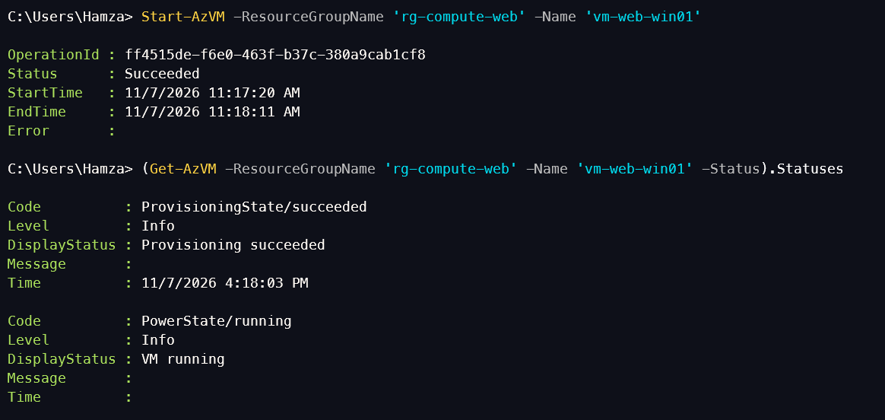
      <p><strong>5. Backend returns to healthy</strong></p>
      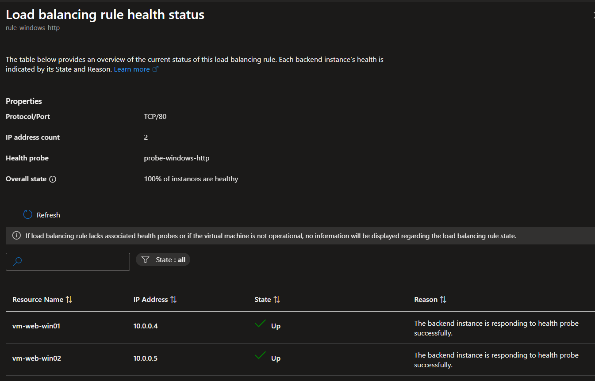
      <p><strong>6. Requests reach both VMs again</strong></p>
      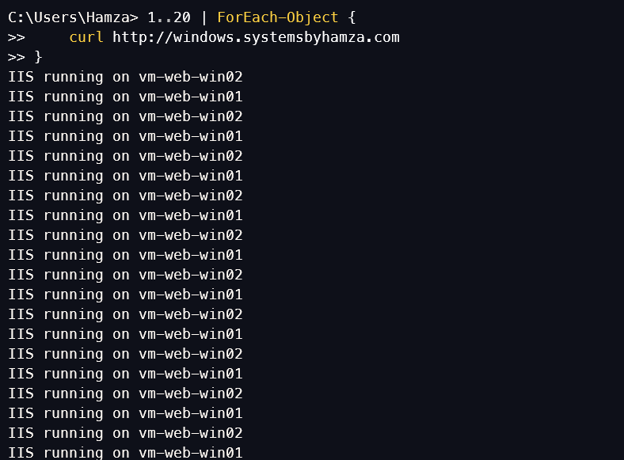
    </td>
  </tr>
</table>

**Linux backend**

<table>
  <tr>
    <th>Failure</th>
    <th>Recovery</th>
  </tr>
  <tr>
    <td>
      <p><strong>1. Deallocate vm-web-linux01</strong></p>
      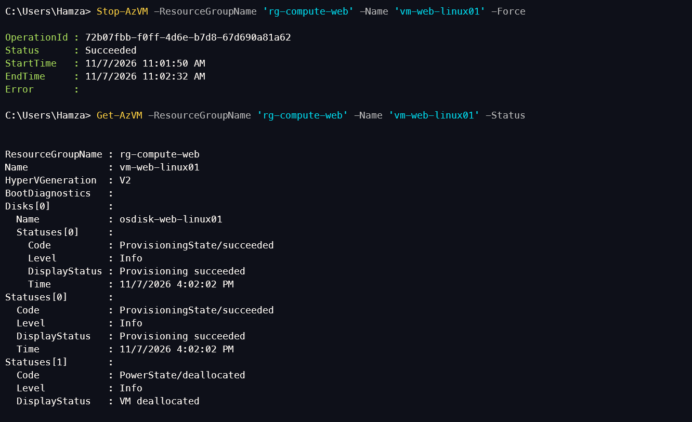
      <p><strong>2. Backend marked unhealthy</strong></p>
      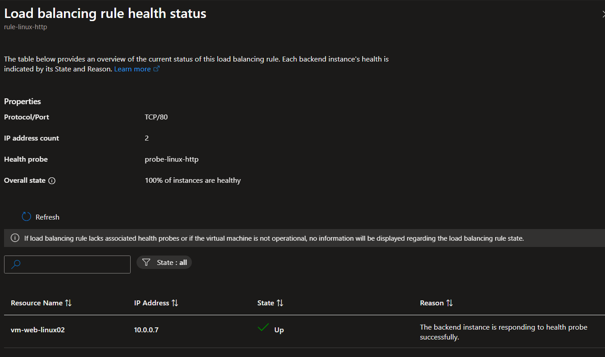
      <p><strong>3. Requests reach vm-web-linux02 only</strong></p>
      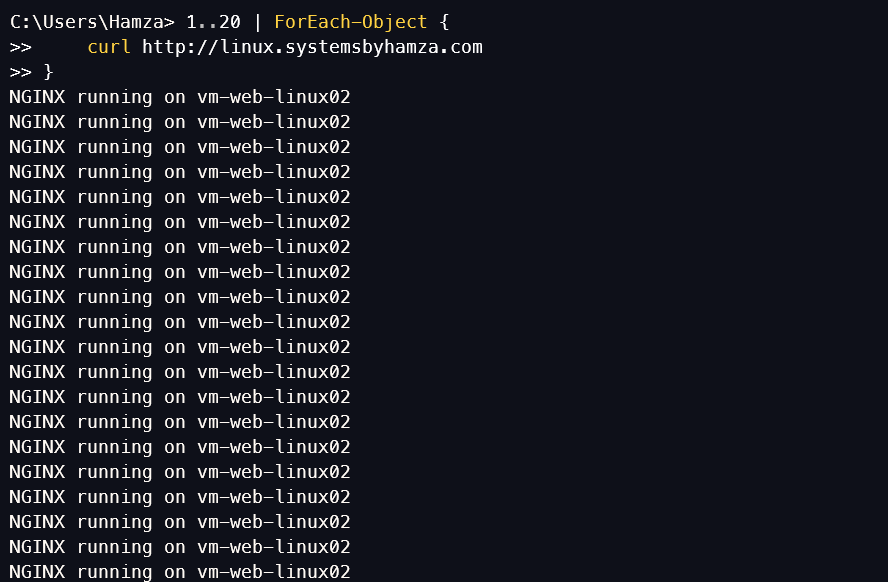
    </td>
    <td>
      <p><strong>4. Reallocate vm-web-linux01</strong></p>
      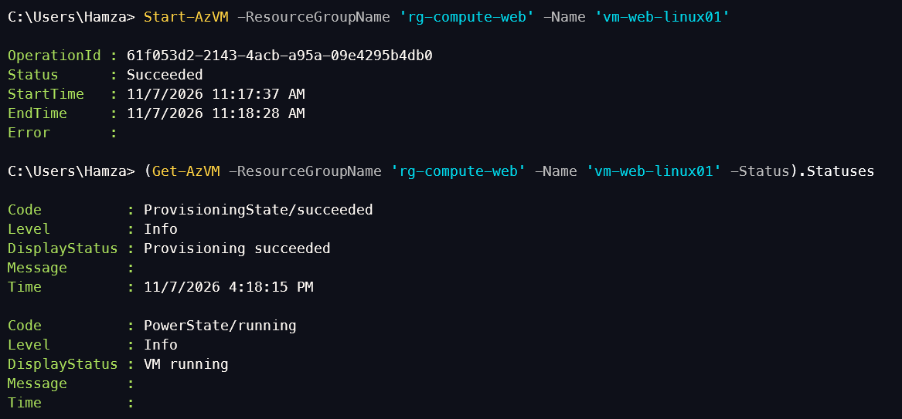
      <p><strong>5. Backend returns to healthy</strong></p>
      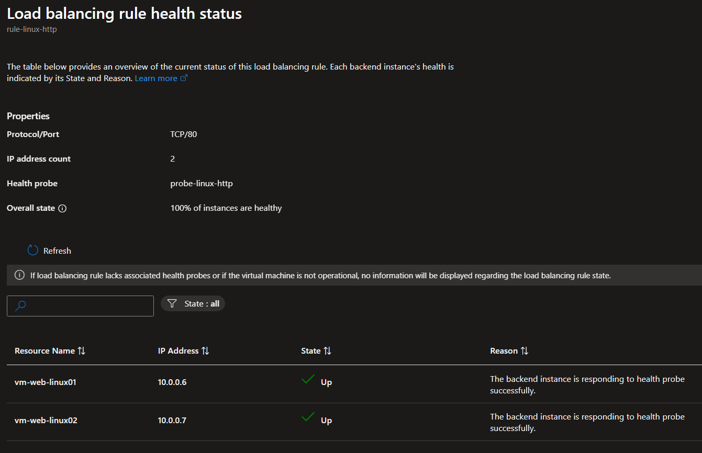
      <p><strong>6. Requests reach both VMs again</strong></p>
      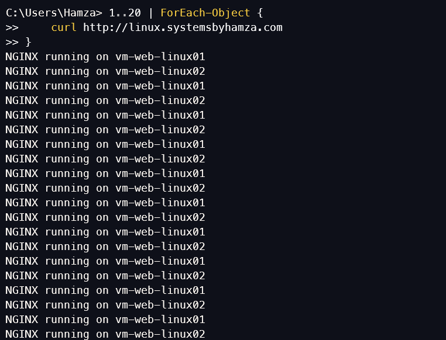
    </td>
  </tr>
</table>

## Project files

- `Architecture/`  -  architecture diagram and exported versions.
- `Configs/`  -  IIS and NGINX guest configuration.
- `Commands/`  -  command output from load-balancing, failover, recovery, and DNS validation.
- `Screenshots/`  -  Azure configuration and validation evidence.
- `Scripts/`  -  Azure PowerShell deployment and configuration scripts.