# Project 03 - Azure Backup and Disaster Recovery

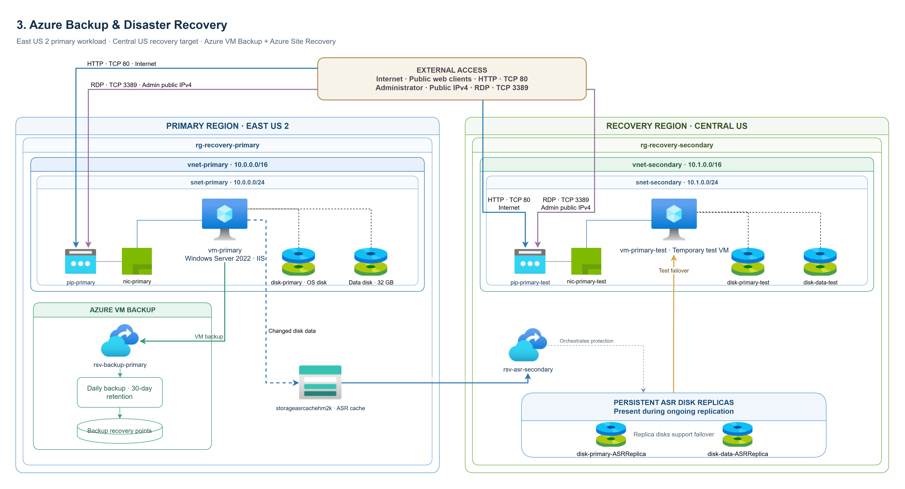

This project deploys a Windows Server workload in Azure and implements two recovery paths:

- **Azure Backup** for scheduled VM backups and file-level recovery.
- **Azure Site Recovery (ASR)** for replicating the workload to a secondary region and testing regional recovery.

The project includes scripts for deploying the infrastructure, configuring the VM, setting up backup and replication, monitoring jobs, and testing recovery.

## Infrastructure

The workload is deployed in East US 2, with Central US configured as the recovery region.

| Component | Primary | Recovery |
|---|---|---|
| Region | East US 2 | Central US |
| Resource group | `rg-recovery-primary` | `rg-recovery-secondary` |
| Virtual network | `vnet-primary` | `vnet-secondary` |
| Address space | `10.0.0.0/16` | `10.1.0.0/16` |
| Subnet | `snet-primary` (`10.0.0.0/24`) | `snet-secondary` (`10.1.0.0/24`) |
| Network security group | `nsg-primary` | `nsg-secondary` |

The source workload is `vm-primary`, running Windows Server 2022 on a `Standard_B2s_v2` VM. It uses a Standard SSD OS disk and a separate 32-GB managed data disk so application data can be included in backup and replication testing.

Infrastructure is defined using arrays of hash tables and deployed with foreach loops. This makes it easier to deploy resources across both regions without repeating configuration code:

```powershell
$VirtualNetworks = @(
    @{
        Name          = 'vnet-primary'
        ResourceGroup = 'rg-recovery-primary'
        Location      = 'eastus2'
        AddressPrefix = '10.0.0.0/16'
        SubnetName    = 'snet-primary'
        SubnetPrefix  = '10.0.0.0/24'
    }
    @{
        Name          = 'vnet-secondary'
        ResourceGroup = 'rg-recovery-secondary'
        Location      = 'centralus'
        AddressPrefix = '10.1.0.0/16'
        SubnetName    = 'snet-secondary'
        SubnetPrefix  = '10.1.0.0/24'
    }
)

foreach ($VirtualNetwork in $VirtualNetworks) {
    $Subnet = New-AzVirtualNetworkSubnetConfig -Name $VirtualNetwork.SubnetName -AddressPrefix $VirtualNetwork.SubnetPrefix
    New-AzVirtualNetwork -Name $VirtualNetwork.Name -ResourceGroupName $VirtualNetwork.ResourceGroup -Location $VirtualNetwork.Location -AddressPrefix $VirtualNetwork.AddressPrefix -Subnet $Subnet
}
```

The NSG deployment follows the same configuration-driven pattern. It retrieves my public IP and creates two inbound rules: RDP (TCP/3389), restricted to my public IP address using a /32 prefix, and HTTP (TCP/80), allowed from the Internet. Each NSG is then associated with its corresponding subnet.

The rules are created once per NSG configuration and applied to the matching subnet:

```powershell
$AdminPublicIP = Invoke-RestMethod -Uri 'https://api.ipify.org'

$RDPRule = New-AzNetworkSecurityRuleConfig -Name 'Allow-RDP' -Direction Inbound -Access Allow -SourceAddressPrefix "$AdminPublicIP/32" -SourcePortRange * -DestinationAddressPrefix VirtualNetwork -DestinationPortRange 3389 -Protocol Tcp -Priority 100
$HTTPRule = New-AzNetworkSecurityRuleConfig -Name 'Allow-HTTP' -Direction Inbound -Access Allow -SourceAddressPrefix Internet -SourcePortRange * -DestinationAddressPrefix VirtualNetwork -DestinationPortRange 80 -Protocol Tcp -Priority 110

$NSG = New-AzNetworkSecurityGroup -Name $NetworkSecurityGroup.Name -ResourceGroupName $NetworkSecurityGroup.ResourceGroup -Location $NetworkSecurityGroup.Location -SecurityRules $RDPRule, $HTTPRule
```

**Deployment scripts:** [Resource groups](Scripts/01-Create-ResourceGroups.ps1) · [Virtual networks](Scripts/02-Create-VirtualNetworks.ps1) · [NSGs](Scripts/03-Create-NSGs.ps1) · [Source VM](Scripts/04-Create-SourceVM.ps1) · [Data disk](Scripts/05-Create-DataDisk.ps1)

### Primary network security group

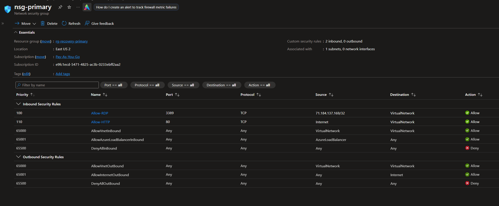

### Recovery network security group

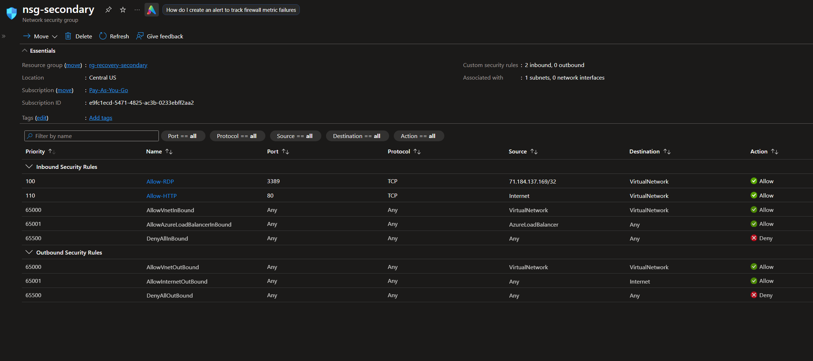

### Source VM disks

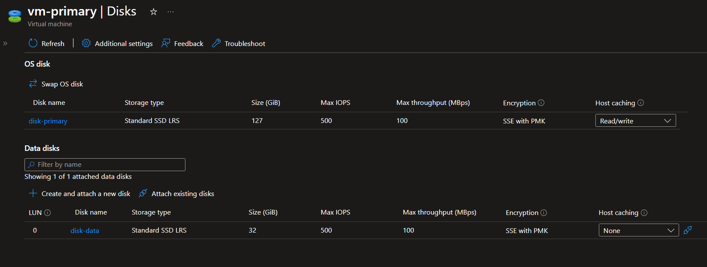

### Guest OS data disk

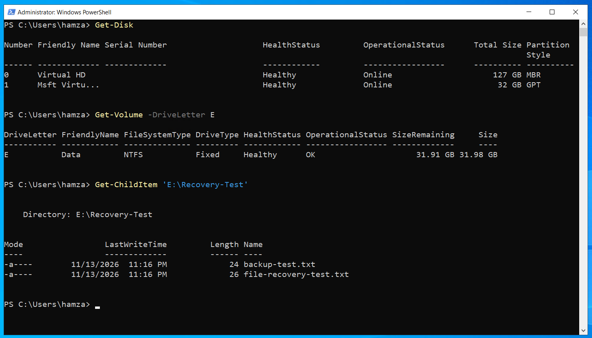

## Guest configuration and IIS workload

The guest configuration prepares the VM for the workload by initializing its data disk and installing IIS. It also configures an IIS page to display the VM's hostname, region, private IP address, and public IP address.

A scheduled task runs at startup under the `SYSTEM` account and runs `03-Generate-IISWebpage.ps1` to refresh the page. This refreshes the page after a restart or recovery without requiring an interactive sign-in:

```powershell
$Action = New-ScheduledTaskAction -Execute 'PowerShell.exe' -Argument '-NoProfile -ExecutionPolicy Bypass -File "C:\Guest-Configs\03-Generate-IISWebpage.ps1"'
$Trigger = New-ScheduledTaskTrigger -AtStartup -RandomDelay (New-TimeSpan -Seconds 60)
$Principal = New-ScheduledTaskPrincipal -UserId 'SYSTEM' -LogonType ServiceAccount -RunLevel Highest

Register-ScheduledTask -TaskName 'Generate-IISWebpage.ps1' -Action $Action -Trigger $Trigger -Principal $Principal -Force
```

When the task runs, the page-generation script queries the Azure Instance Metadata Service (IMDS) for the Azure VM's hostname, region, and private IP. It also retrieves the public IP and writes these details into IIS's default page:

```powershell
$Metadata = Invoke-RestMethod -Headers @{'Metadata' = 'true'} -Uri 'http://169.254.169.254/metadata/instance?api-version=2021-02-01'

$HostName = $Metadata.compute.name
$Location = $Metadata.compute.location
$PrivateIP = $Metadata.network.interface.ipv4.ipAddress[0].privateIpAddress
$PublicIP = Invoke-RestMethod -Uri 'https://api.ipify.org'
```

The page retrieves these values from the Azure VM on which it runs. The source VM displays `vm-primary` in `eastus2`. After test failover, the recovered VM displays `vm-primary-test` in `centralus`.

**Guest configuration scripts:** [Initialize data disk](Scripts/Guest-Configs/01-Initialize-DataDisk.ps1) · [Configure IIS](Scripts/Guest-Configs/02-Configure-IIS.ps1) · [Generate IIS webpage](Scripts/Guest-Configs/03-Generate-IISWebpage.ps1)

### Source workload running in IIS

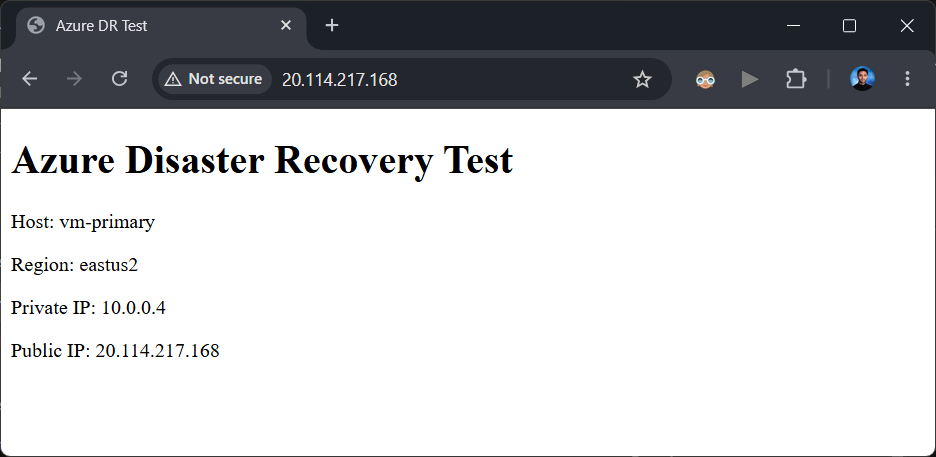

### IIS startup scheduled task

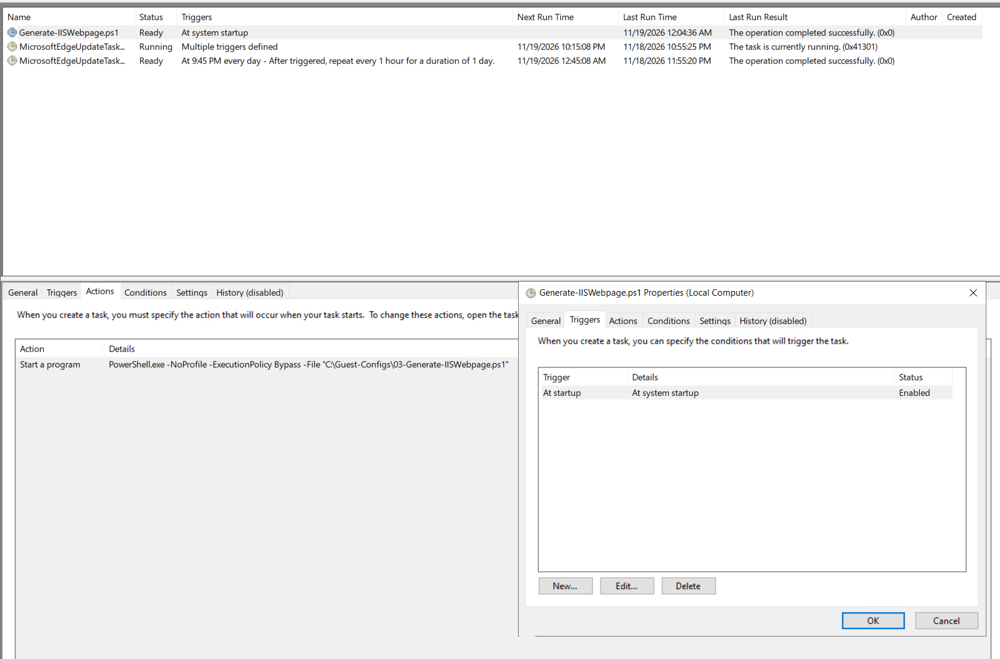

## Azure Backup

The Recovery Services vault `rsv-backup-primary` protects `vm-primary` in East US 2. The daily policy, `policy-vm-daily`, retains recovery points for 30 days and runs at 23:00 EST (04:00 UTC the following day).

The policy script starts from the standard Azure VM schedule and retention objects, then modifies the frequency, run time, and retention period:

```powershell
$SchedulePolicy = Get-AzRecoveryServicesBackupSchedulePolicyObject -WorkloadType AzureVM -PolicySubType Standard
$RetentionPolicy = Get-AzRecoveryServicesBackupRetentionPolicyObject -WorkloadType AzureVM

$SchedulePolicy.ScheduleRunFrequency = 'Daily'
$SchedulePolicy.ScheduleRunTimes.Clear()
$BackupTime = (Get-Date -Hour 23 -Minute 0 -Second 0 -Millisecond 0).ToUniversalTime()
$SchedulePolicy.ScheduleRunTimes.Add($BackupTime)

$RetentionPolicy.DailySchedule.DurationCountInDays = 30

$Policy = New-AzRecoveryServicesBackupProtectionPolicy -Name $PolicyName -WorkloadType AzureVM -SchedulePolicy $SchedulePolicy -RetentionPolicy $RetentionPolicy
Enable-AzRecoveryServicesBackupProtection -Policy $Policy -Name $VMName -ResourceGroupName $ResourceGroupName
```

The script converts 23:00 EST to 04:00 UTC before adding the time to the schedule. It then creates the policy and enables backup protection for the VM.

### Initial backup orchestration

Before starting a new backup, the script checks whether one is already running and whether a recovery point already exists. This prevents an unnecessary duplicate backup:

```powershell
$Jobs = Get-AzRecoveryServicesBackupJob -Status InProgress -Operation Backup -BackupManagementType AzureVM -VaultId $Vault.Id |
    Where-Object WorkloadName -eq $VMName
$RecoveryPoints = Get-AzRecoveryServicesBackupRecoveryPoint -Item $BackupItem -VaultId $Vault.Id

if ($Jobs) {
    Write-Host 'Backup already running. Monitoring existing job.'
    $Job = $Jobs | Select-Object -First 1
}
elseif ($RecoveryPoints) {
    Write-Host 'Recovery point already exists. Skipping backup.'
}
else {
    $Job = Backup-AzRecoveryServicesBackupItem -Item $BackupItem -ExpiryDateTimeUTC (Get-Date).ToUniversalTime().AddDays(30)
}
```

When a job is running, the script polls its status every 30 seconds, retrieves the job details, and displays subtask progress. It refreshes the job object on each iteration and reports the final status:

```powershell
while ($Job.Status -eq 'InProgress') {
    $JobDetails = Get-AzRecoveryServicesBackupJobDetail -JobId $Job.JobId -VaultId $Vault.Id
    $JobDetails.SubTasks | Format-Table Name, Status, Duration

    Start-Sleep -Seconds 30
    $Job = Get-AzRecoveryServicesBackupJob -Job $Job -VaultId $Vault.Id
}

$JobDetails = Get-AzRecoveryServicesBackupJobDetail -JobId $Job.JobId -VaultId $Vault.Id
$JobDetails.SubTasks | Format-Table Name, Status, Duration
```

After the job finishes, the script checks for `Completed` and retrieves the newest recovery point.

**Backup scripts:** [Create vault](Scripts/06-Create-BackupVault.ps1) · [Configure VM backup](Scripts/07-Configure-VMBackup.ps1) · [Start and monitor initial backup](Scripts/08-Start-InitialBackup.ps1)

### Backup restore point collection

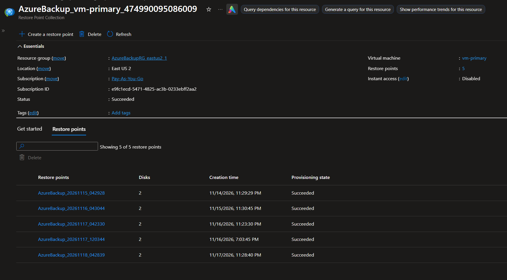

## File-level recovery

Azure Backup file recovery was tested separately from full VM restoration. The recovery script selects the newest recovery point and generates the mount script for the backed-up volumes:

```powershell
$DownloadPath = "$env:USERPROFILE\AzureFileRecovery"
$PasswordFile = "$DownloadPath\RecoveryPassword.txt"

$RecoveryPoints = Get-AzRecoveryServicesBackupRecoveryPoint -Item $BackupItem -VaultId $Vault.Id
$LatestRecoveryPoint = $RecoveryPoints | Sort-Object RecoveryPointTime -Descending | Select-Object -First 1

$MountScript = Get-AzRecoveryServicesBackupRPMountScript -RecoveryPoint $LatestRecoveryPoint -Path $DownloadPath -VaultId $Vault.Id
$MountScript.Password | Set-Content -Path $PasswordFile

Get-ChildItem -Path $DownloadPath
```

The mount script and recovery password are downloaded to my laptop. Running the generated mount executable connects to the recovery point over iSCSI and exposes the backed-up volumes as local drives. Individual files can then be browsed and copied directly on my laptop without restoring the entire VM. When finished, the recovery session is stopped and the volumes are dismounted.

**File recovery scripts:** [Start file recovery](Scripts/09-Start-FileRecovery.ps1) · [Stop file recovery](Scripts/10-Stop-FileRecovery.ps1)

The stop script closes the recovery session by disabling the mount script for the selected recovery point:

```powershell
Disable-AzRecoveryServicesBackupRPMountScript -RecoveryPoint $LatestRecoveryPoint -VaultId $Vault.Id
```

### File recovery point and downloaded mount script

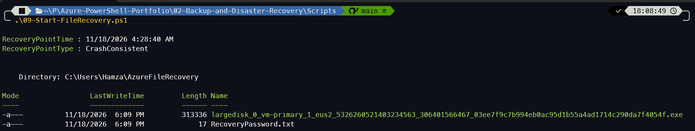

### File recovery mount session

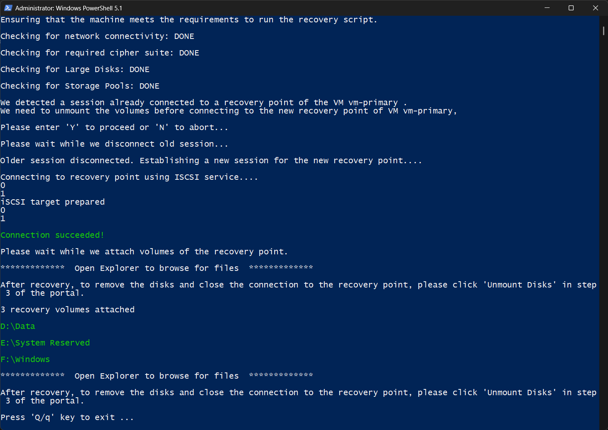

### Recovery volumes mounted locally

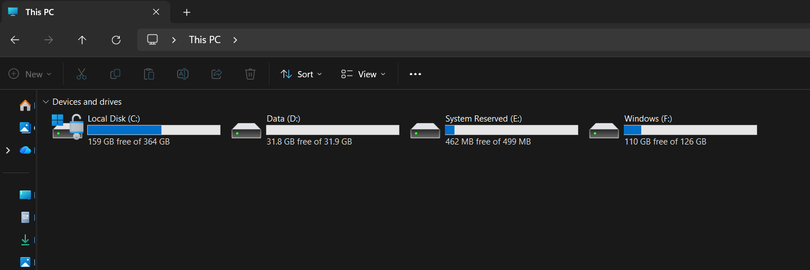

### Recovered files inspected

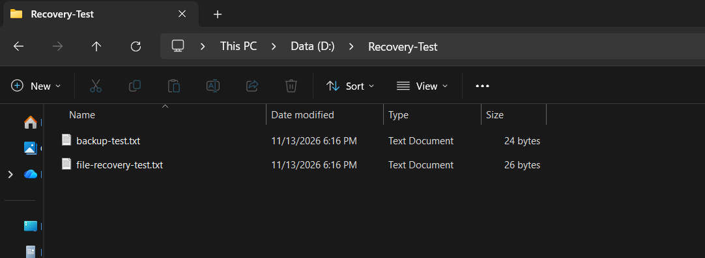

## Azure Site Recovery

Azure Site Recovery replicates `vm-primary` from East US 2 to Central US. The recovery configuration is hosted by `rsv-asr-secondary` and includes:

1. Primary and recovery ASR fabrics.
2. Protection containers for each fabric.
3. The replication policy, `policy-asr`, with 24-hour recovery point retention.
4. A protection container mapping between the regions.
5. The cache storage account, `storageasrcachehm2k`, in East US 2.
6. The recovery resource group, VNet, and subnet used when a test failover is started.

The fabrics, containers, policy, mapping, and cache storage are created before VM replication is enabled. ASR then provisions and maintains the replica disks in the recovery region.

The replication policy and mapping connect the primary and recovery protection containers:

```powershell
New-AzRecoveryServicesAsrPolicy -AzureToAzure -Name $PolicyName -RecoveryPointRetentionInHours 24

$PrimaryContainer = Get-AzRecoveryServicesAsrProtectionContainer -Fabric $PrimaryFabric
$SecondaryContainer = Get-AzRecoveryServicesAsrProtectionContainer -Fabric $SecondaryFabric
$Policy = Get-AzRecoveryServicesAsrPolicy -Name $PolicyName

$Job = New-AzRecoveryServicesAsrProtectionContainerMapping -Name $MappingName -Policy $Policy -PrimaryProtectionContainer $PrimaryContainer -RecoveryProtectionContainer $SecondaryContainer
```

**ASR configuration scripts:** [Create vault](Scripts/11-Create-ASRVault.ps1) · [Create fabrics](Scripts/12-Create-ASRFabrics.ps1) · [Create protection containers](Scripts/13-Create-ASRProtectionContainers.ps1) · [Create replication policy](Scripts/14-Create-ASRReplicationPolicy.ps1) · [Create container mapping](Scripts/15-Create-ASRProtectionContainerMapping.ps1) · [Create cache storage](Scripts/16-Create-ASRCacheStorage.ps1) · [Enable VM replication](Scripts/17-Enable-VMReplication.ps1)

VM replication is enabled with the source VM, cache storage account, protection mapping, and recovery network:

```powershell
$Job = New-AzRecoveryServicesAsrReplicationProtectedItem -AzureToAzure -AzureVmId $VirtualMachine.Id -Name $VirtualMachine.Name -ProtectionContainerMapping $Mapping -LogStorageAccountId $StorageAccount.Id -RecoveryResourceGroupId $RecoveryResourceGroup.ResourceId -RecoveryAzureNetworkId $RecoveryVNet.Id -RecoveryAzureSubnetName $RecoverySubnetName
```

### ASR fabrics and protection containers

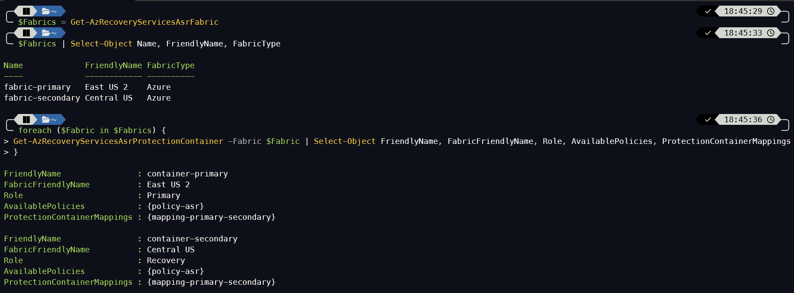

### Replication health

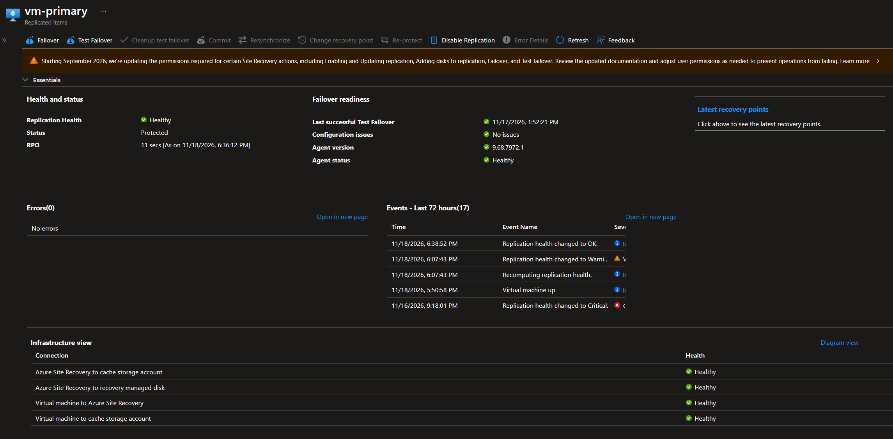

### ASR replication infrastructure

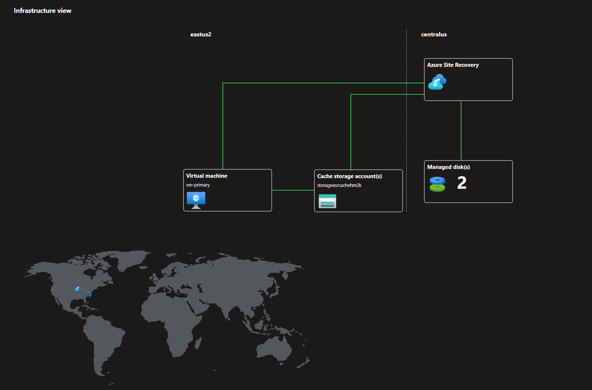

### Replica disks in Central US

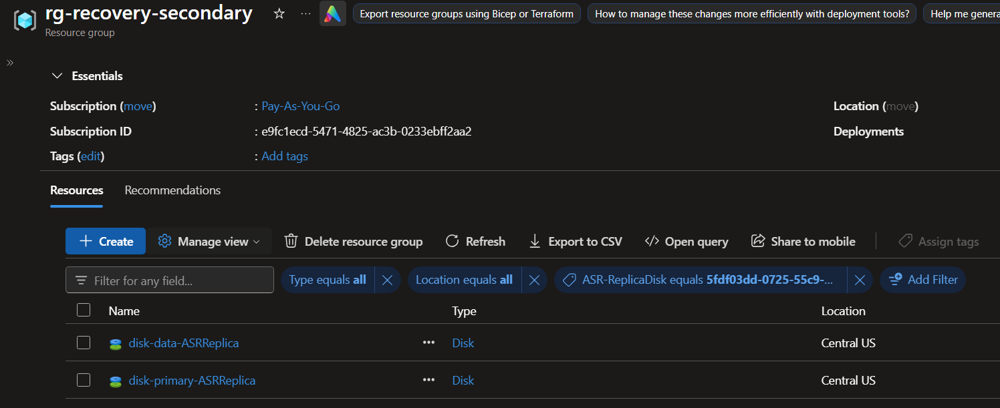

### Monitoring initial replication

ASR provisioning is asynchronous. Enabling replication starts a job, but the VM is not fully protected until initial replication completes. Script 18 uses a `do/while` loop to query the protected item every 30 seconds and wait for the actual `Protected` state:

```powershell
do {
    $ReplicationItem = Get-AzRecoveryServicesAsrReplicationProtectedItem -ProtectionContainer $PrimaryContainer
    Write-Host "Protection State: $($ReplicationItem.ProtectionStateDescription)"

    if ($ReplicationItem.ProtectionState -ne 'Protected') {
        Start-Sleep -Seconds 30
    }
} while ($ReplicationItem.ProtectionState -ne 'Protected')
```

Once protection is established, the script reports replication health and retrieves the latest recovery point:

```powershell
$ReplicationItem | Format-List Name, ProtectionState, ReplicationHealth

$RecoveryPoints = Get-AzRecoveryServicesAsrRecoveryPoint -ReplicationProtectedItem $ReplicationItem
$LatestRecoveryPoint = $RecoveryPoints | Sort-Object RecoveryPointTime -Descending | Select-Object -First 1
$LatestRecoveryPoint | Format-List Name, RecoveryPointType, RecoveryPointTime
```

The script waits for the protection state to reach `Protected` before proceeding with failover testing.

**Monitoring script:** [Monitor initial replication](Scripts/18-Monitor-InitialReplication.ps1)

## Test failover

With replication established, a test failover was initiated from the primary fabric using the latest available recovery point and `vnet-secondary` as the recovery network.

The script retrieves the protected item, selects the newest recovery point, and starts the ASR test failover:

```powershell
$ReplicationItem = Get-AzRecoveryServicesAsrReplicationProtectedItem -ProtectionContainer $PrimaryContainer |
    Where-Object Name -eq $PrimaryVMName

$LatestRecoveryPoint = Get-AzRecoveryServicesAsrRecoveryPoint -ReplicationProtectedItem $ReplicationItem |
    Sort-Object RecoveryPointTime -Descending |
    Select-Object -First 1

$RecoveryVNet = Get-AzVirtualNetwork -Name $RecoveryVNetName -ResourceGroupName $ResourceGroupName

$Job = Start-AzRecoveryServicesAsrTestFailoverJob -ReplicationProtectedItem $ReplicationItem -Direction PrimaryToRecovery -AzureVMNetworkId $RecoveryVNet.Id -RecoveryPoint $LatestRecoveryPoint
```

The failover job is asynchronous, so the script polls it until it leaves `NotStarted` or `InProgress`. It then checks for `Succeeded` before continuing:

```powershell
while ($Job.State -in @('NotStarted', 'InProgress')) {
    Write-Host 'Test Failover job is still running. Checking again in 30 seconds...'
    Start-Sleep -Seconds 30
    $Job = Get-AzRecoveryServicesAsrJob -Job $Job
}

if ($Job.State -ne 'Succeeded') {
    Write-Warning "Test Failover failed. Final state: $($Job.State)"
    return
}
```

The test failover completed successfully and created `vm-primary-test` in Central US with its replicated OS and data disks. A public IP was then associated with the recovered VM's NIC.

The recovery access script attaches a new public IP to the recovered VM's NIC, then runs `03-Generate-IISWebpage.ps1` remotely:

```powershell
$PublicIP = New-AzPublicIpAddress -Name $PublicIPName -ResourceGroupName $ResourceGroupName -Location $Location -AllocationMethod Static

$NIC.IpConfigurations[0].PublicIpAddress = $PublicIP
Set-AzNetworkInterface -NetworkInterface $NIC | Out-Null

$Script = "& 'C:\Guest-Configs\03-Generate-IISWebpage.ps1'"
Invoke-AzVMRunCommand -ResourceGroupName $ResourceGroupName -VMName $VMName -CommandId 'RunPowerShellScript' -ScriptString $Script
```

**Failover scripts:** [Start and monitor test failover](Scripts/19-Test-Failover.ps1) · [Configure recovery VM access](Scripts/20-Configure-RecoveryVMAccess.ps1)

### Test failover PowerShell execution

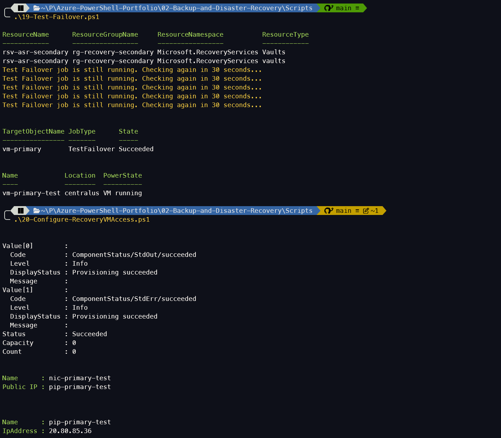

### Test failover job completed

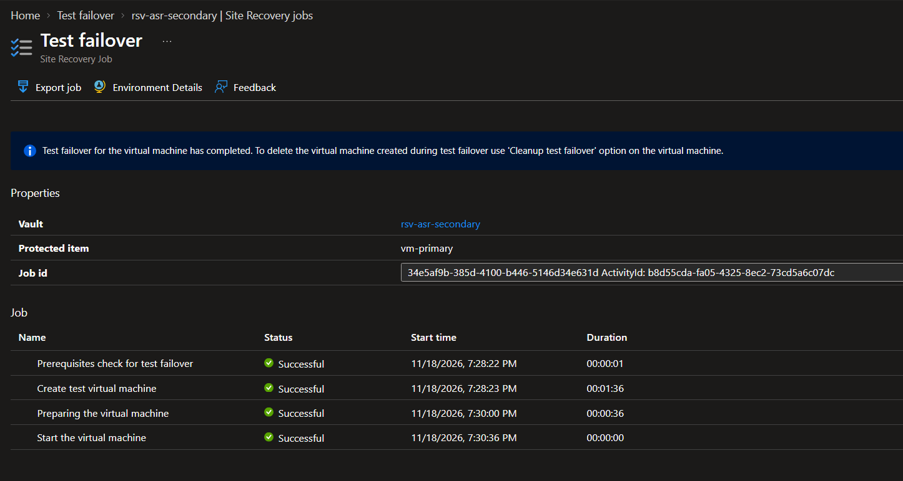

### Recovered VM in Central US

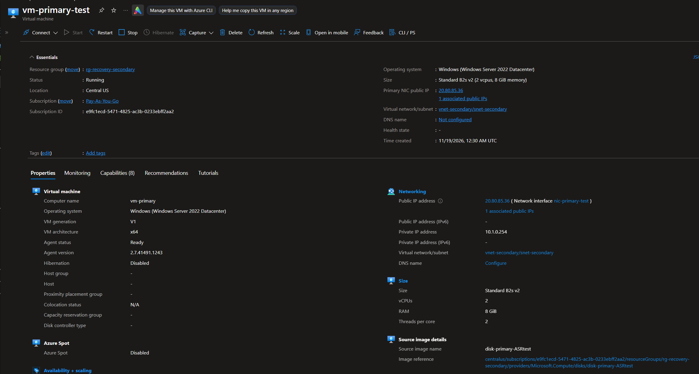

### IIS page served by the recovered VM

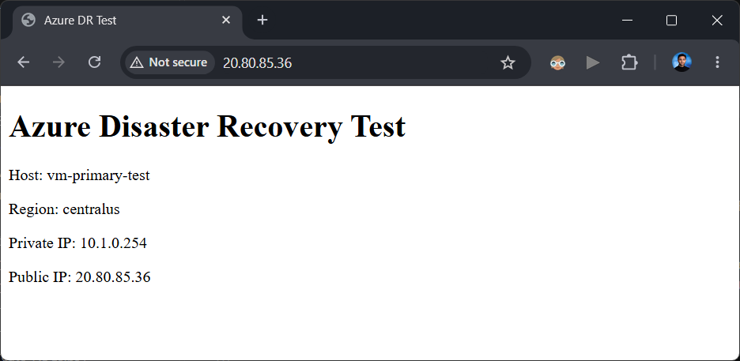

The IIS page displayed the recovered VM's hostname (`vm-primary-test`), region (`centralus`), and private and public IP addresses. This confirmed that the scheduled task ran the page-generation script and updated the IIS page with the recovered VM's details.

## Test failover cleanup

After validation, the temporary test-failover environment was removed with `Start-AzRecoveryServicesAsrTestFailoverCleanupJob`. The cleanup script polls the ASR job and stops if the operation does not succeed. It then checks that the temporary VM and NIC are gone before removing the test public IP:

```powershell
$Job = Start-AzRecoveryServicesAsrTestFailoverCleanupJob -ReplicationProtectedItem $ReplicationItem

while ($Job.State -in @('NotStarted', 'InProgress')) {
    Start-Sleep -Seconds 30
    $Job = Get-AzRecoveryServicesAsrJob -Job $Job
}

if ($Job.State -ne 'Succeeded') {
    Write-Warning "Test Failover Cleanup failed. Final state: $($Job.State)"
    return
}

$RecoveryVM = Get-AzVM -Name $RecoveryVMName -ResourceGroupName $ResourceGroupName -ErrorAction SilentlyContinue
$RecoveryNIC = Get-AzNetworkInterface -Name $RecoveryNICName -ResourceGroupName $ResourceGroupName -ErrorAction SilentlyContinue

if ($RecoveryVM -or $RecoveryNIC) {
    Write-Warning 'Recovery VM or NIC still exists. Investigate ASR cleanup before proceeding.'
    return
}
else {
    Remove-AzPublicIpAddress -Name $PublicIPName -ResourceGroupName $ResourceGroupName -Force
}
```

This is **test failover cleanup, not failback**. It removes the temporary test deployment. It does not fail the workload back to East US 2, delete `vm-primary`, or disable ASR protection.

**Cleanup script:** [Cleanup test failover](Scripts/21-Cleanup-TestFailover.ps1)

### Secondary resource group after cleanup

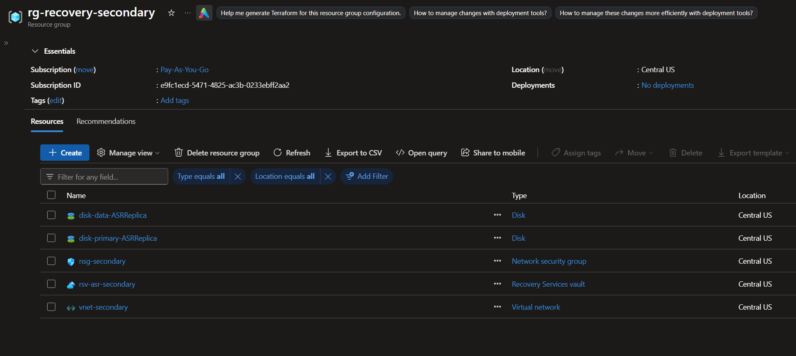

## Project structure

- `Architecture/` - Architecture diagram.
- `Screenshots/` - Selected Azure configuration, backup, replication, and recovery screenshots.
- `Scripts/` - Azure PowerShell deployment, backup, and Site Recovery automation.
- `Scripts/Guest-Configs/` - Windows guest OS, data disk, and IIS configuration scripts.