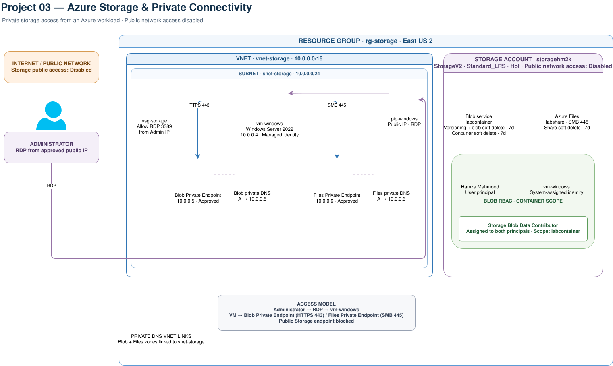
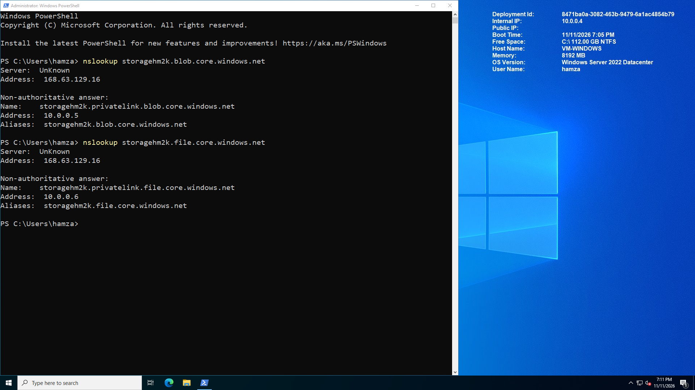
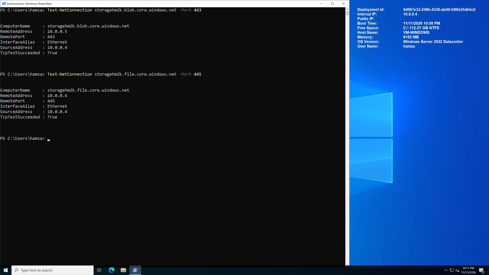
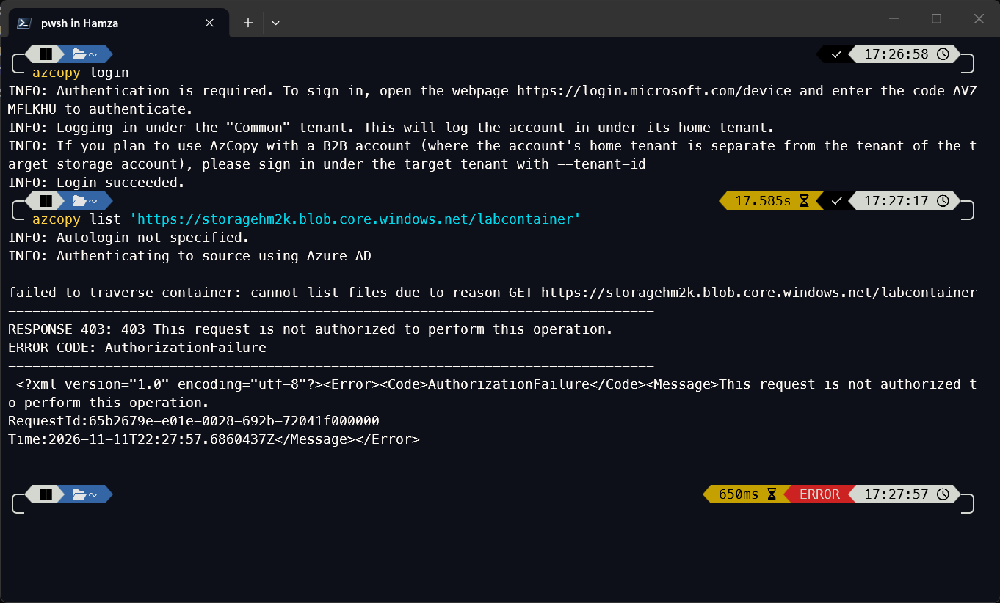
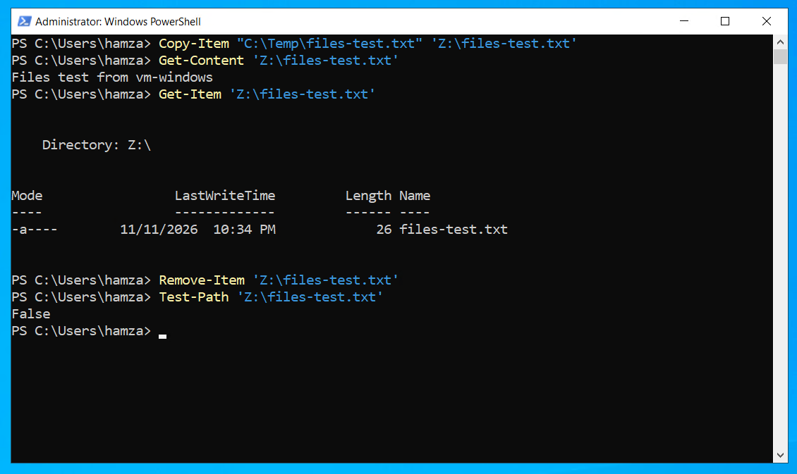
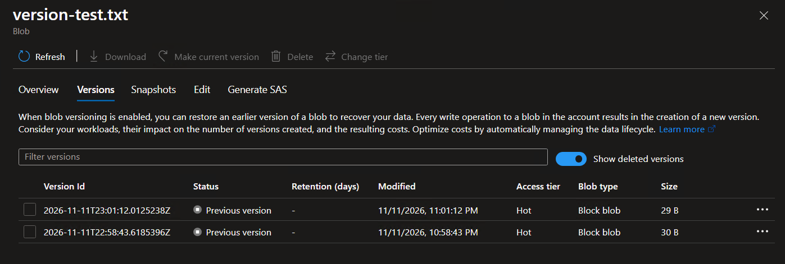
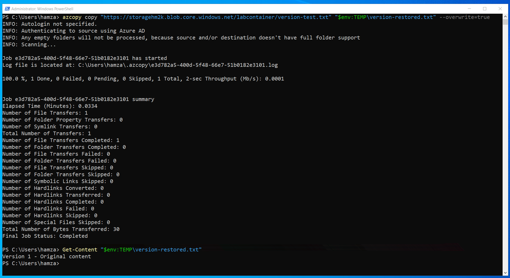
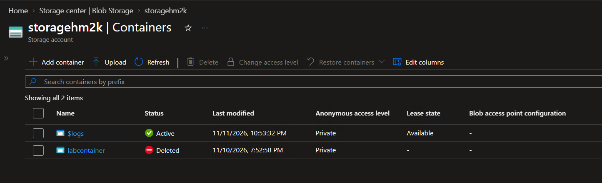
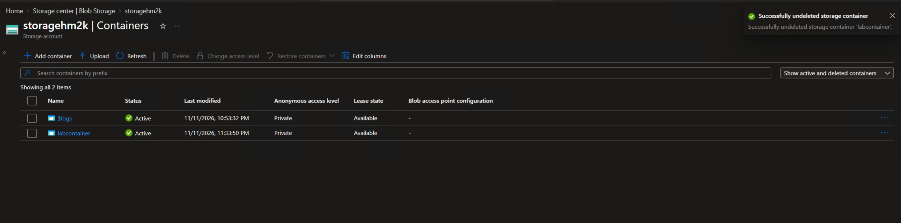

# Project 03 - Azure Storage & Private Connectivity



## Overview

This project deploys and secures an Azure Storage Account containing Blob Storage and Azure Files, with Azure PowerShell used throughout. The work covers resource provisioning, data-plane authorization, network restrictions, Private Link, and data protection.

A Windows Server 2022 VM provides an internal client for Blob access, Azure Files over SMB, and private DNS testing. I retained its public IP for RDP administration and restricted inbound access to my current public IPv4 address.

The resources are deployed to `rg-storage` in East US 2. In the final configuration, both Storage services use Private Endpoints and public network access is disabled on the Storage Account.

## Network layout

| Component | Name | Address range / IP |
|---|---|---|
| Virtual network | `vnet-storage` | `10.0.0.0/16` |
| Subnet | `snet-storage` | `10.0.0.0/24` |
| Network security group | `nsg-storage` | Associated with `snet-storage` |
| Windows VM | `vm-windows` | `10.0.0.4` |
| Blob Private Endpoint | `private-endpoint-blob` | `10.0.0.5` |
| Files Private Endpoint | `private-endpoint-files` | `10.0.0.6` |

The VM and both Private Endpoints share `snet-storage`. The NSG allows RDP only from the administrator's current public IPv4 address, retrieved at deployment time and applied as a `/32` source prefix:

```powershell
$AdminPublicIP = (Invoke-RestMethod https://api.ipify.org).Trim()

$Rule = New-AzNetworkSecurityRuleConfig -Name 'Allow-RDP' -Priority 100 -Protocol Tcp -SourceAddressPrefix "$AdminPublicIP/32" -SourcePortRange * -DestinationAddressPrefix * -DestinationPortRange 3389 -Access Allow -Direction Inbound
```

**Scripts:** [Create resource group](Scripts/01-Create-ResourceGroup.ps1) · [Create network](Scripts/02-Create-Network.ps1) · [Create NSG](Scripts/03-Create-NSG.ps1)


**Screenshots:** [Resource group](Screenshots/01-Resource-Group-Overview.png) · [VNet overview](Screenshots/02-VNet-Overview.png) · [Subnet configuration](Screenshots/03-Subnet-Configuration.png) · [NSG rules](Screenshots/04-NSG-Rules.png)

## Windows client VM

`vm-windows` runs Windows Server 2022 in `snet-storage` at `10.0.0.4`. Its public IP is used for RDP administration only. Storage access is controlled separately by the Storage Account network configuration.

The deployment retrieves the VNet and subnet, creates the public IP and NIC, and adds the NIC to the VM configuration:

```powershell
$VirtualNetwork = Get-AzVirtualNetwork -Name $VirtualNetworkName -ResourceGroupName $ResourceGroupName
$Subnet = $VirtualNetwork.Subnets | Where-Object Name -eq $SubnetName

$PublicIP = New-AzPublicIpAddress -Name $PublicIPName -ResourceGroupName $ResourceGroupName -Location $Location -AllocationMethod Static

$NetworkInterface = New-AzNetworkInterface -Name $NetworkInterfaceName -ResourceGroupName $ResourceGroupName -Location $Location -PrivateIpAddress '10.0.0.4' -Subnet $Subnet -PublicIpAddress $PublicIP
```

During deployment, `Get-Credential` prompts for the local administrator credentials and Boot Diagnostics uses Microsoft-managed storage. A separate script enables the VM's system-assigned managed identity for Blob data access.

**Scripts:** [Create Windows VM](Scripts/04-Create-WindowsVM.ps1) · [Configure VM managed identity](Scripts/05-Configure-VMIdentity.ps1)

**Screenshots:** [Windows VM overview](Screenshots/05-Windows-VM-Overview.png) · [VM networking](Screenshots/06-Windows-VM-Networking.png) · [VM managed identity](Screenshots/07-VM-Managed-Identity.png)

## Storage Account, Blob Storage, and Azure Files

`storagehm2k` is a general-purpose v2 (`StorageV2`) account using Standard locally redundant storage (`Standard_LRS`), which replicates data within the primary region.

The account contains a Blob container and an Azure Files share:

| Resource | Name | Purpose |
|---|---|---|
| Storage Account | `storagehm2k` | Hosts Blob Storage and Azure Files |
| Blob container | `labcontainer` | Object storage and Blob data operations |
| Azure Files share | `labshare` | SMB file share |

The Storage Account is created with `New-AzStorageAccount`:

```powershell
New-AzStorageAccount -Name $StorageAccountName -ResourceGroupName $ResourceGroupName -Location $Location -Kind StorageV2 -SkuName Standard_LRS
```

The Blob container is created using a Storage context authenticated with the signed-in Entra ID account:

```powershell
$Context = New-AzStorageContext -StorageAccountName $StorageAccountName -UseConnectedAccount

New-AzStorageContainer -Name $ContainerName -Context $Context
```

Azure Files is configured separately. The share is created using a Storage context authenticated with a Storage Account key:

```powershell
$StorageAccountKey = (Get-AzStorageAccountKey -Name $StorageAccountName -ResourceGroupName $ResourceGroupName | Where-Object KeyName -eq 'key1').Value

$Context = New-AzStorageContext -StorageAccountName $StorageAccountName -StorageAccountKey $StorageAccountKey

New-AzStorageShare -Name $ShareName -Context $Context
```

**Scripts:** [Create Storage Account](Scripts/06-Create-StorageAccount.ps1) · [Create Blob container](Scripts/07-Create-BlobContainer.ps1) · [Create Azure Files share](Scripts/08-Create-AzureFilesShare.ps1)

**Screenshots:** [Storage Account overview](Screenshots/08-Storage-Account-Overview.png) · [Blob container](Screenshots/09-Blob-Container.png) · [Azure Files share](Screenshots/10-Azure-Files-Share.png)


## Blob authorization with Microsoft Entra ID

Blob data access uses Microsoft Entra ID rather than a Storage Account key. I assigned the `Storage Blob Data Contributor` role at the `labcontainer` scope to two identities: the VM's system-assigned managed identity and my Entra ID user account, Hamza Mahmood (`hamza@hamzamahmood2k.onmicrosoft.com`). This allows me to validate Blob access using both identities without relying on Storage Account keys for Blob authorization.

The role assignment uses the container resource ID as its scope:

```powershell
$StorageAccount = Get-AzStorageAccount -Name $StorageAccountName -ResourceGroupName $ResourceGroupName

$Scope = "$($StorageAccount.Id)/blobServices/default/containers/$ContainerName"

New-AzRoleAssignment -RoleDefinitionName $RoleDefinitionName -ObjectId $VirtualMachine.Identity.PrincipalId -Scope $Scope
New-AzRoleAssignment -RoleDefinitionName $RoleDefinitionName -ObjectId $User.Id -Scope $Scope
```

Scoping the role assignment to `labcontainer` keeps the data permissions limited to that container. When the VM accesses Blob Storage, it can obtain a token through its managed identity rather than using a long-lived Storage Account key stored in its configuration.

**Script:** [Configure Blob RBAC](Scripts/09-Configure-BlobRBAC.ps1)

**RBAC configuration:** [Blob RBAC assignments](Screenshots/11-Blob-RBAC-Assignments.png)

The Storage Account firewall was tested from two public IP addresses: the approved address succeeds, while an address outside the allowlist is rejected. The successful request also uses an Entra ID identity with Blob data permissions.

### Blob request from an approved public IP


The firewall permits the approved source IP, while the container-scoped RBAC assignment separately authorizes the signed-in identity to perform Blob operations.

### Blob request from an unapproved public IP


The request is denied because its source IP is not allowed by the Storage Account firewall. A valid Blob identity does not bypass this network restriction.


## Storage firewall and service endpoint

Before implementing Private Link, a `Microsoft.Storage` service endpoint was configured on `snet-storage`, and the subnet and administrator public IP were added to the Storage Account firewall. The default network action is `Deny`.

The script applies the service endpoint, adds the two allowed network sources, and sets the firewall's default action:

```powershell
Set-AzVirtualNetworkSubnetConfig -Name $Subnet.Name -VirtualNetwork $VirtualNetwork -AddressPrefix $Subnet.AddressPrefix -NetworkSecurityGroup $Subnet.NetworkSecurityGroup -ServiceEndpoint Microsoft.Storage
Set-AzVirtualNetwork -VirtualNetwork $VirtualNetwork

Add-AzStorageAccountNetworkRule -Name $StorageAccountName -ResourceGroupName $ResourceGroupName -VirtualNetworkResourceId $Subnet.Id
Add-AzStorageAccountNetworkRule -Name $StorageAccountName -ResourceGroupName $ResourceGroupName -IPAddressOrRange "$AdminPublicIP"

Update-AzStorageAccountNetworkRuleSet -Name $StorageAccountName -ResourceGroupName $ResourceGroupName -DefaultAction Deny
```

I used the service endpoint as a comparison with Private Link. It provides subnet-based access to the public Storage endpoint, but does not assign a private IP. Private Link instead provides a private IP for each selected Storage subresource. This service endpoint configuration is an earlier comparison exercise, not part of the final access path.

**Script:** [Configure Storage service endpoint and network rules](Scripts/10-Configure-StorageServiceEndpoint.ps1)

### Service endpoint and Storage firewall configuration


The screenshot shows the subnet service endpoint and the Storage Account firewall allowlist. This intermediate configuration restricts access to approved networks while still using the public Storage endpoint.

## Private DNS and Private Endpoints

Blob Storage and Azure Files use separate Private Endpoints because they are distinct Storage subresources. Each endpoint has its own private DNS zone, linked to `vnet-storage`.

| Storage service | Private Endpoint | Private IP | Private DNS zone |
|---|---|---|---|
| Blob | `private-endpoint-blob` | `10.0.0.5` | `privatelink.blob.core.windows.net` |
| Azure Files | `private-endpoint-files` | `10.0.0.6` | `privatelink.file.core.windows.net` |

The VNet links make the private DNS zones available to clients in `vnet-storage`. Clients continue using the standard Storage FQDNs, such as `storagehm2k.blob.core.windows.net` and `storagehm2k.file.core.windows.net`, rather than `privatelink` names.

Inside the VNet, DNS follows a CNAME chain from the normal service FQDN to its corresponding `privatelink` FQDN. For Blob, `storagehm2k.blob.core.windows.net` aliases to `storagehm2k.privatelink.blob.core.windows.net`, which resolves through the private DNS zone to `10.0.0.5`. Azure Files follows the same pattern through `storagehm2k.privatelink.file.core.windows.net`, resolving to `10.0.0.6`. This is the key role of the private DNS zones: they make the standard service names resolve to the Private Endpoint addresses for clients using the linked VNet.

The DNS zones and VNet links are created before the endpoints:

```powershell
New-AzPrivateDnsZone -Name $BlobDNSZoneName -ResourceGroupName $ResourceGroupName
New-AzPrivateDnsZone -Name $FilesDNSZoneName -ResourceGroupName $ResourceGroupName

New-AzPrivateDnsVirtualNetworkLink -Name $BlobDNSLinkName -ZoneName $BlobDNSZoneName -VirtualNetwork $VirtualNetwork -ResourceGroupName $ResourceGroupName
New-AzPrivateDnsVirtualNetworkLink -Name $FilesDNSLinkName -ZoneName $FilesDNSZoneName -VirtualNetwork $VirtualNetwork -ResourceGroupName $ResourceGroupName
```

The Private Endpoint configurations use the `blob` and `file` group IDs and assign the private IP addresses shown above:

```powershell
$BlobConnection = New-AzPrivateLinkServiceConnection -Name $BlobConnectionName -PrivateLinkServiceId $StorageAccount.Id -GroupId blob
$FilesConnection = New-AzPrivateLinkServiceConnection -Name $FilesConnectionName -PrivateLinkServiceId $StorageAccount.Id -GroupId file

$BlobIPConfig = New-AzPrivateEndpointIpConfiguration -Name $BlobIPConfigName -GroupId blob -MemberName blob -PrivateIpAddress '10.0.0.5'
$FilesIPConfig = New-AzPrivateEndpointIpConfiguration -Name $FilesIPConfigName -GroupId file -MemberName file -PrivateIpAddress '10.0.0.6'
```

Each endpoint is associated with its DNS zone through a DNS zone group. Azure maintains the records mapping the Storage service hostnames to the endpoint's private IP address.

**Scripts:** [Create Private DNS zones and VNet links](Scripts/11-Create-PrivateDNS.ps1) · [Create Private Endpoints and DNS zone groups](Scripts/12-Create-PrivateEndpoints.ps1)

DNS resolution was checked from `vm-windows` before and after Private Endpoint deployment. The standard Storage FQDNs initially resolve to public addresses. After deployment, each follows a CNAME to its `privatelink` FQDN and resolves to the corresponding Private Endpoint IP.

### DNS resolution before Private Endpoint deployment


The standard Storage FQDNs resolve to public addresses before the Private Endpoints are deployed.

### DNS resolution after Private Endpoint deployment



The standard FQDNs now CNAME to their `privatelink` FQDNs. The private DNS zones return `10.0.0.5` for Blob and `10.0.0.6` for Azure Files, directing clients to the Private Endpoints.

The supporting configuration evidence remains available here: [Blob Private DNS zone](Screenshots/19.1-Blob-Private-DNS-Zone.png) · [Blob DNS VNet link](Screenshots/19.2-Blob-DNS-VNet-Link.png) · [Files Private DNS zone](Screenshots/19.3-Files-Private-DNS-Zone.png) · [Files DNS VNet link](Screenshots/19.4-Files-DNS-VNet-Link.png) · [Private Endpoint connections](Screenshots/20-Private-Endpoint-Connections.png) · [Blob Private DNS configuration](Screenshots/21.1-Blob-Private-DNS-Configuration.png) · [Files Private DNS configuration](Screenshots/21.2-Files-Private-DNS-Configuration.png)

### Private Endpoint service-port connectivity



The VM successfully connects to TCP 443 for Blob Storage and TCP 445 for Azure Files, confirming service-port reachability through both Private Endpoints.

## Disable public network access

After validating the Private Endpoints and DNS resolution, public network access was disabled on `storagehm2k`:

```powershell
Set-AzStorageAccount -Name $StorageAccountName -ResourceGroupName $ResourceGroupName -PublicNetworkAccess Disabled

Get-AzStorageAccount -Name $StorageAccountName -ResourceGroupName $ResourceGroupName |
    Select-Object StorageAccountName, PublicNetworkAccess
```

This leaves Private Link as the Storage Account's access path. The service endpoint and firewall rules were part of the earlier comparison exercise. They are not required for the final configuration, which has public network access disabled.

**Script:** [Disable Storage Account public network access](Scripts/13-Disable-PublicAccess.ps1)

### Storage Account public network access disabled


I used AzCopy to validate the final access model. From `vm-windows`, the standard Blob FQDN resolves through the `privatelink` CNAME to `10.0.0.5`, and the transfer succeeds through the Private Endpoint. From the laptop, the public endpoint request is blocked because public network access is disabled.

### AzCopy transfer through the Blob Private Endpoint


The successful transfer confirms private DNS resolution, endpoint connectivity, authentication, and Blob data access.

### Public endpoint access blocked from my laptop



The laptop cannot use the VNet's private DNS resolution, and the Storage Account's public endpoint is disabled, so the request is blocked.


## Azure Files over SMB

`vm-windows` connects to `labshare` over SMB through the Files Private Endpoint. The script prompts for the Storage Account key at runtime before mapping the share as a persistent PowerShell drive:

```powershell
$StorageAccountKey = Read-Host 'Storage account key' -AsSecureString
$Credential = [PSCredential]::new("localhost\$StorageAccountName", $StorageAccountKey)

New-PSDrive -Name Z -PSProvider FileSystem -Root "\\$StorageAccountName.file.core.windows.net\$ShareName" -Credential $Credential -Persist
```

For this project, Azure Files uses Storage Account key authentication. This is separate from the Entra ID and managed identity authorization configured for Blob Storage. The Blob RBAC assignments do not provide identity-based SMB authentication.

The UNC path uses the standard Files FQDN, `storagehm2k.file.core.windows.net`. Private DNS resolves it through `privatelink.file.core.windows.net` to `10.0.0.6`, directing SMB traffic through the Files Private Endpoint.

**Additional script:** [Connect Azure Files share](Scripts/Extras/02-Connect-AzureFilesShare.ps1)


### Azure Files SMB connection

The mapped drive confirms an SMB session to `labshare` through the Files Private Endpoint using the Storage Account key.


### Azure Files read and write validation

The test confirms that the mapped share supports both file writes and reads.




## Storage data protection

I enabled Blob versioning and seven-day soft delete for blobs, containers, and Azure Files shares. Versioning retains previous Blob versions, while soft delete provides a recovery window for deleted data.

```powershell
Update-AzStorageBlobServiceProperty -StorageAccountName $StorageAccountName -ResourceGroupName $ResourceGroupName -IsVersioningEnabled $true

Enable-AzStorageBlobDeleteRetentionPolicy -StorageAccountName $StorageAccountName -ResourceGroupName $ResourceGroupName -RetentionDays 7
Enable-AzStorageContainerDeleteRetentionPolicy -StorageAccountName $StorageAccountName -ResourceGroupName $ResourceGroupName -RetentionDays 7

Update-AzStorageFileServiceProperty -StorageAccountName $StorageAccountName -ResourceGroupName $ResourceGroupName -EnableShareDeleteRetentionPolicy $true -ShareRetentionDays 7
```

The service properties are queried to verify versioning and the seven-day retention policies.

**Script:** [Configure Storage data protection](Scripts/14-Configure-StorageProtection.ps1)

### Blob and Azure Files data protection settings


The screenshot confirms the configured versioning and seven-day soft-delete policies. The recovery tests verify that the settings work as expected.

### Recovery tests

The following tests validate recovery for Blob versions, deleted Blobs, containers, and Azure Files shares.

| Recovery operation | Recovery evidence |
|---|---|
| **Restore a previous Blob version** |    |
| **Recover a soft-deleted Blob** |    |
| **Restore a deleted container** |   |
| **Restore a deleted Azure Files share** |   |

## Additional scripts

The `Extras/` directory contains two additional PowerShell scripts:

- [Install AzCopy](Scripts/Extras/01-Install-AzCopy.ps1) - downloads AzCopy, installs it under `C:\Tools\AzCopy`, adds the directory to the machine PATH, and checks the installed version.
- [Connect Azure Files share](Scripts/Extras/02-Connect-AzureFilesShare.ps1) - maps `labshare` as a persistent PowerShell drive using the Storage Account key.

## Project files

- `Architecture/` - architecture diagram and exported PNG/SVG versions.
- `Scripts/` - Azure PowerShell deployment and configuration scripts.
- `Scripts/Extras/` - additional PowerShell scripts for installing AzCopy and connecting to the Azure Files share.
- `Screenshots/` - Azure configuration, connectivity tests, storage operations, and recovery evidence.