# Project 03 - Azure Storage & Private Connectivity


## Overview

This project uses Azure PowerShell to deploy and configure an Azure Storage Account with Blob Storage and Azure Files. It covers storage provisioning, data-plane permissions, network access, Private Link, and data protection.

The environment uses one virtual network, a Windows Server VM, and separate Private Endpoints for Blob Storage and Azure Files. The VM provides a test client inside the VNet and retains a public IP for RDP. The NSG restricts inbound RDP to the administrator's current public IPv4 address.

All resources are deployed to `rg-storage` in East US 2.

The final configuration uses Private Link for both services. Private DNS resolves their Storage hostnames to the private endpoint IPs, and public network access is disabled on the Storage Account. I kept the setup small so the focus stays on how the storage services are secured and accessed.

## Network layout

| Component | Name | Address range / IP |
|---|---|---|
| Virtual network | `vnet-storage` | `10.0.0.0/16` |
| Subnet | `snet-storage` | `10.0.0.0/24` |
| Network security group | `nsg-storage` | Associated with `snet-storage` |
| Windows VM | `vm-windows` | `10.0.0.4` |
| Blob Private Endpoint | `private-endpoint-blob` | `10.0.0.5` |
| Files Private Endpoint | `private-endpoint-files` | `10.0.0.6` |

The VM and both Private Endpoints share the same subnet. The network is intentionally simple, keeping the focus on Storage configuration and access.

The NSG restricts RDP to the administrator's current public IPv4 address. The script retrieves the address at runtime and adds it as a `/32` source prefix:

```powershell
$AdminPublicIP = (Invoke-RestMethod https://api.ipify.org).Trim()

$Rule = New-AzNetworkSecurityRuleConfig -Name 'Allow-RDP' -Priority 100 -Protocol Tcp -SourceAddressPrefix "$AdminPublicIP/32" -SourcePortRange * -DestinationAddressPrefix * -DestinationPortRange 3389 -Access Allow -Direction Inbound
```

**Scripts:** [Create resource group](Scripts/01-Create-ResourceGroup.ps1) · [Create network](Scripts/02-Create-Network.ps1) · [Create NSG](Scripts/03-Create-NSG.ps1)


**Resource group**

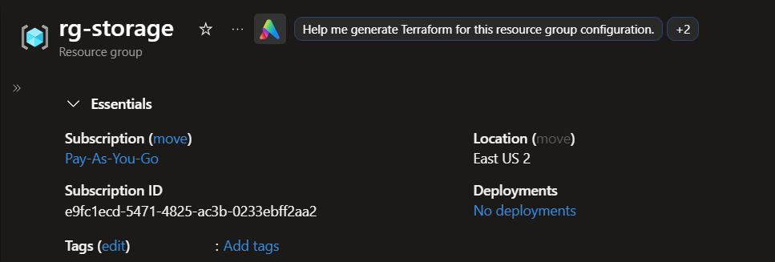

**VNet overview**

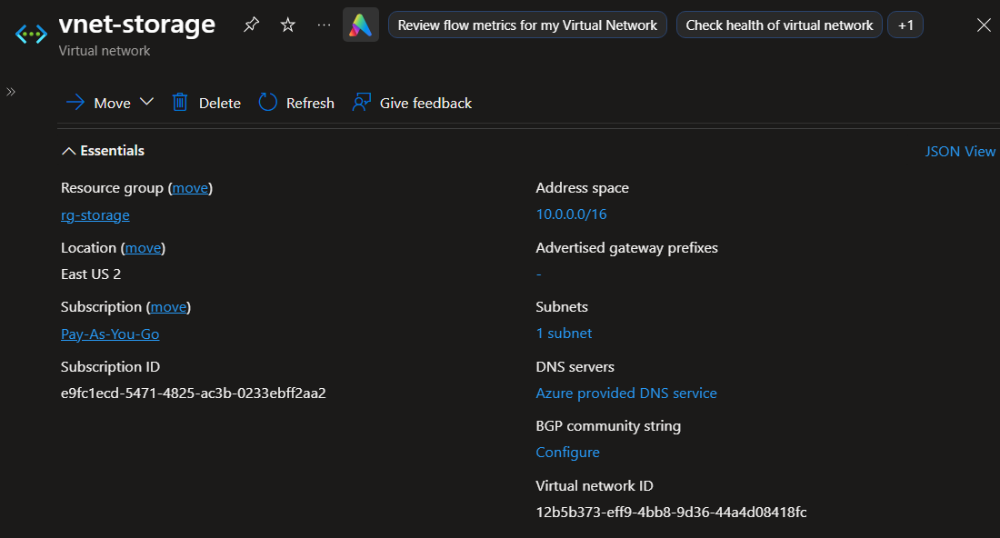

**Subnet configuration**

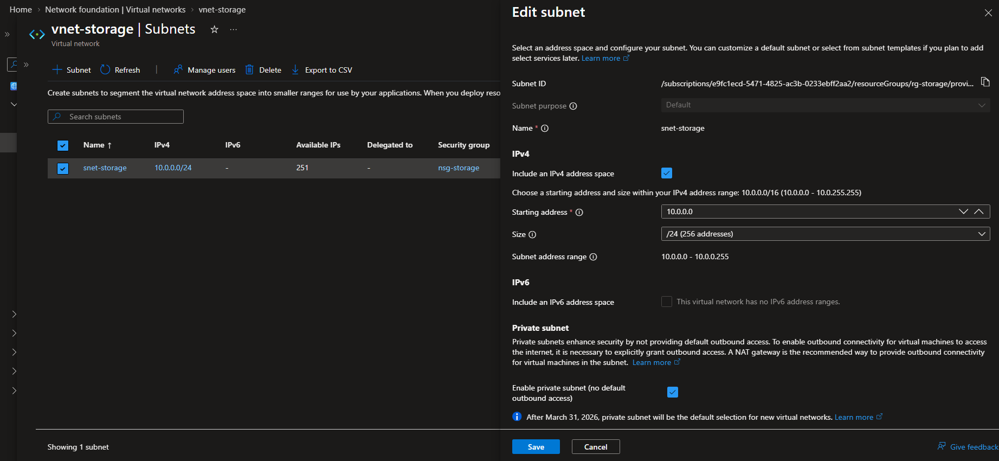


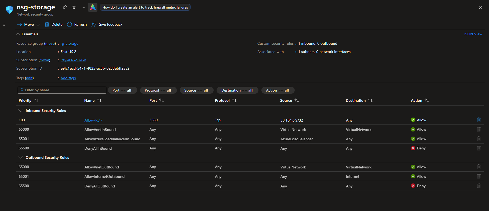

## Windows client VM

`vm-windows` runs Windows Server 2022 in `snet-storage`. It uses private IP `10.0.0.4` and a public IP for RDP administration. That public IP is only for managing the VM. Access to the Storage Account is controlled separately.

The VM is used to test private DNS resolution, Blob operations, and Azure Files access over SMB. Its deployment script retrieves the subnet, creates the public IP and NIC, and adds them to the VM configuration:

```powershell
$VirtualNetwork = Get-AzVirtualNetwork -Name $VirtualNetworkName -ResourceGroupName $ResourceGroupName
$Subnet = $VirtualNetwork.Subnets | Where-Object Name -eq $SubnetName

$PublicIP = New-AzPublicIpAddress -Name $PublicIPName -ResourceGroupName $ResourceGroupName -Location $Location -AllocationMethod Static

$NetworkInterface = New-AzNetworkInterface -Name $NetworkInterfaceName -ResourceGroupName $ResourceGroupName -Location $Location -PrivateIpAddress '10.0.0.4' -Subnet $Subnet -PublicIpAddress $PublicIP
```

The deployment collects local administrator credentials at runtime with `Get-Credential` and enables Microsoft-managed Boot Diagnostics. A separate script enables the VM's system-assigned managed identity for Blob data access.

**Scripts:** [Create Windows VM](Scripts/04-Create-WindowsVM.ps1) · [Configure VM managed identity](Scripts/05-Configure-VMIdentity.ps1)

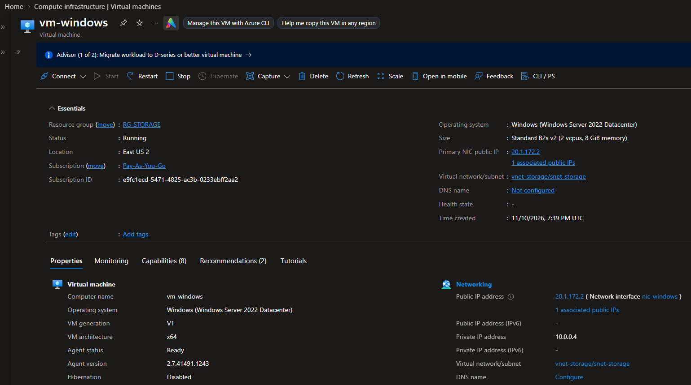

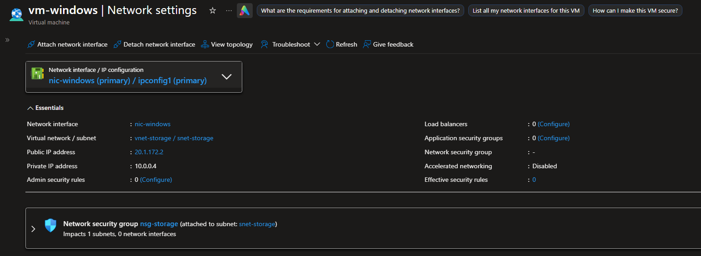

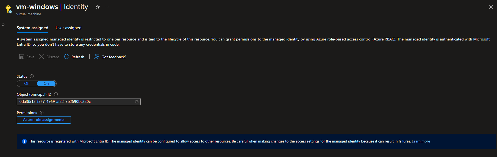

## Storage Account, Blob Storage, and Azure Files

The Storage Account `storagehm2k` is a general-purpose v2 (`StorageV2`) account using Standard locally redundant storage (`Standard_LRS`). LRS keeps replication within the primary region.

The account hosts a Blob container and an Azure Files share:

| Resource | Name | Purpose |
|---|---|---|
| Storage Account | `storagehm2k` | Hosts Blob Storage and Azure Files |
| Blob container | `labcontainer` | Object storage and Blob data operations |
| Azure Files share | `labshare` | SMB file share |

The Storage Account is created with `New-AzStorageAccount`:

```powershell
New-AzStorageAccount -Name $StorageAccountName -ResourceGroupName $ResourceGroupName -Location $Location -Kind StorageV2 -SkuName Standard_LRS
```

The Blob container is created with a Storage context that uses the signed-in Entra ID account:

```powershell
$Context = New-AzStorageContext -StorageAccountName $StorageAccountName -UseConnectedAccount

New-AzStorageContainer -Name $ContainerName -Context $Context
```

The Azure Files share is created with a Storage Account key:

```powershell
$StorageAccountKey = (Get-AzStorageAccountKey -Name $StorageAccountName -ResourceGroupName $ResourceGroupName | Where-Object KeyName -eq 'key1').Value

$Context = New-AzStorageContext -StorageAccountName $StorageAccountName -StorageAccountKey $StorageAccountKey

New-AzStorageShare -Name $ShareName -Context $Context
```

**Scripts:** [Create Storage Account](Scripts/06-Create-StorageAccount.ps1) · [Create Blob container](Scripts/07-Create-BlobContainer.ps1) · [Create Azure Files share](Scripts/08-Create-AzureFilesShare.ps1)

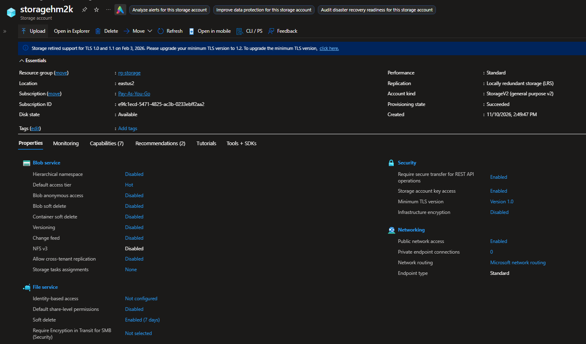


**Blob container**

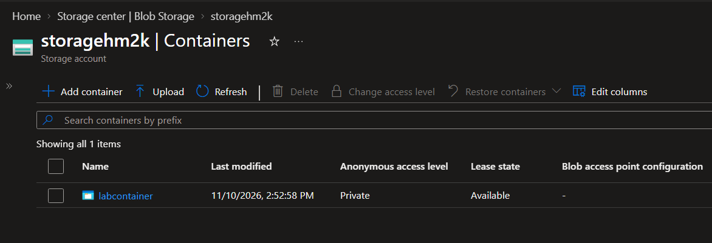

**Azure Files share**

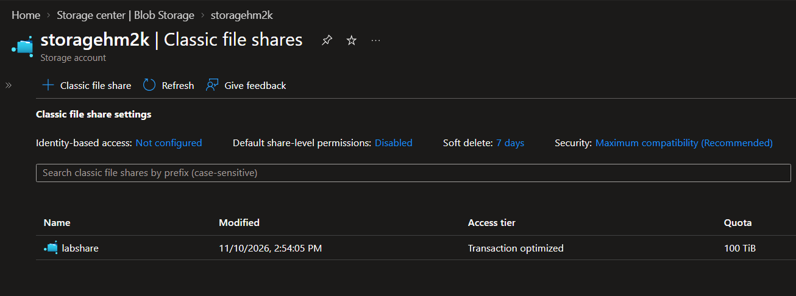


## Blob authorization with Microsoft Entra ID

Blob data access uses Microsoft Entra ID rather than a Storage Account key. The VM's system-assigned managed identity and the signed-in Entra ID user are both assigned the `Storage Blob Data Contributor` role at the scope of `labcontainer`.

The role assignment uses the container resource ID as its scope:

```powershell
$StorageAccount = Get-AzStorageAccount -Name $StorageAccountName -ResourceGroupName $ResourceGroupName

$Scope = "$($StorageAccount.Id)/blobServices/default/containers/$ContainerName"

New-AzRoleAssignment -RoleDefinitionName $RoleDefinitionName -ObjectId $VirtualMachine.Identity.PrincipalId -Scope $Scope
New-AzRoleAssignment -RoleDefinitionName $RoleDefinitionName -ObjectId $User.Id -Scope $Scope
```

Assigning the role at the container scope limits these data-plane permissions to the container instead of the entire Storage Account. The VM identity can access Blob data without storing a long-lived account key in its configuration. Access tests also show a permitted client and a public IP blocked by the Storage firewall during the service endpoint exercise.

**Script:** [Configure Blob RBAC](Scripts/09-Configure-BlobRBAC.ps1)

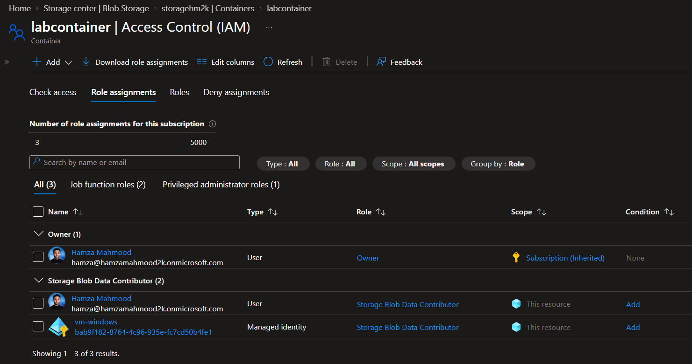


**Authorized Blob access from laptop**

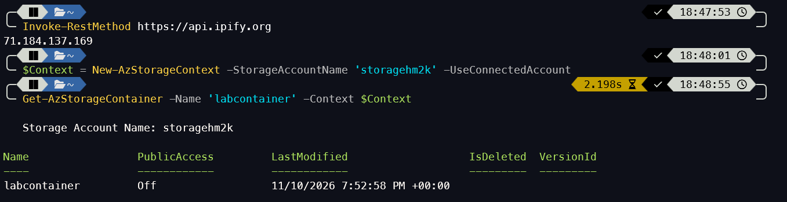

**Blob access denied from an unapproved public IP**

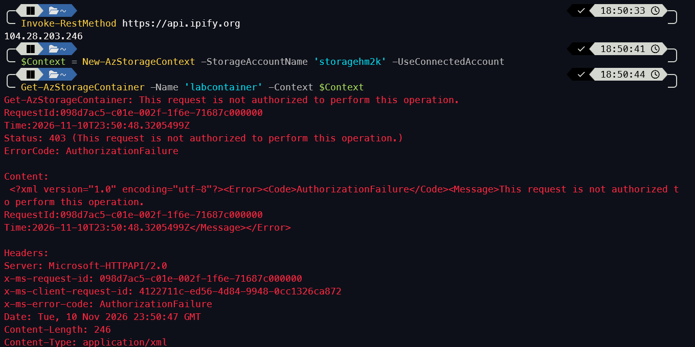


## Storage firewall and service endpoint

Before setting up Private Link, a `Microsoft.Storage` service endpoint is configured on `snet-storage` and the subnet is added to the Storage Account firewall. This demonstrates subnet-based access through Storage virtual network rules.

The script enables the service endpoint, adds the subnet and administrator's public IP to the Storage Account network rules, and sets the default network action to `Deny`:

```powershell
Set-AzVirtualNetworkSubnetConfig -Name $Subnet.Name -VirtualNetwork $VirtualNetwork -AddressPrefix $Subnet.AddressPrefix -NetworkSecurityGroup $Subnet.NetworkSecurityGroup -ServiceEndpoint Microsoft.Storage
Set-AzVirtualNetwork -VirtualNetwork $VirtualNetwork

Add-AzStorageAccountNetworkRule -Name $StorageAccountName -ResourceGroupName $ResourceGroupName -VirtualNetworkResourceId $Subnet.Id
Add-AzStorageAccountNetworkRule -Name $StorageAccountName -ResourceGroupName $ResourceGroupName -IPAddressOrRange "$AdminPublicIP"

Update-AzStorageAccountNetworkRuleSet -Name $StorageAccountName -ResourceGroupName $ResourceGroupName -DefaultAction Deny
```

A service endpoint does not give the Storage service a private IP in the VNet. Traffic still reaches the public Storage endpoint, and the Storage firewall allows or blocks it based on the source subnet. Private Link instead provides a private IP for the selected Storage subresource. I included the service endpoint as an earlier exercise to compare the two approaches. It is not the final access path.

**Script:** [Configure Storage service endpoint and network rules](Scripts/10-Configure-StorageServiceEndpoint.ps1)

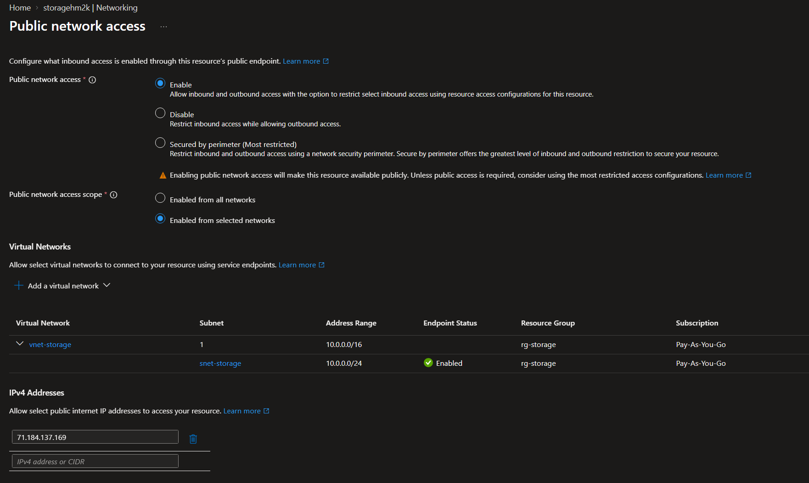

## Private DNS and Private Endpoints

Blob Storage and Azure Files use separate Private Endpoints because they are distinct Storage subresources. Each endpoint has a corresponding private DNS zone linked to `vnet-storage`.

| Storage service | Private Endpoint | Private IP | Private DNS zone |
|---|---|---|---|
| Blob | `private-endpoint-blob` | `10.0.0.5` | `privatelink.blob.core.windows.net` |
| Azure Files | `private-endpoint-files` | `10.0.0.6` | `privatelink.file.core.windows.net` |

The DNS links allow clients in the VNet to resolve the normal Storage hostnames to the private endpoint addresses. The script creates both private DNS zones and links them to the VNet:

```powershell
New-AzPrivateDnsZone -Name $BlobDNSZoneName -ResourceGroupName $ResourceGroupName
New-AzPrivateDnsZone -Name $FilesDNSZoneName -ResourceGroupName $ResourceGroupName

New-AzPrivateDnsVirtualNetworkLink -Name $BlobDNSLinkName -ZoneName $BlobDNSZoneName -VirtualNetwork $VirtualNetwork -ResourceGroupName $ResourceGroupName
New-AzPrivateDnsVirtualNetworkLink -Name $FilesDNSLinkName -ZoneName $FilesDNSZoneName -VirtualNetwork $VirtualNetwork -ResourceGroupName $ResourceGroupName
```

The Private Endpoint configurations use the `blob` and `file` group IDs and assign the private IP addresses shown above:

```powershell
$BlobConnection = New-AzPrivateLinkServiceConnection -Name $BlobConnectionName -PrivateLinkServiceId $StorageAccount.Id -GroupId blob
$FilesConnection = New-AzPrivateLinkServiceConnection -Name $FilesConnectionName -PrivateLinkServiceId $StorageAccount.Id -GroupId file

$BlobIPConfig = New-AzPrivateEndpointIpConfiguration -Name $BlobIPConfigName -GroupId blob -MemberName blob -PrivateIpAddress '10.0.0.5'
$FilesIPConfig = New-AzPrivateEndpointIpConfiguration -Name $FilesIPConfigName -GroupId file -MemberName file -PrivateIpAddress '10.0.0.6'
```

Each endpoint is associated with its DNS zone through a DNS zone group. This maintains the records that map the Storage service hostnames to the private endpoint IPs.

**Scripts:** [Create Private DNS zones and VNet links](Scripts/11-Create-PrivateDNS.ps1) · [Create Private Endpoints and DNS zone groups](Scripts/12-Create-PrivateEndpoints.ps1)

DNS lookups compare resolution before and after the Private Endpoints were created.


**DNS resolution before Private Endpoint creation**

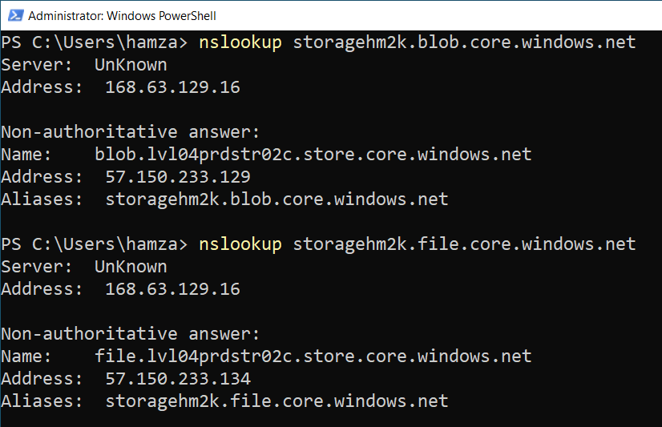

**DNS resolution after Private Endpoint creation**


The screenshots document the Private DNS zones, VNet links, and endpoint connections.


**Blob Private DNS zone**

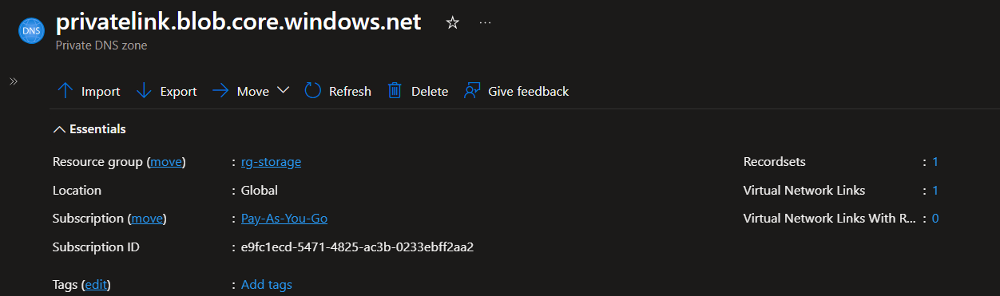

**Blob DNS VNet link**

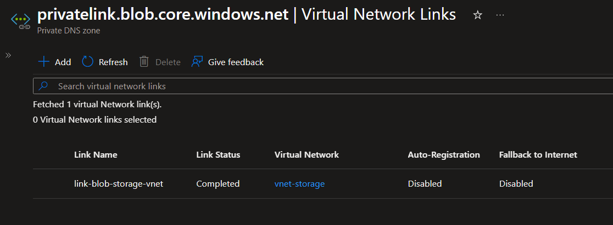

**Files Private DNS zone**

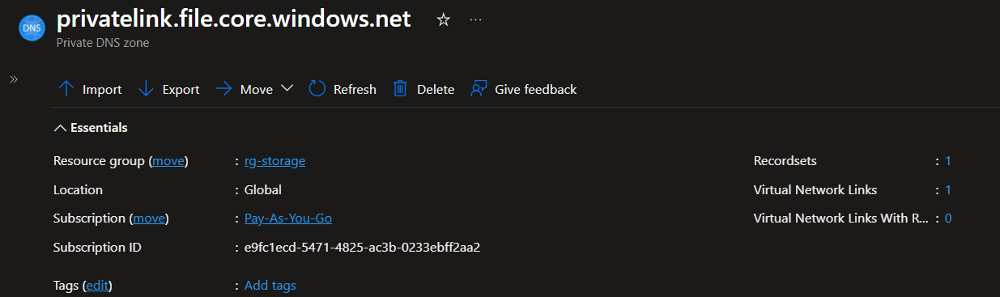

**Files DNS VNet link**

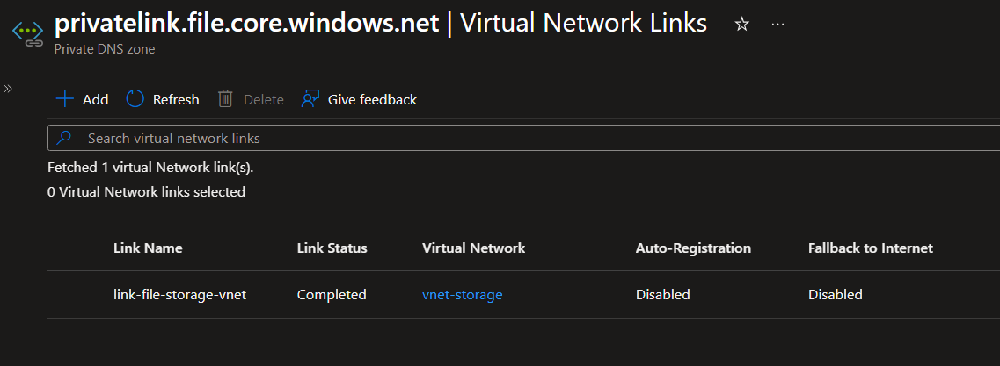


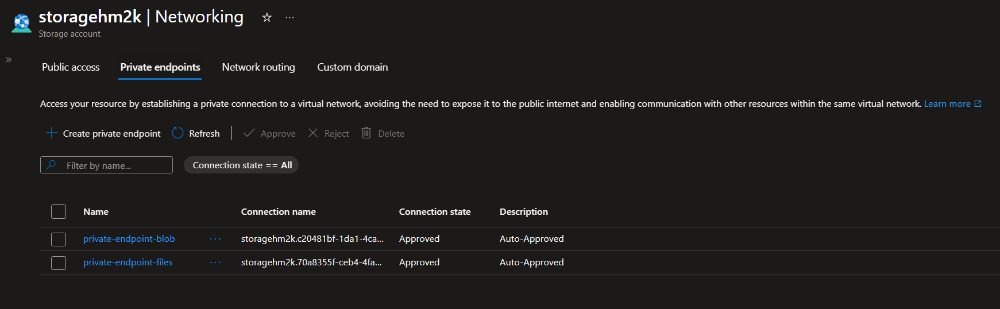


**Blob Private DNS configuration**

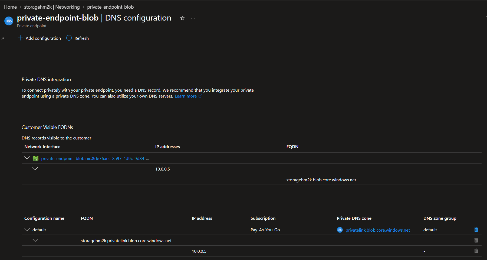

**Files Private DNS configuration**

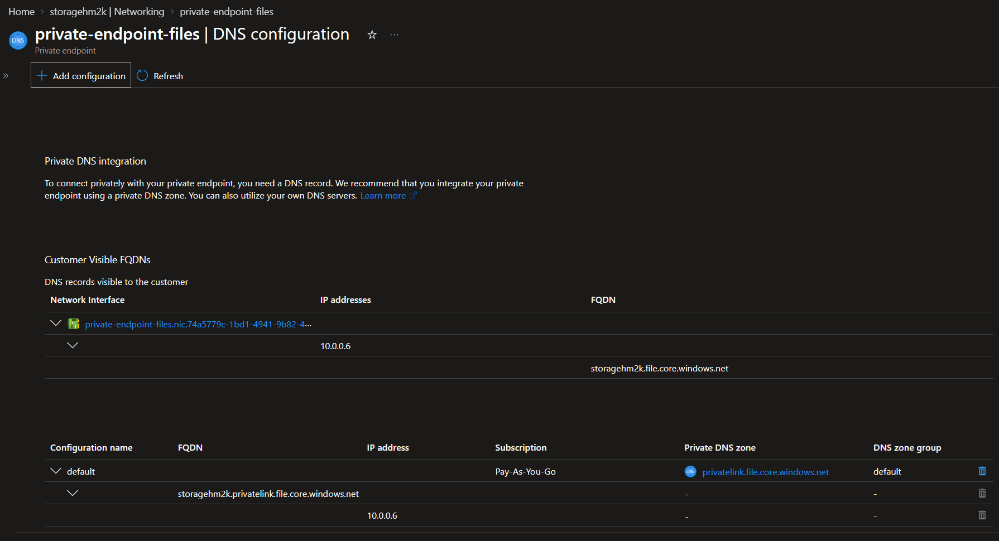


The Windows VM can resolve the Storage hostnames to the private endpoint addresses and reach the endpoints on their service ports:


## Disable public network access

After the Private Endpoints and DNS configuration are in place, public network access is disabled on `storagehm2k`:

```powershell
Set-AzStorageAccount -Name $StorageAccountName -ResourceGroupName $ResourceGroupName -PublicNetworkAccess Disabled

Get-AzStorageAccount -Name $StorageAccountName -ResourceGroupName $ResourceGroupName |
    Select-Object StorageAccountName, PublicNetworkAccess
```

This is the final network configuration. The service endpoint and firewall rules were an earlier exercise. The Storage Account now uses Private Link with public network access disabled.

**Script:** [Disable Storage Account public network access](Scripts/13-Disable-PublicAccess.ps1)

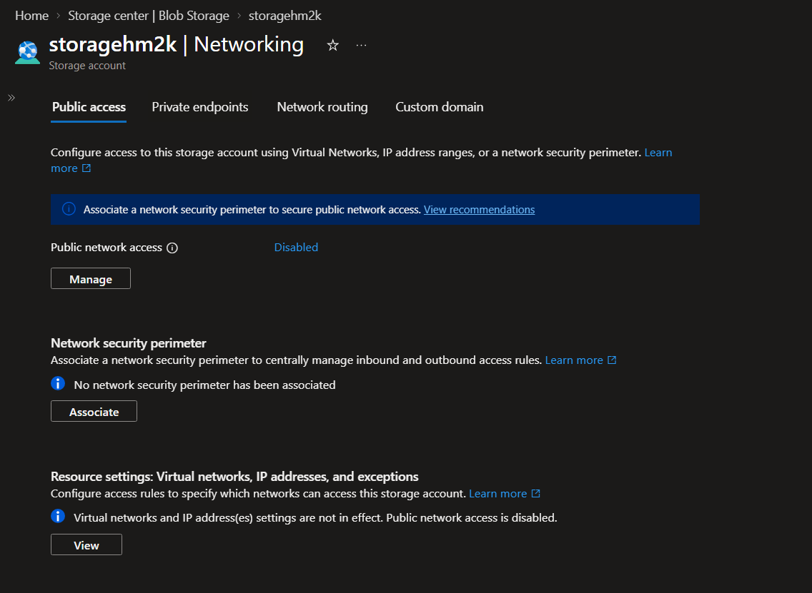

AzCopy on the Windows VM verifies Blob access through the private endpoint. From the laptop, a request to the public endpoint is blocked because public network access is disabled.


**AzCopy access from the VM through the private endpoint**

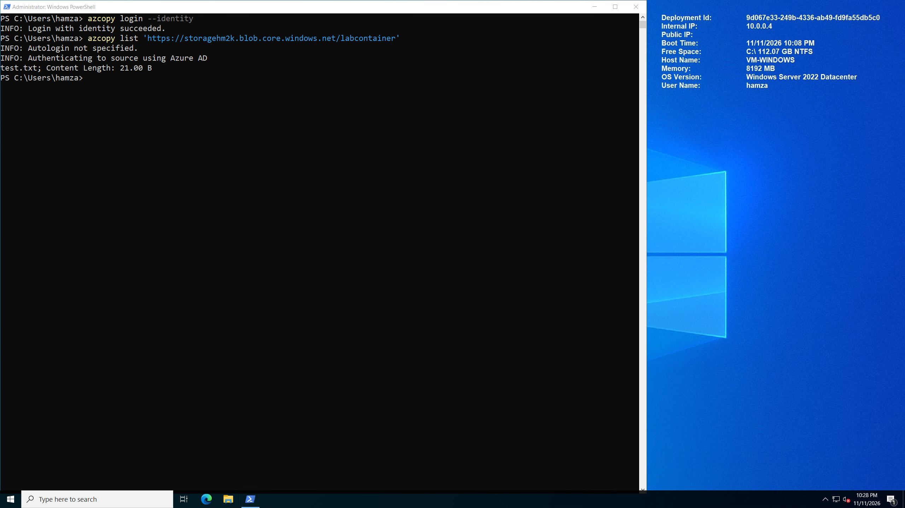

**Public endpoint access blocked from the laptop**


## Azure Files over SMB

The Windows VM connects to the Azure Files share over SMB through the Files Private Endpoint. The script prompts for the Storage Account key and maps the share as a persistent PowerShell drive:

```powershell
$StorageAccountKey = Read-Host 'Storage account key' -AsSecureString
$Credential = [PSCredential]::new("localhost\$StorageAccountName", $StorageAccountKey)

New-PSDrive -Name Z -PSProvider FileSystem -Root "\\$StorageAccountName.file.core.windows.net\$ShareName" -Credential $Credential -Persist
```

This project uses Storage Account key authentication for the SMB connection. It is separate from the Entra ID and managed identity authorization configured for Blob Storage. The Blob RBAC assignments do not provide identity-based SMB authentication.

The share is mounted from the VM and tested with basic file read and write operations.

**Additional script:** [Connect Azure Files share](Scripts/Extras/02-Connect-AzureFilesShare.ps1)


**Azure Files SMB connection**

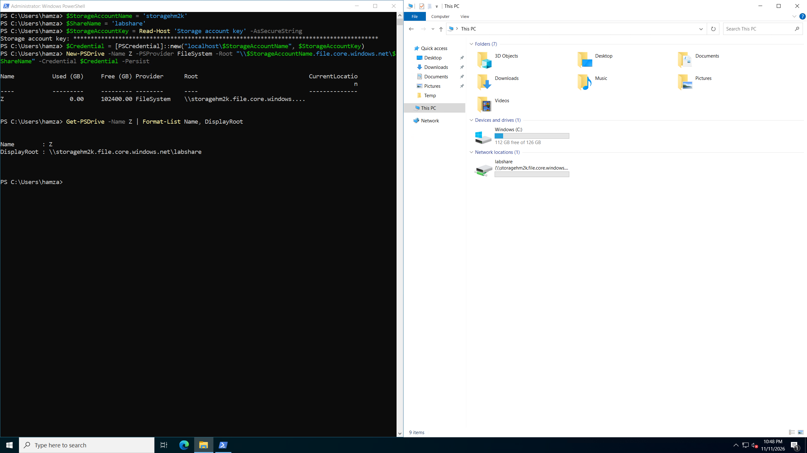

**Azure Files read and write test**


## Storage data protection

Blob versioning and seven-day soft delete are enabled for blobs, containers, and Azure Files shares. Versioning preserves earlier blob versions when a blob is overwritten, while soft delete allows deleted data to be recovered during the retention period.

```powershell
Update-AzStorageBlobServiceProperty -StorageAccountName $StorageAccountName -ResourceGroupName $ResourceGroupName -IsVersioningEnabled $true

Enable-AzStorageBlobDeleteRetentionPolicy -StorageAccountName $StorageAccountName -ResourceGroupName $ResourceGroupName -RetentionDays 7
Enable-AzStorageContainerDeleteRetentionPolicy -StorageAccountName $StorageAccountName -ResourceGroupName $ResourceGroupName -RetentionDays 7

Update-AzStorageFileServiceProperty -StorageAccountName $StorageAccountName -ResourceGroupName $ResourceGroupName -EnableShareDeleteRetentionPolicy $true -ShareRetentionDays 7
```

The service properties are queried after configuration to verify the versioning and retention settings.

**Script:** [Configure Storage data protection](Scripts/14-Configure-StorageProtection.ps1)

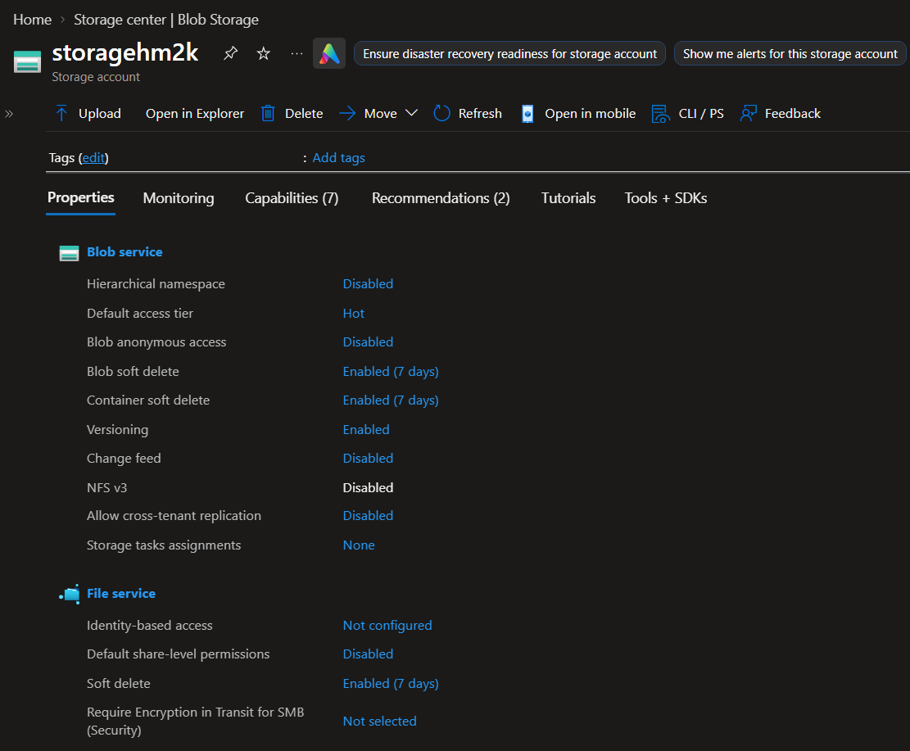

### Recovery tests

Recovery tests cover previous Blob versions, deleted blobs, deleted containers, and deleted Azure Files shares.

**Blob versioning**


**Blob version history**

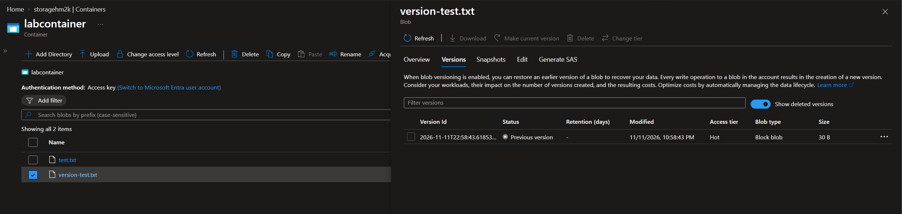

**Blob version restoration**


**Blob soft delete**


**Blob soft delete**

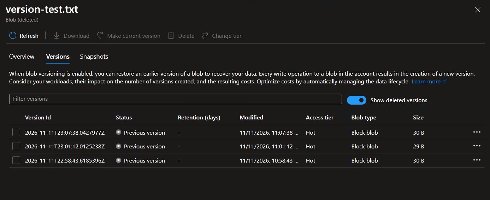

**Blob soft delete restoration**

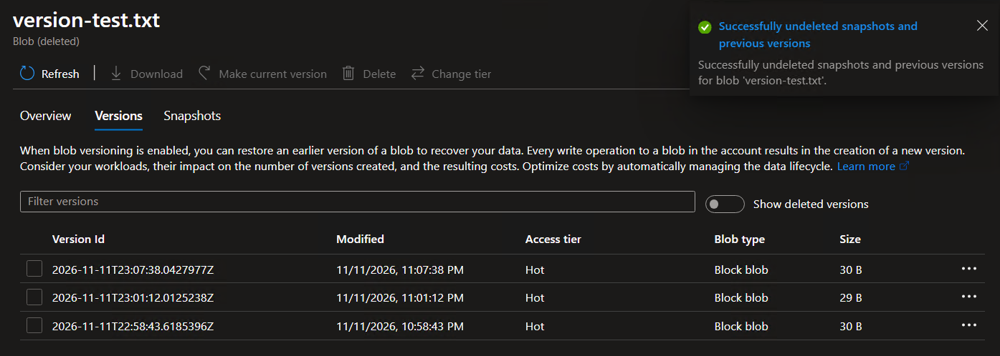


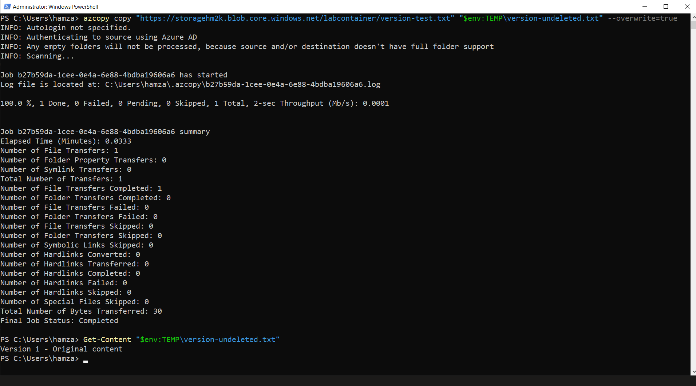

**Container soft delete**


**Deleted container**


**Container restoration**


**Azure Files share soft delete**


**Deleted Azure Files share**

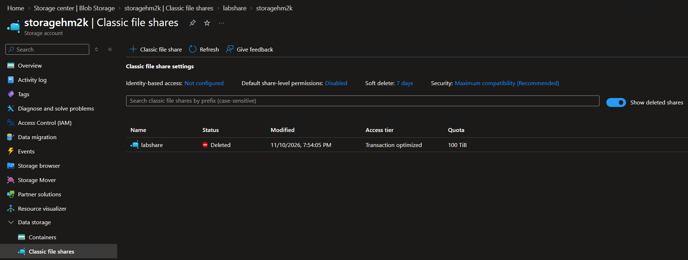

**Azure Files share restoration**

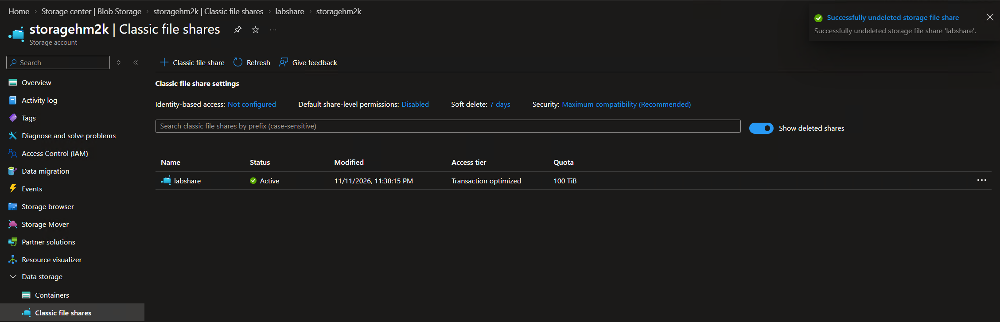


## Additional scripts

The `Extras/` directory contains two additional PowerShell scripts:

- [Install AzCopy](Scripts/Extras/01-Install-AzCopy.ps1) - downloads AzCopy, installs it under `C:\Tools\AzCopy`, adds the directory to the machine PATH, and checks the installed version.
- [Connect Azure Files share](Scripts/Extras/02-Connect-AzureFilesShare.ps1) - maps `labshare` as a persistent PowerShell drive using the Storage Account key.

## Project files

- `Architecture/` - architecture diagram and exported PNG/SVG versions.
- `Scripts/` - Azure PowerShell deployment and configuration scripts.
- `Scripts/Extras/` - additional PowerShell scripts for installing AzCopy and connecting to the Azure Files share.
- `Screenshots/` - Azure configuration, connectivity tests, storage operations, and recovery evidence.