# 4. Azure Storage & Private Connectivity

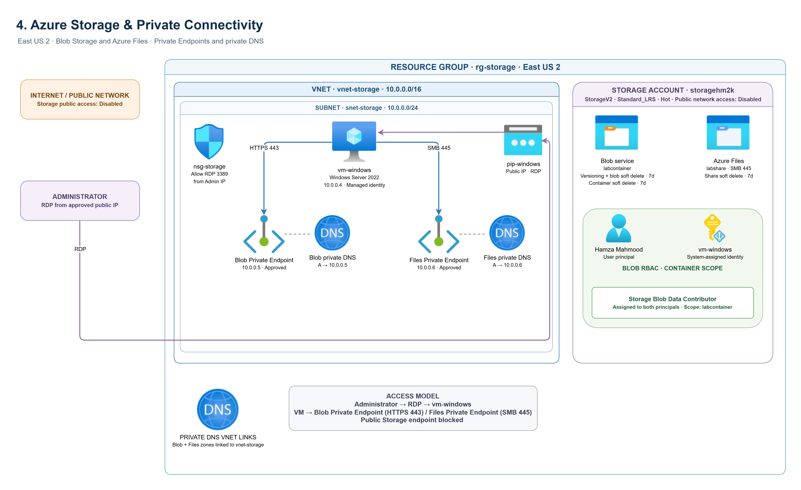

## Overview

This project deploys Azure Blob Storage and Azure Files with restricted network access. It uses Entra ID and managed identity for Blob authorization, Private Endpoints for private connectivity, and SMB for Azure Files access. Blob versioning and soft delete are configured and tested for data recovery.

A Windows Server 2022 VM is deployed in the project network and used to validate private connectivity, Blob access, and Azure Files over SMB.

Resources are deployed in East US 2 in `rg-storage`. The final configuration uses Private Endpoints for Blob Storage and Azure Files, with public network access disabled on the Storage Account.

## Network layout

| Component | Name | Address range / IP |
|---|---|---|
| Virtual network | `vnet-storage` | `10.0.0.0/16` |
| Subnet | `snet-storage` | `10.0.0.0/24` |
| Network security group | `nsg-storage` | Associated with `snet-storage` |
| Test VM | `vm-windows` | `10.0.0.4` |
| Blob Private Endpoint | `private-endpoint-blob` | `10.0.0.5` |
| Files Private Endpoint | `private-endpoint-files` | `10.0.0.6` |

The VNet uses `10.0.0.0/16`. The `snet-storage` subnet uses `10.0.0.0/24`:

```powershell
$Subnet = New-AzVirtualNetworkSubnetConfig -Name $SubnetName -AddressPrefix $SubnetAddressPrefix
New-AzVirtualNetwork -Name $VirtualNetworkName -ResourceGroupName $ResourceGroupName -Location $Location -AddressPrefix $VirtualNetworkAddressPrefix -Subnet $Subnet
```

**Scripts:** [Create resource group](Scripts/01-Create-ResourceGroup.ps1) · [Create network](Scripts/02-Create-Network.ps1)

**Screenshots:** [Resource group](Screenshots/01-Resource-Group-Overview.png) · [VNet overview](Screenshots/02-VNet-Overview.png) · [Subnet configuration](Screenshots/03-Subnet-Configuration.png)

## Network security

`nsg-storage` is associated with `snet-storage`. RDP is allowed only from my public IPv4 address. The script retrieves it at runtime and uses a `/32` source range:

```powershell
$AdminPublicIP = Invoke-RestMethod https://api.ipify.org

$Rule = New-AzNetworkSecurityRuleConfig -Name 'Allow-RDP' -Priority 100 -Protocol Tcp -SourceAddressPrefix "$AdminPublicIP/32" -SourcePortRange * -DestinationAddressPrefix * -DestinationPortRange 3389 -Access Allow -Direction Inbound
$NSG = New-AzNetworkSecurityGroup -Name $NSGName -ResourceGroupName $ResourceGroupName -Location $Location -SecurityRules $Rule
```

The NSG is then attached to `snet-storage`:

```powershell
Set-AzVirtualNetworkSubnetConfig -Name $SubnetName -VirtualNetwork $VirtualNetwork -AddressPrefix $Subnet.AddressPrefix -NetworkSecurityGroup $NSG
Set-AzVirtualNetwork -VirtualNetwork $VirtualNetwork
```

**Script:** [Create NSG](Scripts/03-Create-NSG.ps1)

**Screenshot:** [NSG rules](Screenshots/04-NSG-Rules.png)

## Test VM

`vm-windows` runs Windows Server 2022 on a `Standard_B2s_v2` size. It has private IP `10.0.0.4` and a static public IP for RDP. Inbound RDP is restricted to my current public IPv4 address. The VM also has a system-assigned managed identity for Blob access.

The VM deployment creates its public IP and network interface, then configures the operating system and disk:

```powershell
$PublicIP = New-AzPublicIpAddress -Name $PublicIPName -ResourceGroupName $ResourceGroupName -Location $Location -AllocationMethod Static
$NetworkInterface = New-AzNetworkInterface -Name $NetworkInterfaceName -ResourceGroupName $ResourceGroupName -Location $Location -PrivateIpAddress '10.0.0.4' -Subnet $Subnet -PublicIpAddress $PublicIP

$VMConfig = New-AzVMConfig -VMName $VMName -VMSize $VMSize
Set-AzVMOperatingSystem -VM $VMConfig -ComputerName $VMName -Credential $Credential -Windows
Set-AzVMSourceImage -VM $VMConfig -PublisherName $Publisher -Offer $Offer -Skus $SKU -Version $Version
Set-AzVMOSDisk -VM $VMConfig -Name $OSDiskName -StorageAccountType StandardSSD_LRS -CreateOption FromImage
Add-AzVMNetworkInterface -VM $VMConfig -Id $NetworkInterface.Id

New-AzVM -VM $VMConfig -ResourceGroupName $ResourceGroupName -Location $Location
```

**Scripts:** [Create Windows VM](Scripts/04-Create-WindowsVM.ps1) · [Configure managed identity](Scripts/05-Configure-VMIdentity.ps1)

**Screenshots:** [VM overview](Screenshots/05-Windows-VM-Overview.png) · [VM networking](Screenshots/06-Windows-VM-Networking.png) · [VM managed identity](Screenshots/07-VM-Managed-Identity.png)


## Storage Account, Blob Storage, and Azure Files

`storagehm2k` is a general-purpose v2 (`StorageV2`) account with Standard locally redundant storage (`Standard_LRS`). Data is replicated within the primary region.

The account contains the `labcontainer` Blob container and the `labshare` Azure Files share:

| Resource | Name | Purpose |
|---|---|---|
| Storage Account | `storagehm2k` | Hosts Blob Storage and Azure Files |
| Blob container | `labcontainer` | Object storage and Blob data operations |
| Azure Files share | `labshare` | SMB file share |

The Storage Account is configured as `StorageV2` with `Standard_LRS` replication:

```powershell
New-AzStorageAccount -Name $StorageAccountName -ResourceGroupName $ResourceGroupName -Location $Location -Kind StorageV2 -SkuName Standard_LRS
```

The `labcontainer` container is created using my Entra ID user. The last command checks that it was created:

```powershell
$Context = New-AzStorageContext -StorageAccountName $StorageAccountName -UseConnectedAccount

New-AzStorageContainer -Name $ContainerName -Context $Context

Get-AzStorageContainer -Name $ContainerName -Context $Context
```

Azure Files is configured separately. The share is created using a Storage context authenticated with a Storage Account key:

```powershell
$StorageAccountKey = (Get-AzStorageAccountKey -Name $StorageAccountName -ResourceGroupName $ResourceGroupName | Where-Object KeyName -eq 'key1').Value

$Context = New-AzStorageContext -StorageAccountName $StorageAccountName -StorageAccountKey $StorageAccountKey

New-AzStorageShare -Name $ShareName -Context $Context
```

**Scripts:** [Create Storage Account](Scripts/06-Create-StorageAccount.ps1) · [Create Blob container](Scripts/07-Create-BlobContainer.ps1) · [Create Azure Files share](Scripts/08-Create-AzureFilesShare.ps1)

**Screenshots:** [Storage Account overview](Screenshots/08-Storage-Account-Overview.png) · [Blob container](Screenshots/09-Blob-Container.png) · [Azure Files share](Screenshots/10-Azure-Files-Share.png)


## Blob authorization with Microsoft Entra ID

Blob access uses Microsoft Entra ID. The `Storage Blob Data Contributor` role is assigned at the `labcontainer` scope to the VM's system-assigned managed identity and my Entra ID user.

The script gets my Entra ID user from the Az context. It then assigns the role to my user account and the VM identity:

```powershell
$VirtualMachine = Get-AzVM -Name $VirtualMachineName -ResourceGroupName $ResourceGroupName

$UserContext = Get-AzContext
$User = Get-AzADUser -UserPrincipalName $UserContext.Account.Id

$Scope = "$((Get-AzStorageAccount -Name $StorageAccountName -ResourceGroupName $ResourceGroupName).Id)/blobServices/default/containers/$ContainerName"

New-AzRoleAssignment -RoleDefinitionName $RoleDefinitionName -ObjectId $VirtualMachine.Identity.PrincipalId -Scope $Scope
New-AzRoleAssignment -RoleDefinitionName $RoleDefinitionName -ObjectId $User.Id -Scope $Scope
```

Both role assignments are scoped to `labcontainer`. The VM accesses Blob Storage through its managed identity, and my Entra ID user can access the same container.

**Script:** [Configure Blob RBAC](Scripts/09-Configure-BlobRBAC.ps1)

**Screenshot:** [Blob RBAC assignments](Screenshots/11-Blob-RBAC-Assignments.png)

The Storage Account firewall was tested from two public IP addresses. Requests from the approved address succeed while requests from an address outside the allowlist are blocked.

### Blob request from an approved public IP

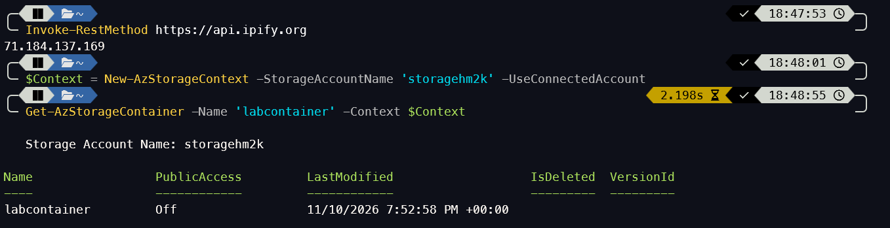

The firewall allows the approved IP address. The container-level RBAC assignment gives my Entra ID user permission to access Blob data.

### Blob request from an unapproved public IP

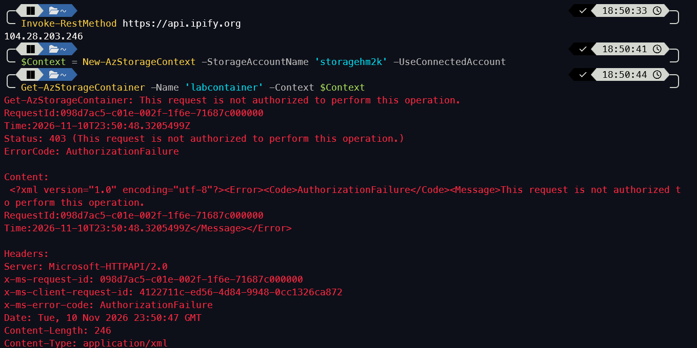

The Storage Account firewall blocks the request because the source IPv4 address is not allowlisted. Blob RBAC does not override the network rule.


## Storage firewall and service endpoint

Before implementing Private Link, a `Microsoft.Storage` service endpoint was configured on `snet-storage`, and the subnet and my public IPv4 address were added to the Storage Account firewall. The default network action is `Deny`.

The script enables the service endpoint, adds the subnet and my public IPv4 address to the firewall, and sets the default action to `Deny`:

```powershell
Set-AzVirtualNetworkSubnetConfig -Name $Subnet.Name -VirtualNetwork $VirtualNetwork -AddressPrefix $Subnet.AddressPrefix -NetworkSecurityGroup $Subnet.NetworkSecurityGroup -ServiceEndpoint Microsoft.Storage
Set-AzVirtualNetwork -VirtualNetwork $VirtualNetwork

Add-AzStorageAccountNetworkRule -Name $StorageAccountName -ResourceGroupName $ResourceGroupName -VirtualNetworkResourceId $Subnet.Id
Add-AzStorageAccountNetworkRule -Name $StorageAccountName -ResourceGroupName $ResourceGroupName -IPAddressOrRange $AdminPublicIP

Update-AzStorageAccountNetworkRuleSet -Name $StorageAccountName -ResourceGroupName $ResourceGroupName -DefaultAction Deny
```

A service endpoint allows the subnet to reach the public Storage endpoint. It does not assign a private IP. Private Link uses a private IP for each Storage subresource. The service endpoint was tested first, but is not part of the final configuration.

**Script:** [Configure Storage service endpoint and network rules](Scripts/10-Configure-StorageServiceEndpoint.ps1)

### Service endpoint and Storage firewall configuration

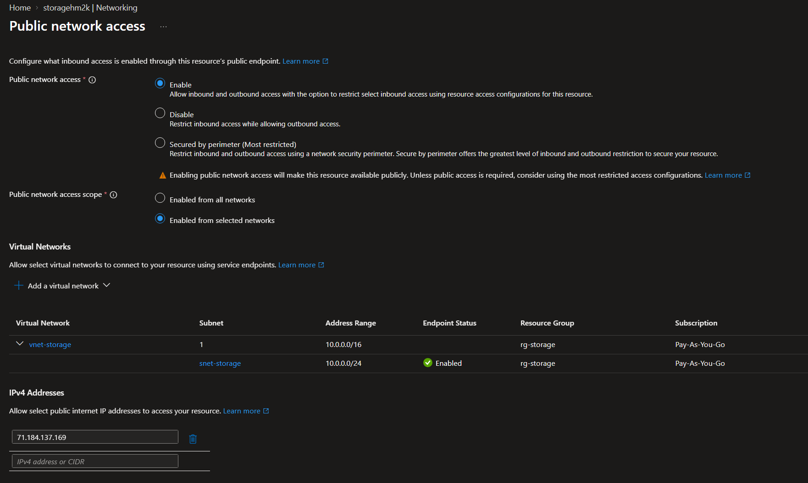

The service endpoint and firewall rules limit access to the configured subnet and my public IPv4 address. This configuration was used before switching to Private Link.

## Private DNS and Private Endpoints

Blob Storage and Azure Files each have a Private Endpoint and private DNS zone. Both zones are linked to `vnet-storage`.

| Storage service | Private Endpoint | Private IP | Private DNS zone |
|---|---|---|---|
| Blob | `private-endpoint-blob` | `10.0.0.5` | `privatelink.blob.core.windows.net` |
| Azure Files | `private-endpoint-files` | `10.0.0.6` | `privatelink.file.core.windows.net` |

Both zones are linked to `vnet-storage`. Clients use the normal Storage hostnames. Inside the VNet, DNS resolves them to the Private Endpoint IPs: `10.0.0.5` for Blob and `10.0.0.6` for Azure Files.

The DNS script creates one private DNS zone for each Storage subresource and links both zones to the VNet:

```powershell
New-AzPrivateDnsZone -Name $BlobDNSZoneName -ResourceGroupName $ResourceGroupName
New-AzPrivateDnsZone -Name $FilesDNSZoneName -ResourceGroupName $ResourceGroupName

New-AzPrivateDnsVirtualNetworkLink -Name $BlobDNSLinkName -ZoneName $BlobDNSZoneName -VirtualNetwork $VirtualNetwork -ResourceGroupName $ResourceGroupName
New-AzPrivateDnsVirtualNetworkLink -Name $FilesDNSLinkName -ZoneName $FilesDNSZoneName -VirtualNetwork $VirtualNetwork -ResourceGroupName $ResourceGroupName
```

The endpoint script creates a connection and private IP configuration for each subresource. It then creates the Private Endpoints and their DNS zone groups:

```powershell
$BlobConnection = New-AzPrivateLinkServiceConnection -Name $BlobConnectionName -PrivateLinkServiceId $StorageAccount.Id -GroupId blob
$FilesConnection = New-AzPrivateLinkServiceConnection -Name $FilesConnectionName -PrivateLinkServiceId $StorageAccount.Id -GroupId file

$BlobIPConfig = New-AzPrivateEndpointIpConfiguration -Name $BlobIPConfigName -GroupId blob -MemberName blob -PrivateIpAddress '10.0.0.5'
$FilesIPConfig = New-AzPrivateEndpointIpConfiguration -Name $FilesIPConfigName -GroupId file -MemberName file -PrivateIpAddress '10.0.0.6'

New-AzPrivateEndpoint -Name $BlobEndpointName -ResourceGroupName $ResourceGroupName -Location $Location -Subnet $Subnet -PrivateLinkServiceConnection $BlobConnection -IpConfiguration $BlobIPConfig
New-AzPrivateEndpoint -Name $FilesEndpointName -ResourceGroupName $ResourceGroupName -Location $Location -Subnet $Subnet -PrivateLinkServiceConnection $FilesConnection -IpConfiguration $FilesIPConfig

New-AzPrivateDnsZoneGroup -Name default -ResourceGroupName $ResourceGroupName -PrivateEndpointName $BlobEndpointName -PrivateDnsZoneConfig $BlobDNSConfig
New-AzPrivateDnsZoneGroup -Name default -ResourceGroupName $ResourceGroupName -PrivateEndpointName $FilesEndpointName -PrivateDnsZoneConfig $FilesDNSConfig
```

Each endpoint has a DNS zone group. Azure manages the records that point the Storage hostnames to the endpoint IPs.

**Scripts:** [Create Private DNS zones and VNet links](Scripts/11-Create-PrivateDNS.ps1) · [Create Private Endpoints and DNS zone groups](Scripts/12-Create-PrivateEndpoints.ps1)

DNS resolution was checked from the test VM before and after the Private Endpoints were created. Before deployment, the Storage hostnames resolve to public addresses. After deployment, they resolve through their `privatelink` names to the Private Endpoint IPs.

### DNS resolution before Private Endpoint deployment

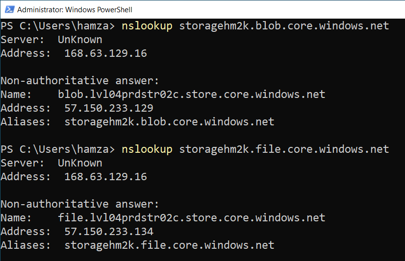

Before Private Endpoint deployment, the standard Storage hostnames resolve to public addresses.

### DNS resolution after Private Endpoint deployment

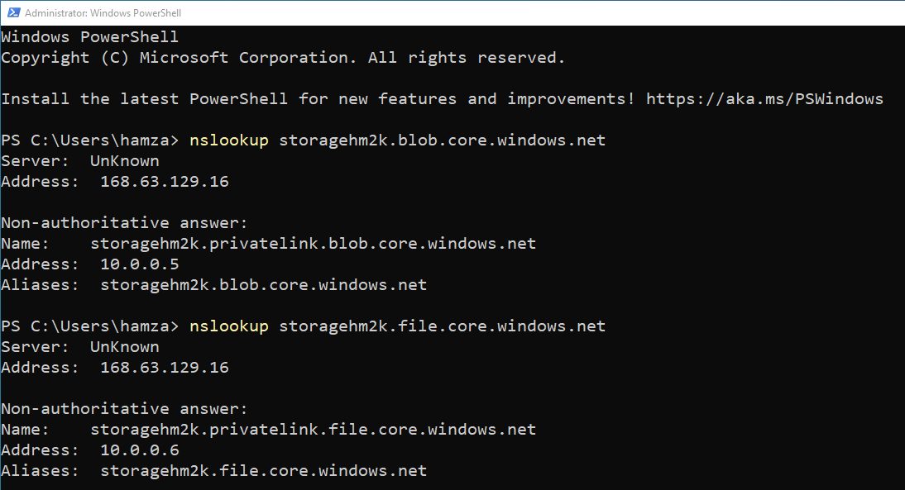

After deployment, the standard hostnames resolve through the `privatelink` zones to `10.0.0.5` for Blob and `10.0.0.6` for Azure Files.

Additional configuration screenshots: [Blob Private DNS zone](Screenshots/19.1-Blob-Private-DNS-Zone.png) · [Blob DNS VNet link](Screenshots/19.2-Blob-DNS-VNet-Link.png) · [Files Private DNS zone](Screenshots/19.3-Files-Private-DNS-Zone.png) · [Files DNS VNet link](Screenshots/19.4-Files-DNS-VNet-Link.png) · [Private Endpoint connections](Screenshots/20-Private-Endpoint-Connections.png) · [Blob Private DNS configuration](Screenshots/21.1-Blob-Private-DNS-Configuration.png) · [Files Private DNS configuration](Screenshots/21.2-Files-Private-DNS-Configuration.png)

### Private Endpoint service-port connectivity

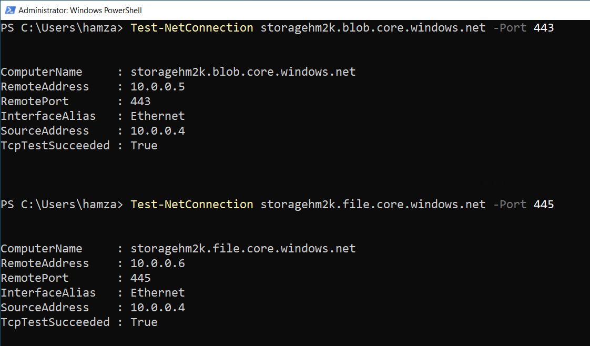

The test VM connects to TCP 443 on the Blob endpoint and TCP 445 on the Files endpoint.

## Disable public network access

After validating the Private Endpoints and DNS resolution, public network access was disabled on `storagehm2k`:

```powershell
Set-AzStorageAccount -Name $StorageAccountName -ResourceGroupName $ResourceGroupName -PublicNetworkAccess Disabled
```

Private Link is now the Storage Account's access path. The earlier service endpoint and firewall rules are no longer used. Public network access is disabled.

**Script:** [Disable Storage Account public network access](Scripts/13-Disable-PublicAccess.ps1)

### Storage Account public network access disabled

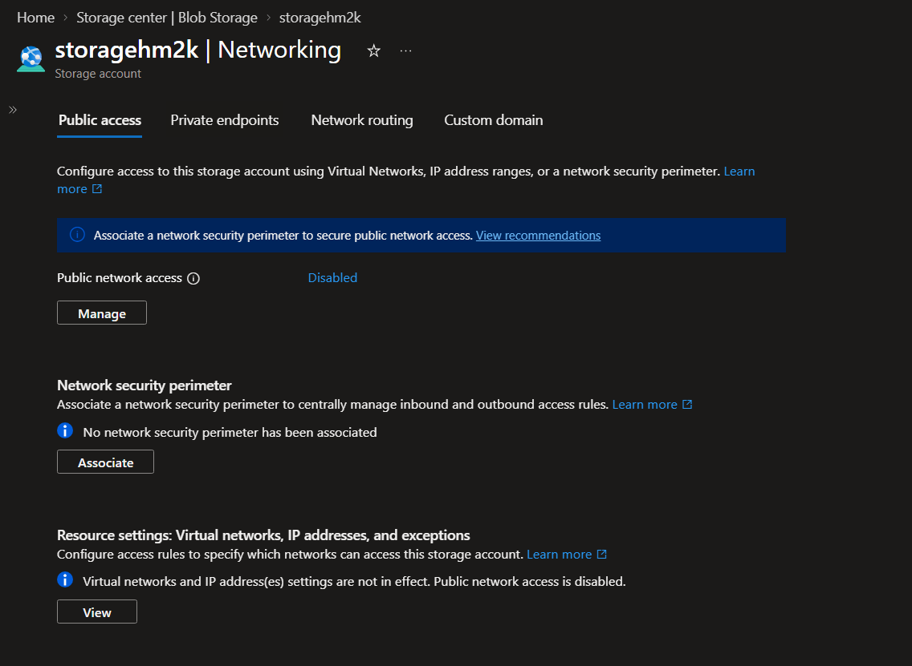

AzCopy was used to test the final configuration. From the test VM, the Blob hostname resolves through the `privatelink` CNAME to `10.0.0.5`. The transfer succeeds through the Private Endpoint. Requests from my laptop to the public endpoint are blocked.

### AzCopy transfer through the Blob Private Endpoint

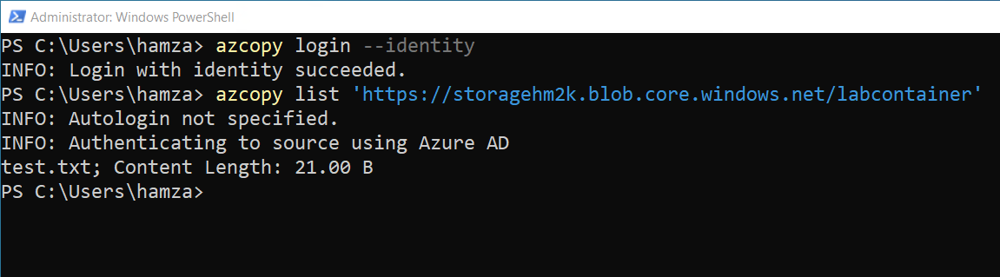

This confirms that private DNS resolution, endpoint connectivity, and Blob authentication are working.

### Public endpoint access blocked from my laptop

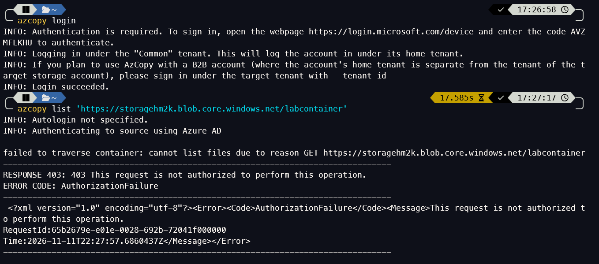

My laptop resolves the public endpoint instead of the private endpoint. With public network access disabled, the connection fails.

## Azure Files over SMB

The test VM connects to `labshare` over SMB through the Files Private Endpoint. The script prompts for the Storage Account key before mapping the share as a persistent PowerShell drive:

```powershell
$StorageAccountKey = Read-Host 'Storage account key' -AsSecureString

$Credential = [PSCredential]::new("localhost\$StorageAccountName", $StorageAccountKey)

New-PSDrive -Name Z -PSProvider FileSystem -Root "\\$StorageAccountName.file.core.windows.net\$ShareName" -Credential $Credential -Persist
```

Azure Files uses the Storage Account key for SMB authentication. Blob access uses Entra ID and managed identity instead. The Blob RBAC assignments do not provide SMB authentication.

The UNC path uses `storagehm2k.file.core.windows.net`. Private DNS resolves it to `10.0.0.6` through `privatelink.file.core.windows.net`. SMB traffic therefore uses the Files Private Endpoint.

**Additional script:** [Connect Azure Files share](Scripts/Extras/02-Connect-AzureFilesShare.ps1)


### Azure Files SMB connection

The mapped drive accesses `labshare` through the Files Private Endpoint using the Storage Account key.

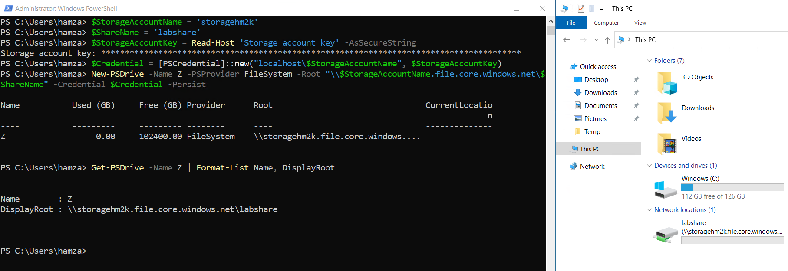

### Azure Files read and write validation

The mapped share is tested with a file write followed by a read.

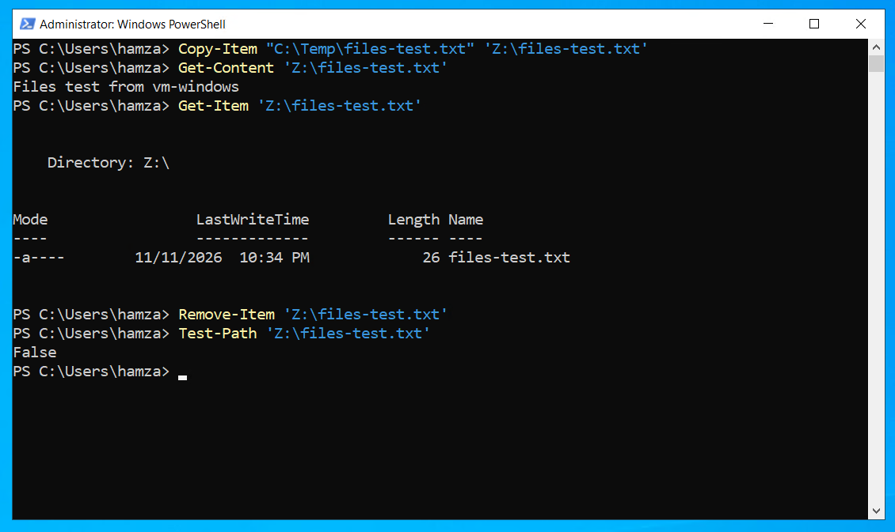


## Storage data protection

The script enables Blob versioning and seven-day soft delete for blobs, containers, and Azure Files shares. The `if` statements check each setting before changing it. An update only runs when a setting is disabled or has the wrong retention period. This also means the script can be run again without updating settings that are already correct.

```powershell
if (-not $BlobProperties.IsVersioningEnabled) {
    Update-AzStorageBlobServiceProperty -StorageAccountName $StorageAccountName -ResourceGroupName $ResourceGroupName -IsVersioningEnabled $true
}

if (-not $BlobProperties.DeleteRetentionPolicy.Enabled -or $BlobProperties.DeleteRetentionPolicy.Days -ne 7) {
    Enable-AzStorageBlobDeleteRetentionPolicy -StorageAccountName $StorageAccountName -ResourceGroupName $ResourceGroupName -RetentionDays 7
}

if (-not $BlobProperties.ContainerDeleteRetentionPolicy.Enabled -or $BlobProperties.ContainerDeleteRetentionPolicy.Days -ne 7) {
    Enable-AzStorageContainerDeleteRetentionPolicy -StorageAccountName $StorageAccountName -ResourceGroupName $ResourceGroupName -RetentionDays 7
}

if (-not $FileProperties.ShareDeleteRetentionPolicy.Enabled -or $FileProperties.ShareDeleteRetentionPolicy.Days -ne 7) {
    Update-AzStorageFileServiceProperty -StorageAccountName $StorageAccountName -ResourceGroupName $ResourceGroupName -EnableShareDeleteRetentionPolicy $true -ShareRetentionDays 7
}
```

**Script:** [Configure Storage data protection](Scripts/14-Configure-StorageProtection.ps1)

### Blob and Azure Files data protection settings

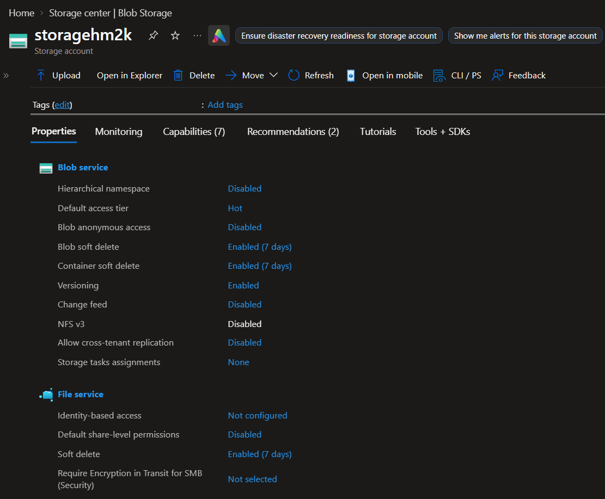

The policies are tested by restoring previous Blob versions and recovering deleted Blobs, containers, and Azure Files shares.

### Recovery tests

The data protection configuration was tested by recovering Blob data and deleted storage resources. The tests cover both Blob versioning and soft delete for Blobs, containers, and Azure Files shares.

#### Blob version recovery

Blob versioning was tested by uploading a file and then overwriting it with updated content. The initial upload contained `Version 1 - Original content`.

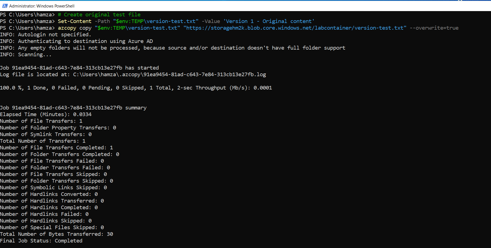

The local file was updated to `Version 2 - Updated content` and uploaded again using AzCopy. This created a new version of the existing Blob while retaining its previous version.

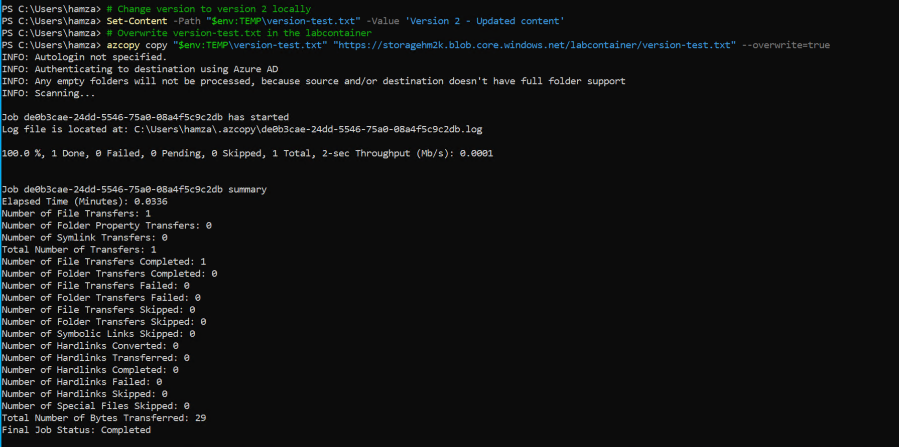

The version history of `version-test.txt` was inspected to identify the earlier version. That version was copied to a separate Blob named `version-restored.txt` using AzCopy.

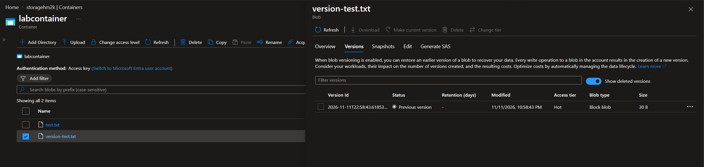

The version restoration operation was performed using Azure Portal. The recovered file was then downloaded and its contents checked to verify that the earlier version had been recovered.

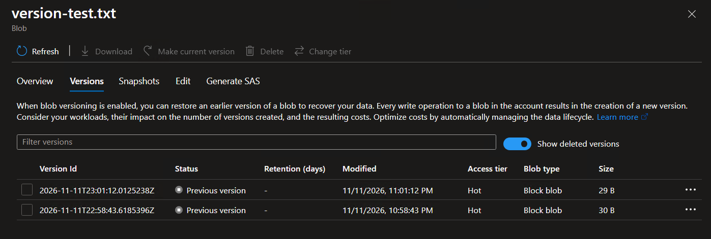

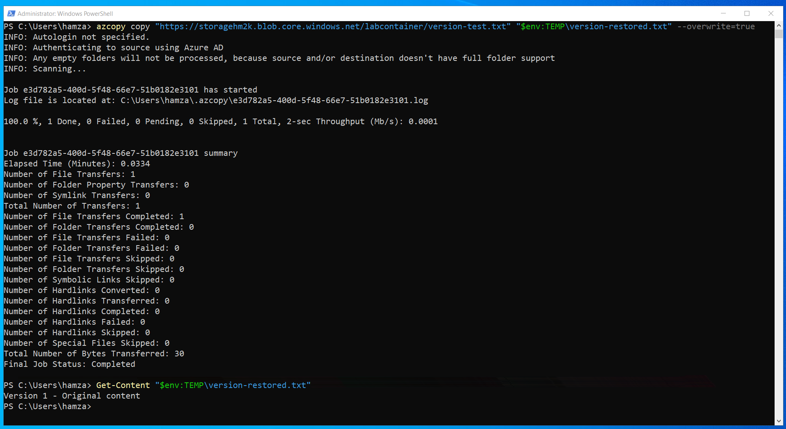

#### Blob soft-delete recovery

Blob soft delete was tested by deleting `version-test.txt` after completing the versioning test. The deletion was performed using AzCopy.

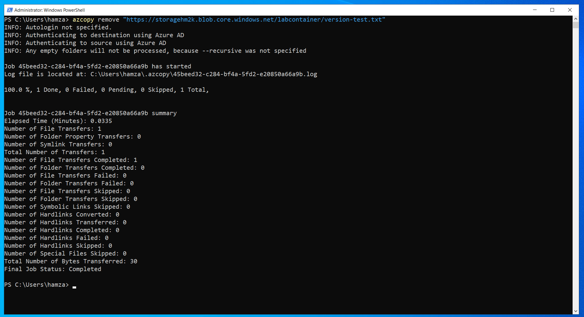

The Storage Account showed `version-test.txt` with a `Deleted` status. Its previous versions remained available through the deleted versions view.

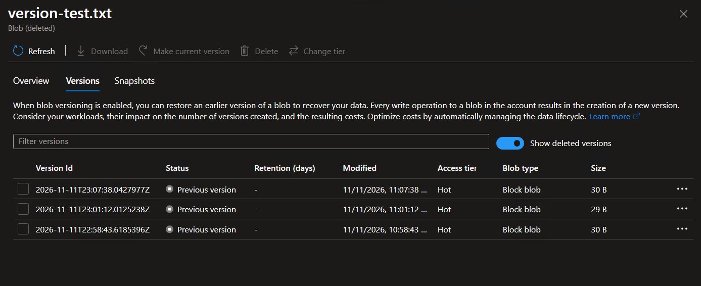

The undelete operation successfully recovered the Blob and its previous versions.

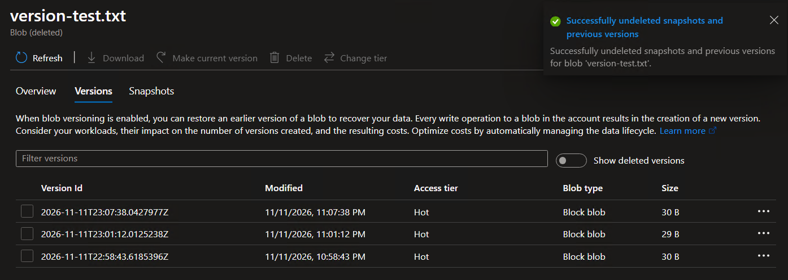

AzCopy was then used to download the recovered Blob. The downloaded file was inspected to confirm that its original content was accessible.

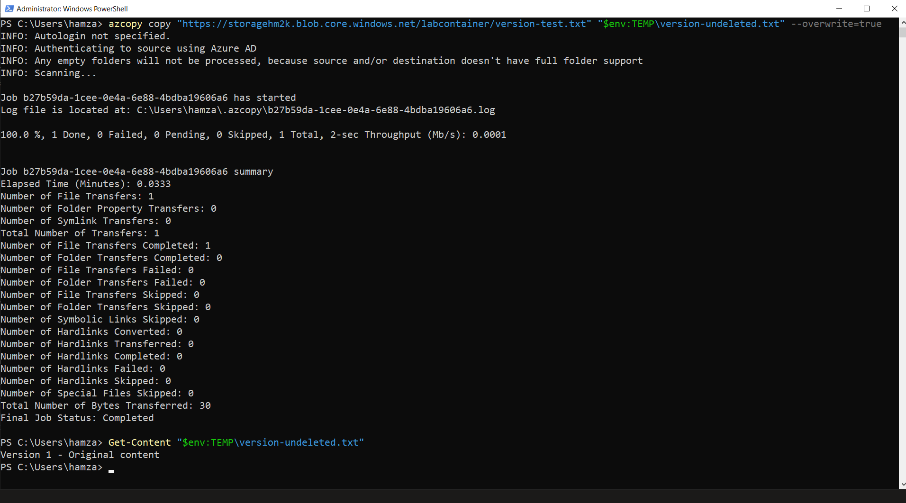

#### Container recovery

The `labcontainer` container was deleted to test container soft delete. It appeared in the Storage Account with a `Deleted` status.

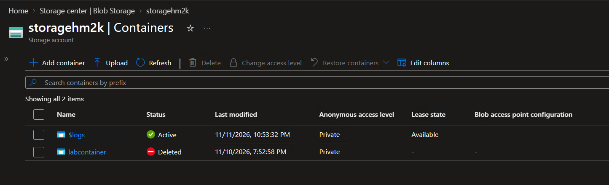

The container recovery operation was performed through the Azure Portal to restore `labcontainer`.

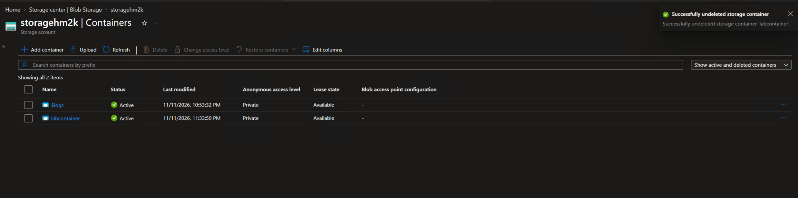

After restoration, `labcontainer` appeared with an `Active` status in the Storage Account.

#### Azure Files share recovery

The `labshare` Azure Files share was deleted to test share soft delete. It appeared in the Storage Account's deleted shares list.

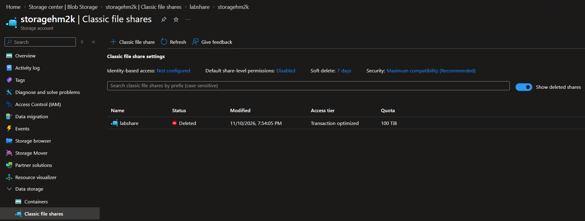

The share recovery operation was performed through the Azure Portal to restore `labshare`.

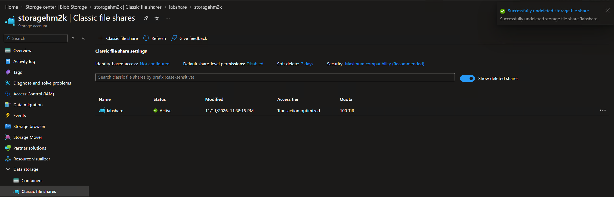

## Project files

- `Architecture/` - architecture diagram and exported PNG/SVG versions.
- `Scripts/` - Azure PowerShell deployment and configuration scripts.
- `Scripts/Extras/` - additional scripts for AzCopy installation and Azure Files connectivity.
- `Screenshots/` - Azure configuration, connectivity tests, storage operations, and recovery evidence.