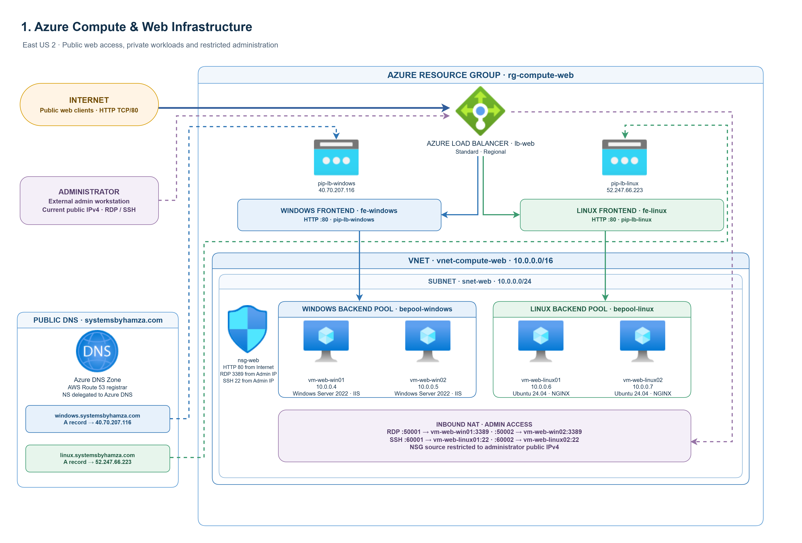
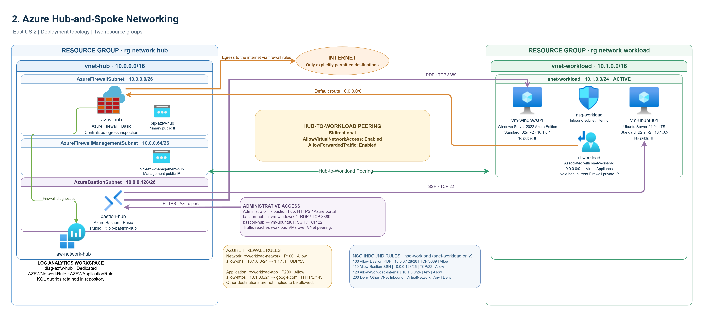
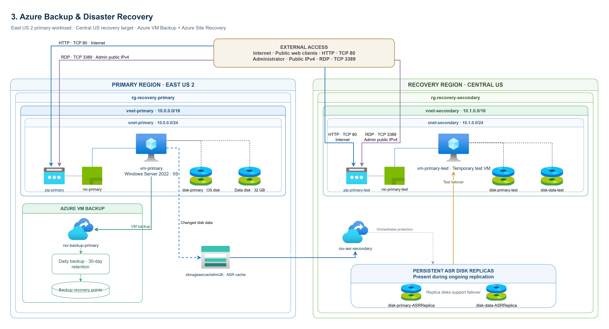
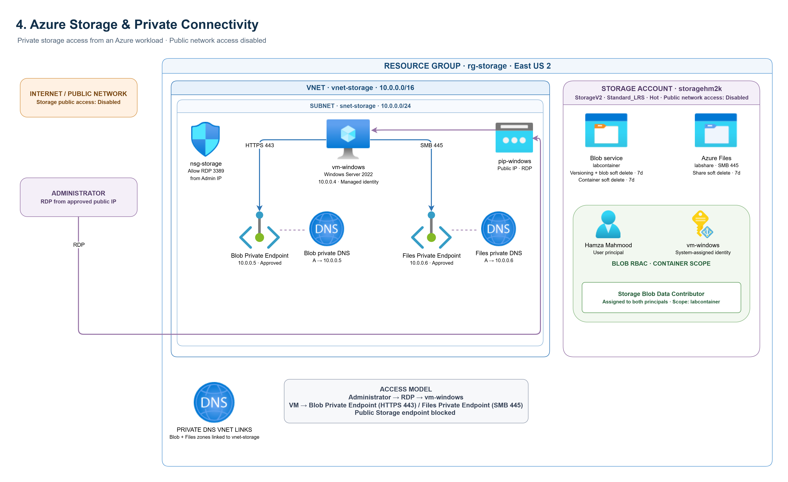

# Azure PowerShell Portfolio

## Introduction

As part of my broader interest in IT and networking, I wanted to develop a solid understanding of cloud computing. Earlier in the year, I started learning AWS and later decided to expand my knowledge to Azure. Before diving into Azure, I spent the summer learning PowerShell by reading *Learn PowerShell in a Month of Lunches* and *Learn PowerShell Scripting in a Month of Lunches*. My goal was to build a foundation in PowerShell before working with Azure. After countless hours of studying and hands-on labs with the help of great courses from John Savill and Alan Rodrigues, I passed the Azure Administrator (AZ-104) exam in October 2026.

After passing the AZ-104 exam, I took Alan Rodrigues' Azure PowerShell course on Udemy. I saw it as an opportunity to connect the PowerShell fundamentals I had learned with the Azure concepts I had studied. I was also already familiar with his teaching style from his AZ-104 course. The course gave me the idea to build these projects using Azure PowerShell rather than relying on the Azure Portal.

This repository brings together four projects covering compute, networking, backup and disaster recovery, and storage. Each project documents the resources deployed, how they were configured, and the testing carried out.

## Projects

### 1. Compute & Web Infrastructure

This project deploys four web servers in Azure: two Windows Server VMs running IIS and two Ubuntu VMs running NGINX. An Azure Standard Load Balancer provides separate public endpoints for the Windows and Linux workloads and distributes HTTP traffic across each pair of servers. Health probes monitor the backend instances, while inbound NAT rules provide administrative access to the VMs through their private IP addresses.

The project also configures explicit outbound connectivity and public DNS records for the web endpoints. The deployment demonstrates how multiple web servers can be hosted behind a load balancer while keeping the VMs themselves on private IP addresses.

[1. Compute & Web Infrastructure](01-Compute-and-Web-Infrastructure/README.md)

### 2. Hub-and-Spoke Networking

This project builds a hub-and-spoke network in Azure to centralize traffic inspection and provide secure access to private workloads. A workload VNet connects to a central hub through VNet peering, where Azure Firewall filters and inspects workload traffic using configured routes and firewall rules. Azure Bastion provides administrative access to the Windows Server and Ubuntu test VMs without requiring public IP addresses on the VMs.

Firewall diagnostics are sent to Log Analytics for monitoring and review. The project uses the test VMs to validate private connectivity, DNS resolution, and controlled outbound access through the hub.

[2. Hub-and-Spoke Networking](02-Hub-and-Spoke-Networking/README.md)

### 3. Backup & Disaster Recovery

This project deploys a Windows Server workload in East US 2 and implements two recovery paths. Azure Backup provides scheduled VM backups and file-level recovery, while Azure Site Recovery replicates the workload to Central US for regional disaster recovery.

The project covers the configuration of backup policies, recovery points, replication, and monitoring of recovery jobs. A test failover is performed in the secondary region to verify that the replicated VM can be recovered and the workload brought back online.

[3. Backup & Disaster Recovery](03-Backup-and-Disaster-Recovery/README.md)

### 4. Storage & Private Connectivity

This project focuses on securing Azure Blob Storage and Azure Files through network restrictions, private connectivity, and controlled access. A Windows Server VM is deployed to validate access to both services. Blob access uses Microsoft Entra ID and a system-assigned managed identity, while Azure Files is accessed over SMB using the Storage Account key.

Both services use Private Endpoints and private DNS, with public network access disabled on the Storage Account. The project also configures Blob versioning and soft delete for Blobs, containers, and Azure Files shares, with recovery tests used to verify data protection.

[4. Storage & Private Connectivity](04-Storage-and-Private-Connectivity/README.md)